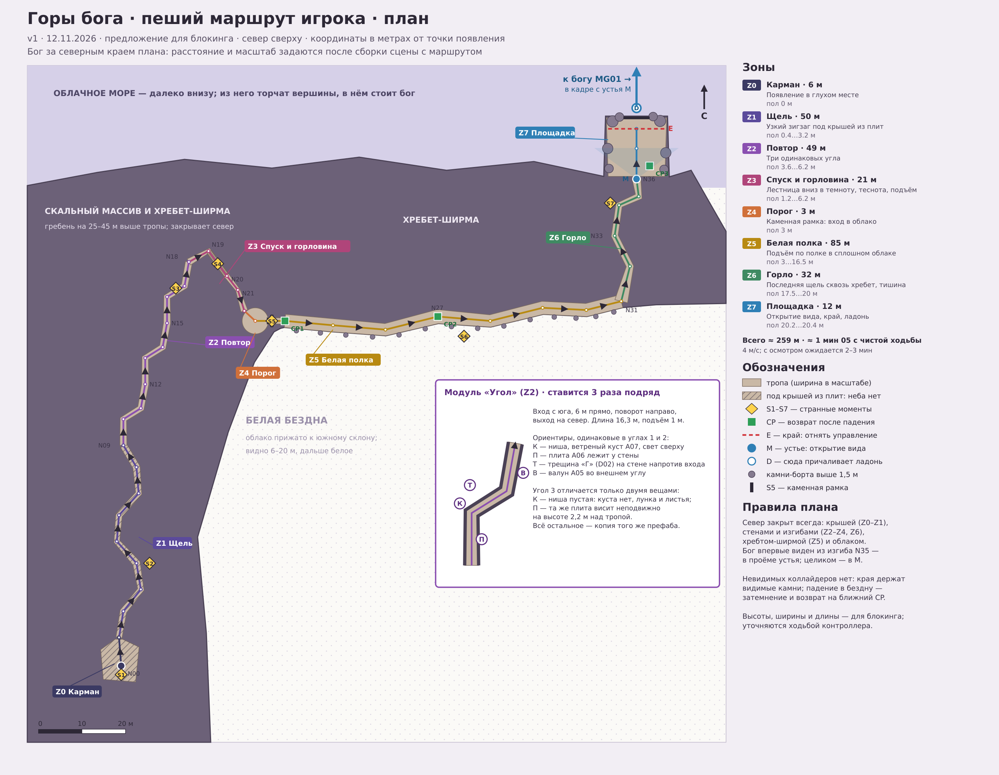
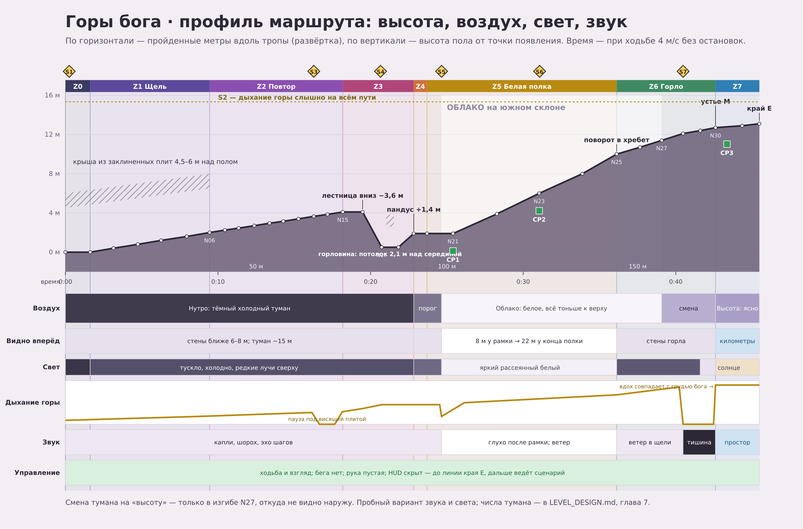
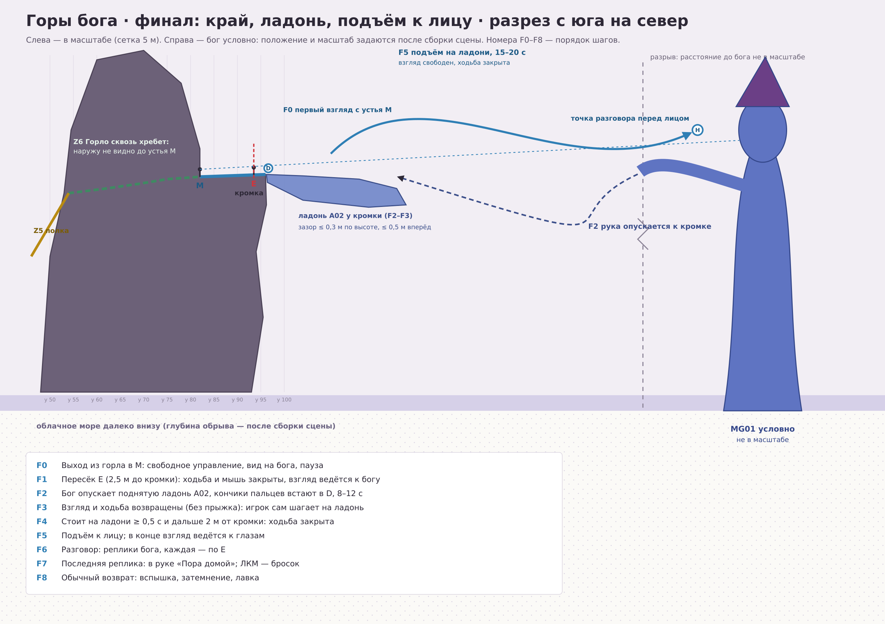
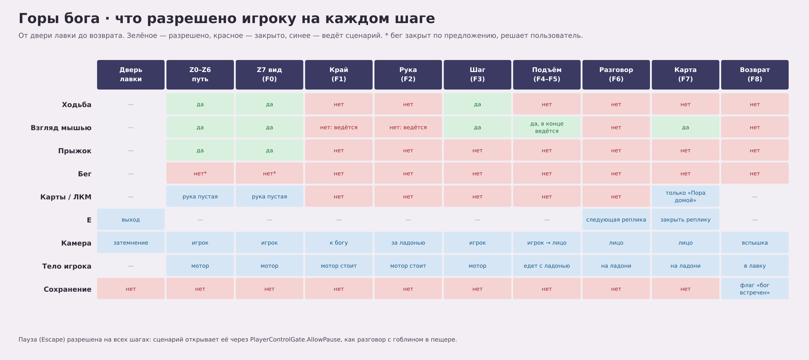

# Горы бога — дизайн уровня

**Hakaton · уровень встречи с богом MG01 · версия 2 · 12 ноября 2026.** Маршрут v2 на 30% короче первого: ≈ 182 м вместо ≈ 259 м.

Короткий сюжетный уровень. Игрок приходит в себя в глухом каменном кармане. Он идёт по тесному, петляющему и повторяющемуся пути и поднимается сквозь облако. В конце он выходит из щели и видит, что стоит посреди бескрайних гор, а вдалеке, выше гор, стоит бог. У края обрыва управление отнимается: бог подносит ладонь, игрок сам шагает на неё, и бог поднимает его к лицу. Бог говорит, отдаёт карту «Пора домой», и игрок возвращается в лавку.

**Статус:** предложение для блокинга. Главная часть этой версии — пеший маршрут: его план, профиль и паспорта зон. Длины, ширины и высоты проверены ходьбой настоящего контроллера игрока. Бог на схемах условный: его размер, расстояние и поворот ты выставляешь сам после сборки сцены с маршрутом. Блокаут собран в отдельной сцене `hukaton/Assets/GodMountains/Scenes/GodMountains.unity` (глава 11). Арт окружения, сценарий финала и тексты реплик ещё не сделаны.

## Что уже решено

| Вопрос | Решение |
| --- | --- |
| Когда игрок попадает к богу | Один раз, после цели лавки в 666 монет выручки. Следующий выход через дверь лавки ведёт к богу, а не на вылазку |
| Колода | Не берётся. Рука пустая, сердца скрыты, смерти нет |
| Как бог дотягивается | Стоит на месте. «Вдалеке» он из-за своего размера. До края обрыва дотягивается рукой |
| Размер и место бога | Задаются после сборки сцены с маршрутом |
| Как игрок попадает на ладонь | Сам шагает: на этот момент возвращается ходьба |
| Разговор | Бог произносит реплики, каждая закрывается по E. Игрок молчит |
| Возврат | Бог отдаёт «Пора домой». Игрок бросает карту, и срабатывает обычный возврат в лавку |

## Содержание

1. Замысел и ритм
2. Вход и выход
3. Схема маршрута
4. Профиль маршрута
5. Паспорта зон Z0–Z7
6. Странные моменты S1–S7
7. Туман, свет и звук
8. Как бог остаётся скрытым до конца
9. Финал F0–F8
10. Управление, безопасность и падения
11. Сборка в Unity
12. Ассеты
13. Проверки блокинга
14. Открытые вопросы

# 1 Замысел и ритм

Игрок не должен понимать, где он, пока не выйдет наружу. Весь путь закрыт: сначала каменная крыша, потом высокие стены, потом белое облако. Повороты, повторы и спуск в темноту сбивают ориентацию. Сквозь весь путь слышно глухое ритмичное дыхание, и камни иногда осыпаются в такт. Это дышит бог, но игрок узнаёт это только в конце.

| Участок | Что чувствует игрок |
| --- | --- |
| Карман, щель | Тесно, темно, непонятно, где он |
| Повтор | «Я хожу по кругу?» |
| Спуск и горловина | Тревога: путь ведёт вниз, в темноту, стены сжимаются |
| Порог и белая полка | Потерянность: вокруг только белое, слева стена, справа ничего |
| Горло | Дыхание обрывается, наступает тишина, впереди свет |
| Площадка | Простор и масштаб: бескрайние горы, бог выше гор |
| Край и ладонь | Беспомощность, потом доверие: игрок сам шагает на руку |
| Лицо | Близость и разговор |

Ориентиры по времени:

- маршрут ≈ 182 м, это около 45 с чистой ходьбы при 4 м/с;
- первый проход с осмотром занимает 1,5–2 минуты;
- весь уровень вместе с финалом длится 4–6 минут, в зависимости от длины разговора.

# 2 Вход и выход

**Условие входа.** Выручка не меньше 666 монет, и бог ещё не встречен. Нажатие двери в лавке в этом состоянии не открывает выбор места, а сразу ведёт к богу. Проверки двери прежние: лавка закрыта, нет разговора и открытых окон.

**Переход.** Обычное затемнение двери, но без титра места: игрок не должен узнать, куда попал. В темноте около 1,5 с уже слышен первый вдох. Затем экран открывается в кармане Z0.

**Без колоды.** Уровень идёт как пролог в пещере: вылазка без колоды (`DeckWorkshop.DepartPrologue`, `ExpeditionWorld.BeginPrologue`). Рука пустая, HUD вылазки скрыт, поражения нет.

**Внутри ничего не сохраняется.** Если выйти из игры посреди уровня, игрок окажется в лавке, бог останется не встреченным, и следующий выход через дверь снова поведёт к богу с начала.

**Выход.** В финале бог выдаёт «Пора домой», игрок бросает её ЛКМ. Дальше обычный возврат пролога: карта улетает вверх, вспышка, затемнение, лавка. Сохраняется флаг «бог встречен». С этого момента дверь открывает выбор места вылазки, как сейчас после 666 монет.

**Что поменять в текстах лавки.** Уведомление «Лавка процветает!» сейчас обещает выбор места у двери. До встречи с богом это неправда, поэтому строку про дверь нужно убрать. Выбор места открывается после встречи с богом.

# 3 Схема маршрута

Север сверху. Координаты в метрах от точки появления: `x` направлен на восток, `y` на север, `h` — высота пола. В Unity точка плана переводится как `(x, h, y)` от корня уровня. Все узлы, ширины, чекпоинты и триггеры лежат в [data/route.json](data/route.json), и схемы строятся из этого файла.

Маршрут идёт так:

1. Из кармана путь ведёт на север по зигзагу щели под каменной крышей.
2. Затем три одинаковых угла.
3. Вырезанная лестница ведёт вниз, в горловину. Пандус поднимается к круглому карману с каменной рамкой.
4. За рамкой начинается белая полка: она идёт на восток вдоль южной стены хребта. Слева стена, справа облачная бездна.
5. В конце полки путь поворачивает налево, в горло сквозь хребет.
6. Горло выводит на площадку северного склона, к обрыву над облачным морем. Бог стоит на севере.

| Зона | Длина | Пол, м | Ширина прохода | Что видно | Что происходит |
| --- | --- | --- | --- | --- | --- |
| Z0 Карман | 6,5 м до выхода | 0 | комната ≈ 7 × 9 м, потолок 4–6 м | только стены и полоса света сверху | появление лицом к стене (S1) |
| Z1 Щель | 31 м | 0 → 2,0 | 1,4–1,8 м | 6–7 м до следующего изгиба, неба нет | пять колен зигзагом под крышей |
| Z2 Повтор | 35 м | 2,0 → 4,1 | 1,6 м | 6 м до стены угла | три одинаковых угла, третий другой (S3) |
| Z3 Спуск и горловина | 19 м | 4,1 → 0,5 → 1,9 | 1,4 → 1,0 → 1,6 м | стены, темно | 18 ступеней вниз, горловина, пандус (S4) |
| Z4 Порог | 3,4 м | 1,9 | карман r = 3 м, проём рамки 1,4 × 2,4 м | белый свет сверху | каменная рамка, за ней облако (S5) |
| Z5 Белая полка | 50 м | 1,9 → 10,0 | 2,8–3,2 м | 8 → 22 м белого | подъём вдоль хребта (S6) |
| Z6 Горло | 26 м | 10,0 → 12,7 | 1,6–2,0 м | стены, свет в конце | смена тумана, тишина (S7), последний изгиб |
| Z7 Площадка | 11,5 м до края | 12,7 → 13,2 | 14 × 14 м | горы, облачное море, бог | открытие вида, край E, ладонь |

Ключевые точки:

| Точка | x, y, h | Что это |
| --- | --- | --- |
| N00 | −34,5; −29,5; 0 | Появление, взгляд на юг, в стену в 2 м |
| N01 | −35; −23; 0 | Единственный выход из кармана, щель 1,4 м |
| N06 | −35; 5; 2,0 | Конец щели, вход в первый угол |
| N07 / N10 / N13 | −35; 9 / −31,5; 19 / −28; 29 | Начала углов 1, 2, 3 |
| N16 → N17 | −20; 37,5; 4,1 → −17; 33,5; 0,5 | Вырезанная лестница вниз |
| N17 → N18 | до −14,3; 30; 0,5 | Горловина: 4,4 м, ширина 1,0 м, потолок 2,1 м только над серединой |
| N20 | −10,6; 23,8; 1,9 | Центр круглого кармана |
| S5 | −6,8; 23,8; 1,9 | Каменная рамка, ось прохода на восток |
| N21 / CP1 | −3,8; 23,8; 1,9 | Конец прохода за рамкой, начало белой полки |
| N23 / CP2 | 18,7; 23,8; 6,0 | Середина полки |
| N25 | 38,7; 26,1; 10,0 | Конец полки, поворот в хребет |
| N27 | 37,9; 36,8; 11,4 | Изгиб горла: здесь сменяется туман |
| N28 | 38,9; 42,3; 12,1 | Дыхание обрывается |
| N29 | 42,9; 44,3; 12,4 | Последний изгиб: впереди светлое устье |
| N30 / M | 42,4; 48,3; 12,7 | Устье: первый полный кадр на бога |
| CP3 | 45,4; 51,5; 12,8 | Возврат после падения с площадки |
| N32 / E | y = 59,8; h 13,1 | Линия края: отнимается управление |
| Кромка | y = 62,3; h 13,2 | Открытая часть 6 м, x 39,4–45,4 |
| D | 42,4; 62,8; 13,2 | Сюда причаливает ладонь |

# 4 Профиль маршрута

Подъём за весь путь — 13,2 м, и на нём есть один спуск на 3,6 м по лестнице.

| Участок | Уклон |
| --- | --- |
| Щель и углы | ≈ 4° |
| Полка | 10–13° |
| Пандус после горловины | ≈ 19° (1,4 м за 4 м) |
| Лестница | 35° (ступени 0,2 м, проступь 0,28 м) |

Контроллер берёт уклон до 48° и ступень до 0,28 м, так что все участки проходимы с запасом.

Полка Z5 — самый длинный участок: 50 м, около 12 с ходьбы. Чтобы на ней не было скучно, видимость растёт от 8 до 22 м, свет становится ярче, кусты указывают направление (S6), а дыхание набирает громкость.

# 5 Паспорта зон

## Z0 Карман

- **Назначение:** появиться так, чтобы не понимать, где находишься.
- **Геометрия:** неровная комната ≈ 7 × 9 м, потолок 4–6 м, сводом служат плиты A03 и стенки A01. Единственный выход — щель шириной 1,4 м на севере, в 3 м за спиной игрока.
- **Старт:** игрок стоит лицом к стене на расстоянии 2 м (S1).
- **Свет:** в комнате темно. Узкий холодный луч из трещины в потолке падает возле выхода, поэтому выход — самое светлое место, и игрок разворачивается к нему.
- **Наполнение:** ничего лишнего, одна-две розетки A08 в щелях.

## Z1 Щель

- **Геометрия:** пять колен по ≈ 6 м с изломами 40–60° попеременно вправо и влево. Ширина 1,4–1,8 м, стены 10–18 м.
- **Крыша:** заклиненные плиты на высоте 4,5–6 м над полом. Между ними узкие светлые трещины, неба через них не видно.
- **Видимость:** за следующим изгибом всегда стена, вперёд видно не дальше 7 м.
- **Подъём:** по 0,4 м на колено, почти незаметно.
- **Ведение:** трещины в крыше становятся светлее по ходу пути.
- **Дыхание:** в такт выдоху с крыши сыплется каменная крошка (S2).

## Z2 Повтор

- **Модуль «Угол»:** 11,6 м. Вход с юга, 4 м прямо, косой сдвиг на 3 м вправо, 4 м на север, подъём 0,7 м. Модуль ставится три раза подряд одним префабом.
- **Ориентиры:** ниша с ветреным кустом A07 и светом сверху (К), плита A06 у стены (П), трещина «Г» на стене напротив входа (Т), валун A05 во внешнем углу (В).
- **Углы 1 и 2:** точные копии, один и тот же префаб без случайных отличий.
- **Угол 3** отличается двумя вещами:
  - в нише нет куста, остались лунка и опавшие листья;
  - та же плита висит неподвижно на высоте 2,2 м над тропой, и игрок проходит под ней.
- **Небо:** крыши в Z2 нет, но конец каждого прямого отрезка закрыт стеной выше 12 м. Небо видно только выше 60° над горизонтом, и оно белое от облака.

## Z3 Спуск и горловина

- **Лестница:** 18 ступеней по 0,2 м (спуск 3,6 м), проступь 0,28 м, ширина 1,4 → 1,2 м. Ступени слишком ровные, будто вырезаны. С каждой ступенью становится темнее.
- **Горловина:** 4,4 м длиной, ширина 1,0 м (капсула игрока — 0,56 м). Потолок 2,1 м (капсула — 1,8 м) висит только над её серединой: по 1,2 м у низа лестницы и у пандуса открыты, иначе голова упирается в потолок на ступенях и на подъёме. Здесь дыхание звучит громче всего и с эхом, на выдохе слегка дрожит камера.
- **Пандус:** подъём на 1,4 м за 4 м. Впереди белое свечение кармана Z4, это и есть ведение.

## Z4 Порог

- **Геометрия:** круглый карман радиусом 3 м, открытый вверх, белый свет от облака.
- **Рамка:** на восточной стороне кармана стоит кривая каменная рамка (S5): два столба и перемычка, проём 1,4 × 2,4 м. Рамка стоит в проходе ровно своей ширины, так что пройти можно только сквозь неё.
- **За рамкой:**
  - звук глохнет, включается фильтр низких частот;
  - в первые 3 м туман сменяется с «нутра» на «облако». Проход здесь ещё узкий, и наружу не видно.

## Z5 Белая полка

- **Геометрия:** 50 м на восток вдоль южной стены хребта. Слева сплошная стена высотой 25–45 м, справа бездна в облаке. Ширина 2,8–3,2 м, подъём 8,1 м, уклон 10–13°.
- **Внешний край:**
  - по всей длине лежат низкие камни 0,3–0,6 м: они показывают край, но через них можно перешагнуть нарочно;
  - через каждые ≈ 6 м стоит валун высотой от 1,5 м;
  - на внешней стороне каждого изгиба (N22–N24) идёт сплошной борт из валунов от 1,5 м, чтобы игрок, идущий прямо, не шагнул в бездну.
- **Видимость:** 8 м у рамки, 22 м у конца полки. Туман редеет по мере подъёма, и это чувствуется как продвижение.
- **Ведение:** все ветреные кусты A07 на полке наклонены на восток, по ходу пути (S6). Ветер дует в спину.
- **Падение:** затемнение в белое и возврат на CP1 (участок N21–N23) или CP2 (участок N23–N25).

## Z6 Горло

- **Геометрия:** у N25 путь поворачивает налево, в хребет. Угол у N25 — одна сплошная стена без клиньев: в стыке двух стен игрока выбрасывало. Щель шириной 1,6–2,0 м, стены 15–25 м, сверху узкая полоса неба.
- **Изгибы:** N26, N27, N28 и последний изгиб N29.
  - В N27 туман меняется с «облака» на «высоту». Из этой точки наружу не видно.
  - В N28 дыхание обрывается, наступают 3–4 с тишины (S7).
  - Из N29 впереди, в 4 м, видно светлое устье. Бог виден только в проёме.
- **Устье M:** проём ≈ 2 × 4 м, ось строго на север.

## Z7 Площадка

- **Геометрия:** ступень вершины A04 ≈ 14 × 14 м. Пол поднимается от 12,7 м у устья до 13,2 м у кромки. От устья до кромки 14 м прямо.
- **Края:**
  - по бокам скала и валуны от 1,5 м;
  - кромка открыта только в середине, на 6 м (x 39,4–45,4), справа и слева от проёма лежат валуны;
  - за кромкой отвесный обрыв в облачное море. Его глубина задаётся вместе с богом.
- **Позади:** гребень хребта всего на 4–8 м выше площадки, поэтому, обернувшись, игрок видит над ним дальние вершины.
- **Время:** игрока не торопят. Он может стоять и смотреть сколько хочет.
- **Край E:** линия в 2,5 м до кромки, ≈ 3 с ходьбы от устья. Пересечение линии запускает финал (глава 9).

# 6 Странные моменты S1–S7

Все моменты дешёвые и сделаны средствами уровня. Каждый можно убрать отдельно: маршрут без них остаётся рабочим.

| ID | Где | Что происходит | Как сделать |
| --- | --- | --- | --- |
| S1 | Z0 | Игрок открывает глаза, глядя в стену | Поворот точки появления |
| S2 | весь путь | Дыхание горы: вдох ≈ 3 с, выдох ≈ 4 с. Громкость растёт к концу пути, на выдохе сыплется крошка и чуть дрожит камера (Z1–Z3) | Один зацикленный звук, громкость по продвижению по маршруту. Лёгкая тряска через `CameraFeel`. На площадке вдохи совпадают с грудью бога: период анимации Idle равен периоду звука |
| S3 | Z2 | Три одинаковых угла, третий другой: ниша пустая, плита висит | Один префаб ×3 и вариант третьего |
| S4 | Z3 | Слишком ровная лестница вниз, в темноту, затем теснота | Геометрия и свет |
| S5 | Z4 | Каменная рамка в проходе. Сквозь неё звук глохнет и начинается облако | Ассет рамки, триггер звука и тумана |
| S6 | Z5 | Все кусты наклонены по ходу пути | Поворот экземпляров A07 |
| S7 | Z6 | Дыхание обрывается: 3–4 с тишины перед устьем | Триггер звука в N28 |

Под висящей плитой в третьем углу дыхание на 2–3 с замолкает.

# 7 Туман, свет и звук

## Туман

Уровень лежит в своей сцене и, пока он открыт, она активна. Поэтому туман и окружение берутся из настроек этой сцены, как в пещере. Внутри уровня туман плавно меняется по продвижению вдоль маршрута. Обе смены происходят там, где наружу ничего не видно.

| Профиль | Где | Режим и плотность | Цвет | Видно |
| --- | --- | --- | --- | --- |
| Нутро | Z0–Z4, до рамки | Exponential Squared, 0,12 | #2E2A38, тёмный сланцево-лиловый | ≈ 14 м, но стены ближе |
| Облако | от рамки до N27 | Exponential Squared, 0,22 у рамки → 0,08 у N25 | #E9E5EF, бело-лавандовый | 8 → 22 м |
| Высота | N27 → конец | Linear, начало и конец подбираются после размещения бога | #ABA0C7, цвет дали из концепт-пакета | километры |

Как пересчитать: при Exponential Squared туман закрывает 95% цвета на расстоянии ≈ 1,73 / плотность. Для сравнения, в лощине сейчас 0,024, это ≈ 72 м, а дальняя плоскость камеры — 60 м.

Профиль «Высота» подбирается под бога: лицо и ладони должны читаться, сам бог — выглядеть дымчатым, а дальние массивы — растворяться в лавандовом. Смены профилей:

- нутро → облако — за 3 м после рамки;
- облако → высота — между N26 и N28.

## Свет

- **Своё солнце.** У уровня одно своё направленное солнце на отдельном rendering layer, как слой `Cave` в пещере. Солнца лавки и лощины на уровень не светят.
- **Z0–Z3.** Тусклый холодный ambient и несколько узких лучей из трещин.
- **Z4–Z5.** Яркий рассеянный белый: светится само облако.
- **Z6.** Темно, в конце яркая полоса.
- **Z7.** Ясное солнце сбоку-сзади от игрока, чтобы лицо бога было освещено на три четверти. Точный угол задаётся после размещения бога.

## Звук

| Где | Основа | Дыхание (S2) | События |
| --- | --- | --- | --- |
| Z0–Z1 | капли, шорох, эхо шагов | тихо | крошка с крыши на выдохе |
| Z2 | то же | средне | пауза под висящей плитой |
| Z3 | эхо громче, шаги ближе | громче всего | дрожь в горловине |
| Z4–Z5 | глухо после рамки, ветер в спину | приглушённо, растёт | — |
| Z6 | ветер в щели | громко, в N28 обрывается | 3–4 с тишины |
| Z7 | простор, далёкий ветер | возвращается, в такт груди бога | — |

Музыки на маршруте нет. Предложение: при открытии вида в устье звучит один долгий низкий аккорд, а под разговор — тихий гул. Сама музыка — отдельная задача в стиле игры.

# 8 Как бог остаётся скрытым до конца

Бог выше гор, поэтому его спрятать труднее, чем обычный объект. Правила маршрута:

1. **Z0–Z1:** над головой крыша, неба нет.
2. **Z2–Z4:** конец каждого прямого отрезка закрыт стеной выше 12 м. Небо видно только выше 60°, и оно белое от облака.
3. **Z5:** хребет-ширма стоит на севере в 1–3 м от игрока и поднимается на 25–45 м. Север закрыт до ≈ 85° над горизонтом. На юге облако, а бог стоит на севере.
4. **Z6:** горло с изгибами. Из N28 устье не видно: прямую к нему перекрывает внутренний угол последнего изгиба. Из N29 бог виден только в проёме устья.
5. **M:** полный вид. Игрок выходит лицом на север, бог целиком в кадре.

Проверка после блокинга: вдоль маршрута N00–N28 через каждый метр пускать лучи из глаз игрока в контрольные точки бога (лицо, ладони, колпак, центр). Каждый луч должен упереться в геометрию уровня или уйти дальше видимости тумана. Это одноразовая проверка, после неё скрипт удаляется.

# 9 Финал F0–F8

**F0 — устье.** Управление полностью свободное. Бог дышит в позе Idle. Игрок может стоять, оборачиваться и подходить к краю сколько угодно. Предложение на будущее: глаза на теле бога медленно поворачиваются к игроку. Это нужно, только если глаза можно анимировать.

**F1 — край E.** Игрок пересекает линию в 2,5 м до кромки, с любого направления.

- Ходьба и мышь закрываются (`PlayerControlGate.SetBlocked`), тело плавно тормозит.
- Взгляд за ≈ 1,5 с переводится на бога (`FirstPersonView.Guide`), как к гоблину в пещере.

**F2 — рука.** Бог опускает поднятую ладонь A02 к кромке за 8–12 с, с плавным началом и концом.

- Взгляд следует за ладонью с небольшой задержкой.
- При касании: лёгкая тряска, облако пыли у кромки (Retro Arsenal) и глухой удар.
- Кончики пальцев встают в точку D. Зазор с кромкой не больше 0,3 м по высоте и 0,5 м вперёд, иначе игрок не сможет шагнуть.
- Предложение: глаз на ладони (E05) смотрит на игрока, если глаза можно анимировать.

**F3 — шаг.** Возвращаются ходьба и мышь. Прыжок и бег закрыты, подсказок на экране нет.

- Ладонь держится неподвижно.
- Если игрок стоит без дела больше 20 с, пальцы слегка шевелятся, приглашая его. Это предложение, без текста.
- Игрок может уйти обратно в горло: бог ждёт, ничего не ломается.
- Если игрок шагнёт в обрыв мимо ладони, его вернёт на CP3.

**F4 — посадка.** Условие: игрок стоит на коллайдере ладони не меньше 0,5 с и находится дальше 2 м от кромки.

- Ходьба закрывается, мышь остаётся.
- Тело переходит под внешнее управление (`FirstPersonMotor.TryClaimExternalControl`) и дальше движется вместе с костью кисти с постоянным смещением.
- Ладонь чуть проседает на ≈ 0,3 м и поднимается: игрок чувствует свой вес.

**F5 — подъём.** 15–20 с по дуге вверх и к лицу, над облачным морем.

- Мышь свободна: можно смотреть по сторонам.
- В последние 2 с взгляд переводится на глаза бога.
- Ладонь останавливается в точке H перед лицом. Лицо занимает около двух третей высоты кадра; точное расстояние задаётся после выбора масштаба.

**F6 — разговор.** Реплики идут по одной, каждая закрывается по E. Первое нажатие E дописывает текст, второе закрывает реплику, как в пещере.

- Реплики появляются на той же льняной плашке с печатью текста (Text Animator). Плашка стоит в экранной позиции, как у учебного гоблина: над головой высотой в сотни метров она бессмысленна.
- Каждую реплику сопровождают звук голоса, небольшое движение головы и моргание.
- Мышь закрыта, взгляд держится на лице.
- Объём: 6–9 реплик. Текст пишется после утверждения маршрута.

**F7 — карта.** Последняя реплика — передача карты.

- В руке появляется только «Пора домой», и она сразу выбрана (`Expedition.GrantReturn`, как в пещере).
- После E возвращается мышь, ходьба остаётся закрытой: игрок стоит на ладони.
- ЛКМ бросает карту, другие броски запрещены правилами броска (`IThrowRules`).

**F8 — возврат.** Обычный возврат пролога: карта улетает вверх, вспышка, затемнение, лавка. Сохраняется флаг «бог встречен».

# 10 Управление, безопасность и падения

- **Бег.** Предлагаю выключить на всём уровне: медленный шаг держит странность, а маршрут короткий. Окончательно решаешь ты.
- **Прыжок.** Разрешён на маршруте и на площадке. Выключается на шаге F3 и дальше.
- **Карты и HUD.** Рука пустая, карт нет до F7. Сердца скрыты, урона и смерти нет.
- **Падение.** Срабатывает, когда ноги оказываются на 4 м ниже пола ближайшего участка маршрута: в бездне Z5 или под кромкой и бортами Z7.
  - Экран за 0,4 с уходит в белое (в Z7 — в цвет облачного моря).
  - Игрок переносится на ближайший чекпоинт позади по маршруту, и экран открывается.
  - Под бездной стоят триггеры, а не преграды. Это тот же приём, что возврат на берег в пещере (`ExpeditionWorld.NearestShore`).
- **Никаких невидимых коллайдеров.** Края держат видимые камни и стены. Открыта только середина кромки, куда приходит ладонь. Коллайдер ладони повторяет видимую поверхность ладони.
- **Запасы контроллера.** Ширина прохода не меньше 1,0 м при капсуле 0,56 м. Потолок не ниже 2,1 м при высоте капсулы 1,8 м. Ступени 0,2 м при допустимой ступени 0,28 м.
- **Возврат назад.** Разрешён везде, ничего не сбрасывается.
- **Пауза.** Работает на всех шагах (`PlayerControlGate.AllowPause`).

# 11 Сборка в Unity

**Блокаут (12.11.2026).** Сцена `Assets/GodMountains/Scenes/GodMountains.unity` открывается одна, по Play игрок проходит весь путь от кармана до края площадки. В ней:

- пол, стены, крыши, лестница, рамка, полка, горло и площадка по узлам N00–N32;
- три угла Z2: префаб `Corner module` и его вариант для третьего угла;
- хребет-ширма, облачное море, кольца вершин и бог MG01 v3 на черновом месте ≈ 1,6 км к северу;
- метки: появление, CP, M, E, кромка, D, S1–S7 и точка H у лица бога;
- компонент воздуха `GodMountainsAtmosphere`, который ведёт туман по маршруту;
- тестовый игрок.

Капсула игрока проходит весь маршрут без упоров, и бог не виден ни из одной точки N00–N28. Настоящий игрок прошёл весь путь с клавиатуры туда, обратно и вдоль обеих стен (128 участков): без падений и выбросов; одна остановка — вплотную к правому краю полки у N22 игрок упирается в валун борта, его обходят. Подробности — в `Assets/GodMountains/README.md`, снимки и отчёты — в `output/god-mountains-blockout-v2/`. Корень уровня стоит на x = −4000. Ниже описано то, что ещё предстоит собрать.

**Сцена.**

- Отдельная сцена `Assets/GodMountains/Scenes/GodMountains.unity` в Build Settings, по образцу пещеры.
- Она догружается аддитивно при входе, становится активной (свой свет и туман) и выгружается на пути в лавку.
- Корень — `God mountains — level` с компонентом уровня. В нём сериализованные ссылки:
  - точка появления, CP1–CP3;
  - триггеры рамки, тумана, звука и края E;
  - точки D и H;
  - экземпляр бога и коллайдер ладони;
  - триггеры падения.

**Сценарий.**

- Компонент встречи живёт в `Hakaton.unity`, как `CaveTutorial`. Этапы: выключен → путь → край → рука → шаг → подъём → разговор → карта → готово.
- Он использует то, что уже есть:
  - `ExpeditionWorld.BeginPrologue/EndPrologue` и `PrologueReturned`;
  - `PlayerControlGate.SetBlocked/AllowPause`;
  - `FirstPersonView.Guide`;
  - внешнее управление `FirstPersonMotor` для поездки на ладони;
  - `Expedition.GrantReturn`, `IThrowRules`;
  - `ScreenFade`, `CameraFeel`;
  - плашку реплик как у учебного гоблина.

**Игровой цикл.**

- `GameLoop` получает ссылку на встречу. Если цель достигнута, а бог не встречен, дверь запускает встречу вместо выбора места.
- Флаг «бог встречен» хранится в `GameSave`.

**Положение уровня в мире.**

- Корень ставится так, чтобы в пределах дальней плоскости камеры не оказалось ничего другого из `Hakaton.unity` (пещера по той же причине стоит на x = 600).
- При этом корень держится в пределах ≈ 8 км от начала координат, чтобы не терять точность float.

**Камера.**

- В игре дальняя плоскость — 60 м. Встреча поднимает её при входе ровно настолько, чтобы были видны бог и дальние массивы, и возвращает при выходе. Так уже делает `FarSilhouettes`.
- При ближней плоскости 0,05 м и дальней в километры на дальней геометрии может появиться мерцание глубины. Если бог мерцает, он и дальнее кольцо гор рисуются отдельной камерой в стеке URP. Решается при сборке сцены.

**Ладонь.**

- Поверхность ходьбы — простой коллайдер по видимой верхней стороне ладони A02, он следует за костью кисти.
- Тело не делается дочерним объектом ладони, а едет через внешнее управление мотора.

**Бог.**

- Нужен скелет: ты говорил, что он понадобится позже.
- Клипы:
  - Idle — дыхание с периодом звука S2;
  - вытягивание A02 к D через IK-цель;
  - удержание у кромки;
  - подъём от D к H;
  - разговорный Idle с движением головы и морганием.
- Модель v3 и тестовый скелет уже есть: `output/mountain-god-model-v3`.

**Порядок сборки.**

1. Блокинг маршрута по `route.json` простыми объёмами и прогон контроллером.
2. Ты ставишь бога: масштаб, расстояние и поворот.
3. Видимость, туман, свет.
4. Финал: сначала на заглушке руки, потом на скелете.
5. Ассеты из концепт-пакета.
6. Звук.
7. Реплики.

# 12 Ассеты

Из концепт-пакета гор (`output/god-mountains-concept-pack-v1`) берутся язык камня, палитра и модули. Маршрут пакета (вход → полка → седловина → вершина) открывал вид сразу. Здесь вид открывается только в конце, поэтому маршрут пакета не используется.

| Ассет пакета | Где на уровне |
| --- | --- |
| A01 Скальная стенка | стены Z0–Z3, горла Z6, южная стена хребта в Z5 |
| A02 Полка поворота | участки белой полки Z5 с низким внешним бортом |
| A03 Нависающий козырёк | свод кармана Z0, крыша щели Z1, рама устья M |
| A04 Ступень вершины | площадка Z7 |
| A05 Наклонный валун | борта Z5 и Z7, ориентир «В» в углах Z2 |
| A06 Отколовшаяся плита | плиты крыши Z1, плита «П» в углах (в третьем — висит) |
| A07 Ветреный куст | ниша «К» в углах Z2, кусты-указатели Z5 |
| A08 Скальная розетка | редко в щелях по всему пути |
| A09 Дальний массив | бескрайние вершины вокруг площадки |

Новые ассеты:

| ID | Что | Где |
| --- | --- | --- |
| G01 | Каменная рамка: два кривых столба и перемычка, проём 1,4 × 2,4 м | S5, Z4 |
| G02 | Вырезанная лестница, 18 ступеней по 0,2 м | Z3 |
| G03 | Облачное море: несколько слоёв плоскостей под кромкой с мягким краем у вершин | вид с Z7 |
| G04 | Модуль «Угол» как префаб из A01, A05, A06, A07 и декаля трещины | Z2 ×3 |

Бог MG01 — модель v3, пока без скелета.

Ориентиры из пакета: V02 показывает характер полки (на уровне она в облаке), V05 — площадку и взгляд назад. Стилевые правила пакета действуют и здесь: на камне нет глаз, лиц и частей тела, камни не превращаются в анатомию.

# 13 Проверки блокинга

1. Весь маршрут проходится реальным контроллером: нет застреваний, ширины и потолки хватает, лестница и пандус берутся.
2. Чистая ходьба от появления до E занимает 60–80 с.
3. Лучи из N00–N28 не находят бога (глава 8). Из M бог целиком в кадре при взгляде на север.
4. Углы 1 и 2 неотличимы на снимках с одинаковой локальной камеры. Угол 3 отличается только нишей и плитой.
5. Смена тумана незаметна: на записи экрана в местах смены нет скачка.
6. Падение в Z5 и Z7 возвращает на правильный чекпоинт. В сцене нет невидимых преград.
7. Край E срабатывает с любого направления. Перевод взгляда не крутит камеру больше чем на 180°.
8. Ладонь причаливает с зазором не больше 0,5 м вперёд и 0,3 м по высоте. На неё можно зайти. F4 срабатывает только когда игрок действительно на ладони.
9. Во время подъёма тело не дрожит, не скользит и не проваливается, мышь работает.
10. Реплики идут по E, печать текста пропускается. Бросок карты возвращает в лавку, флаг сохраняется.
11. Выход из игры посреди уровня приводит к повтору при следующем выходе через дверь.
12. Пауза работает, подсказок на экране нет.

# 14 Открытые вопросы

1. Размер, расстояние и поворот бога, глубина обрыва и уровень облачного моря. Задаёшь ты после блокинга маршрута.
2. Какой рукой бог берёт игрока. Предлагаю A02 (правая поднятая ладонь, ниже и ближе к груди) или A01.
3. Текст реплик и голос бога. Черновик напишу после утверждения маршрута.
4. Бег на уровне: выключить (предложение) или оставить.
5. Странные моменты S1–S7: оставить все или часть.
6. Титр при входе: без титра (предложение) или с названием места.
7. Музыка: тишина и один аккорд при открытии вида (предложение) или отдельный трек.

## Источники

- Последние указания пользователя: описание уровня и ответы от 12.11.2026.
- [Концепт-пакет гор](../../../output/god-mountains-concept-pack-v1/README.md): стиль, модули A01–A09, палитра.
- [MG01 — модель v3](../../../output/mountain-god-model-v3/README.md) и [концепт-пакет MG01](../../../output/mountain-god-art-pack-v1/README.md).
- Код игры:
  - `Assets/Tutorial/Runtime/Cave/CaveTutorial.cs` — образец сценария, разговора и передачи «Пора домой»;
  - `Assets/Expedition/Runtime/ExpeditionWorld.cs` — пролог и возврат;
  - `Assets/Game/Runtime/GameLoop.cs` — дверь и цель 666 монет;
  - `Assets/Character/Runtime/` — мотор, взгляд, владение управлением.
- Настройки игрока: префаб `FirstPersonPlayer` — капсула 1,8 × 0,28 м, ступень 0,28 м, уклон 48°, FOV 75°; ходьба 4 м/с.
