# Старая пасека подробный дизайн уровня

**Hakaton / Тихая лощина / первый полноценный уровень. Версия 1.1. 9 ноября 2026.**

Большая постоянная локация 150 × 120 м с несколькими связанными пешими петлями. Игрок осваивает её за несколько коротких вылазок, узнаёт выгодные места применения карт и возвращается с изменённой колодой. Плотность поддерживается развилками, препятствиями, добычей, укрытиями и видимыми будущими целями. Базовые маршруты работают без обязательной последовательности выпавших карт.

Уровень содержит 22 основные точки интереса, 18 преград, пять постоянных мостов, две питающие водные линии, озеро и южный сток. Для первого знакомства сохраняется ориентир 20–30 минут суммарно с короткими посещениями лавки. Верхние маршруты и охота на тролля продолжают работать после этого знакомства.

**Статус:** подробное предложение для блокаута. Это документация, схемы и проверенные расчёты связности; увеличенная сцена Unity в рамках этой работы не собиралась. Габариты и временные ориентиры становятся окончательными после испытания реального контроллера, коллизий, NavMesh и случайной руки.

## Как пользоваться

- Для обсуждения замысла читать главы 1–5 и общий план.
- Для сборки конкретного места использовать паспорта 01–22, преграды П01–П18 и координаты в `data/level-plan.json`.
- Для настройки карт читать главы 8–9 и разрезы. Подпись высоты сама по себе не доказывает достижимость.
- Для сборки Unity читать главы 13–16: зависимости от текущей реализации, правила ассетов и проверяемые условия готовности.
- Все деньги в примерах — базовая стоимость товара или стоимость карты, а не гарантированный результат торга. Все интервалы времени — цели для плейтеста, если прямо не указана длительность эффекта.

## Содержание

1. Замысел и ограничения
2. Контракт с механиками игры
3. География, координаты и плотность
4. Вода, берега и мосты
5. Маршруты и организация внимания
6. Паспорта 22 точек интереса
7. Паспорта 18 преград
8. Все карты и их задачи на уровне
9. Разобранные игровые ситуации
10. Монстры и организация столкновений
11. Добыча, экономика и повторные посещения
12. Окружение и существующие ассеты
13. Свет, звук, визуальная читаемость и интерфейс
14. Требования к сборке Unity
15. Расхождения между замыслом и текущей реализацией
16. План проверок и критерии готовности
17. Плейтесты и настройка плотности
18. Порядок реализации и расширение
19. Решения, допущения и открытые вопросы
20. Источники и состав комплекта

# 1 Замысел и ограничения

## 1.1 Что игрок должен понять

Карты меняют доступные действия в знакомом пространстве. Сегодня игрок узнаёт, что за ручьём есть путь к троллю; в другой вылазке замораживает участок русла; позже проходит над водой по ветви и видит тот же двор сверху. Ценность повторного посещения возникает из нового маршрута, способа добычи или тактики, а не из необходимости заново искать выход.

Каждое существенное препятствие должно отвечать на четыре вопроса: что именно закрыто, какое действие поможет, куда можно пойти сейчас без этой карты и что окупает затраты. У короткого пути наградой может быть сокращение маршрута и изменение угла подхода; у отдельного кармана с расходом карты должна лежать гарантированная находка.

## 1.2 Зафиксированные требования пользователя

| Требование | Следствие для уровня |
| --- | --- |
| Первый полноценный уровень | Стартовая колода уже применима; отдельного длинного линейного обучения нет |
| Запас под новые карты | Высокие полки, верхняя переправа, физический ящик и прыжковая ниша видны заранее |
| 20–30 минут на освоение за несколько заходов | Основные петли распределены на три ознакомительных посещения; время не относится к одному заходу |
| Максимальная плотность и минимум пустоты | Длинные связи получают развилку, ориентир, смену видимости или взаимодействие |
| Больше воды, встроенной в дизайн | Ручей, река и сток разделяют маршруты и боевые подходы; мосты сохраняют связность |
| Увеличить локацию, сохранив плотность | Площадь выросла примерно в 2,12 раза, число основных точек в 2,2 раза |
| Подробно показать преграды | Общий план, четыре увеличенных района, номера П01–П18, размеры и паспорта |

## 1.3 Чего считать успехом

После трёх ознакомительных вылазок игрок узнаёт стартовый настил, арку, пасеку, северный мост, причал и нижний мост без открытия карты. Он умеет выбрать следующую цель по руке, знает хотя бы два безопасных пеших обхода и помнит минимум одну будущую цель для новой карты. Поражение объясняется понятной ошибкой: поздний отход, попадание в глубокую воду, неверная траектория или рискованный бой.

Первая локация допускает уход без охоты на пса или тролля. Агрессивный куст защищает боковой карман. Мирный гриб показывает альтернативу охоте: его можно просто оставить. Игрок должен различать необязательную опасность и обычную связь между районами.

## 1.4 Границы этой версии

Сохраняются существующие карты, правила общей руки, физика и торговый цикл. Не вводятся плавание, течение, управление шлюзами, сбор мёда, лодка, открываемый сарай, постоянный мост между вылазками или новые монстры как обязательные механики. Стрелки на схемах воды показывают географическое направление стока. Физическое течение из них не следует.

# 2 Контракт с механиками игры

## 2.1 Одна колода и случайная рука

В текущем `Cards.asset` стартовая колода содержит 12 экземпляров: 2 Импульса, 2 Льда, 2 Огня, 4 Удара и 2 Лечения. Коллекция содержит 15 стартовых экземпляров, но три запасных не входят в готовую колоду. Рука начинается с трёх карт и расширяется до четырёх и пяти; сохранённая цена первой покупки размера руки — 200, следующей — 400. Максимальный уровень карты в текущем конфиге — 2. Эти значения взяты из сохранённых ассетов, а не из значений по умолчанию конструктора `DeckRules`. [S03]

Карта расходуется при выпуске. После броска приходит следующая из запаса; использованная карта не возвращается в текущую вылазку. Массовый сброс убирает всю обычную руку без эффектов и добирает новую, пока есть запас. Поэтому нельзя проектировать цепочку «Огонь, затем Лёд, затем Импульс» как обязательный вход в основной район: все три карты могут не встретиться в удобном порядке. [S01, S03]

Практическое правило: по пешей сети игрок доходит до новых целей даже с неудобной рукой. Долго живущие изменения позволяют применить карту сейчас и воспользоваться результатом позже. Если Игрок выжег П01, ему не нужно немедленно проходить через него; путь пригодится при возвращении через арку.

## 2.2 Завершение и цена поражения

«Пора домой» появляется, когда запас добора пуст и в руке не осталось обычных карт. Появление не завершает вылазку автоматически. Игрок может закончить осмотр и активировать возврат в удобном месте. Возвращаться ногами на настил 01 не требуется. Остатки руки можно использовать на дополнительные цели либо сбросить; одно нажатие сброса не опустошает весь запас сразу. [S01, S03]

В текущей реализации поражение сохраняет `floor(count × (1 − 0,5))` предметов каждого типа. Единственный экземпляр конкретного товара теряется целиком. Поэтому формулировка «теряется половина общей стоимости сумки» была бы неверной. На маршруте с одним дорогим трофеем риск может быть выше, чем предполагает средняя доля 50%. [S04]

## 2.3 Что сохраняется между заходами

География и основные ориентиры постоянны. Внутри вылазки сохраняются выжженные проходы, лёд, неподожжённая смола, кубы, ветви, верёвки и живые союзные деревья в пределах правил соответствующей карты. Между вылазками эти изменения сбрасываются, монстры и находки восстанавливаются. В магазине сохраняются деньги, экземпляры карт, улучшения и торговая прогрессия. [S02, S03, S05]

Прогресс уровня прежде всего информационный: игрок помнит расположение выгодной переправы, подход к тайнику и реакцию монстра. Новые карты меняют способ работы с тем же пространством. В этой версии не нужны закрытые навсегда ворота или глобальные квестовые флаги.

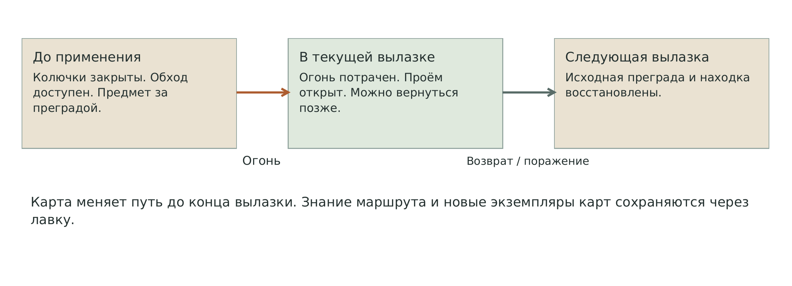

## 2.4 Движение и бросок

Рабочие параметры общего персонажа: шаг 4 м/с, спринт 6,5 м/с, обычный прыжок 1,2 м, высота капсулы 1,8 м, радиус 0,28 м. В префабе используется гравитация 25 м/с². Импульсы нормализуются относительно 9,81 м/с², поэтому расчётные высоты карт сохраняются, хотя длительность полёта становится меньше. [S06]

Бросок имеет заряд 0,65 с, скорость 6–18 м/с, гравитацию карты 9,81 м/с² и подкрутку. Во время подготовки броска бег блокируется. Важные площадки применения карт должны давать возможность остановиться, выбрать траекторию и увидеть первое препятствие на пути снаряда. Узкий уступ на краю воды не должен одновременно требовать разгон, заряд и точный разворот камеры. [S04]

## 2.5 Подбор и физические предметы

Подбор работает с дистанцией 3,2 м и вспомогательной сферой радиуса 0,35 м. Награда на уступе должна быть удалена от всех доступных нижних позиций камеры с запасом: ориентир не менее 4 м до коллайдера находки, проверяемый в реальной сцене. Значение высоты уступа 2,8 м не делает предмет на краю недоступным. [S04]

Текущий `FindFocusedLoot` перебирает результаты `SphereCastAll` и не отсекает предметы за непрозрачной стеной. До сборки тайников, полагающихся на закрытый обзор, требуется проверка препятствия между камерой и предметом. Это зависимость реализации R01, а не свойство, уже обеспеченное схемой. [S04]

Притяжение воздействует на физическую находку и переводит доступный неподвижный `WorldLoot` в динамическое состояние. Предмет не подбирается автоматически. Для Подмены нужен отдельный подвижный неживой объект подходящей массы. Отделившееся колесо повозки SP11 остаётся декоративной частью статического ассета. [S05, S07]

# 3 География координаты и плотность

## 3.1 Система координат

На схемах X растёт на восток, плоская координата Y плана растёт на юг; север находится сверху. Высота H указывается отдельно относительно поверхности озера H=0. Координаты центров точек имеют точность для первичного размещения, а не для окончательной геодезии.

Предлагаемое соответствие Unity: `Xworld = Xplan`, `Zworld = 120 − Yplan`, `Yworld = H`. Так север соответствует +Z, а старт расположен на юге. При сдвиге общего корня уровня все координаты применяются локально к нему. Обозначение «+6 м» у точки относится к полу или опоре игрока, а не к высоте модели.

Скелет занимает около 150 × 120 м. Схематические русла продолжаются за край, чтобы вода не начиналась плоским обрезом в поле зрения. Внешняя граница создаётся рельефом, каменными стенками и плотными массами леса; она не должна обещать доступный проход, который затем блокируется невидимой стеной.

## 3.2 Проверка увеличения

| Показатель | Предыдущая версия | Расширенная версия |
| --- | --- | --- |
| Габарит | Около 100 × 85 м | Около 150 × 120 м |
| Площадь прямоугольного габарита | 8 500 м² | 18 000 м² |
| Основные точки | 10 | 22 |
| Площадь на одну точку | 850 м² | Около 818 м² |
| Относительная плотность точек | 1,00 | Около 1,04 |

Это сравнение по площади габарита. Оно не доказывает одинаковую плотность на проходимом полу: часть площади занимают вода, скалы и вертикальные ярусы. Реальная метрика — расстояние по маршруту между осмысленными решениями и длительность пустого перехода.

## 3.3 Целевой ритм

Для первого блокаута принять ориентир: через 8–15 м движения появляется новый читаемый сигнал — развилка, укрытие, добыча, вид на соседнюю точку, береговой край или изменение высоты. Между крупными точками обычно 15–35 м. Более длинная связь требует промежуточного решения или заметной смены композиции. Эти интервалы проверяются по пешему пути, а не по прямой между центрами.

Плотность не означает, что все противники видны и активны одновременно. Непрозрачные каменные рёбра и корни делят соседние сцены. Из каждого места показывать один ведущий ориентир и не более двух альтернативных направлений одновременно. Локальный участок для спокойного выбора руки остаётся действием: он даёт безопасную позицию перед рискованной сценой, даже когда на нём не лежит ещё одна монета.

## 3.4 Общий план

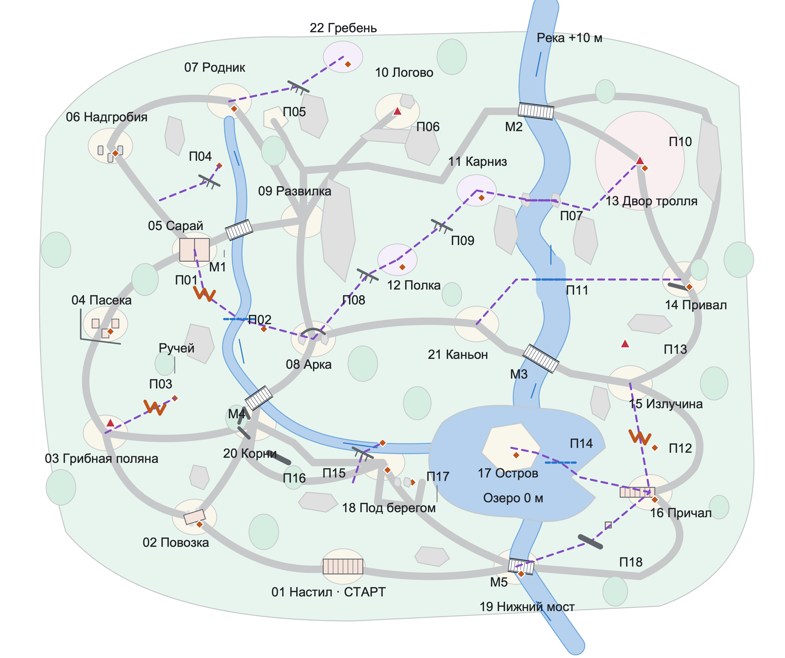

**Обозначения:** серые широкие линии — постоянные пешие связи; фиолетовый пунктир — дополнительные связи с картой; оранжевые ломаные — сжигаемые колючки; штрих на кромке — уступ; синяя перемычка — водная переправа; красный треугольник — существо; ромб — находка. М1–М5 — постоянные мосты. П01–П18 имеют паспорта в главе 7.

## 3.5 Распределение высот

Южный настил +8 м даёт обзор, но не прямую линию огня через всю локацию. Западные тропы идут от +2…5 м к надгробиям +8 м и роднику +9 м. Центр спускается к арке +3 м и каньону +1 м. Нижняя полка +6 м и карниз +10 м образуют отдельную вертикальную ветку. Гребень +14 м — дальняя цель. Восточный двор +5 м постепенно спускается через привал +3 м к берегам +1 м.

Между двумя подписями высот нужны реальные склоны, террасы или разрыв. Нельзя соединять +10 м и +5 м короткой горизонтальной полосой, потому что в плане они стоят рядом. Особенно проверить сопряжения карниза 11 с верхним восточным берегом, родника 07 с нишей +5 м и стартового настила 01 с нижними тропами.

# 4 Вода берега и мосты

## 4.1 Единая водная система

Пасечный ручей начинается ниже родника 07. Он проходит между сараем и центральной развилкой, отделяет пасеку от арки, огибает корневой двор и входит в западную часть озера. Его ширина около 1,5–2 м даёт частые небольшие пересечения и позволяет сочетать Огонь с обычным прыжком.

Северная река входит с отметки около +10 м, проходит между северной петлёй и восточными участками и уходит в озеро. В среднем течении каменные берега образуют ущелье: верхний разрыв П07 отделён по высоте от низкой переправы П11. Вода и береговые камни дают разную читаемость: верх предлагает техническое перемещение, нижний участок — выгодный боковой подход.

Южный сток уводит воду из озера к отметке −1 м. Мост М5 соединяет берега ниже острова и создаёт второй пеший вход к причалу. Благодаря стоку озеро включено в местность, а южный маршрут становится самостоятельной петлёй.

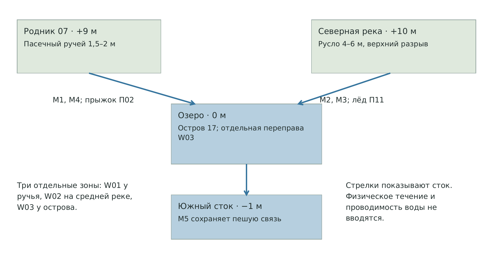

## 4.2 Постоянные мосты

| Мост | Центр X Y | Связь | Начальные размеры для блокаута | Роль |
| --- | --- | --- | --- | --- |
| М1 | 44; 42 | 05–09 через ручей | Длина около 5 м, чистая ширина 2,4 м | Основной западный переход при отсутствии Огня |
| М2 | 104; 18 | Северная тропа–внешний край 13 | Около 7 × 2,6 м | Связь с востоком без верхней Ветви |
| М3 | 105; 68 | 15–21 | Около 7 × 2,6 м | Нижний речной обход и смена берега после боя |
| М4 | 48; 76 | 08–20 | Около 5 × 2,4 м | Связь центра с корнями и южными находками |
| М5 | 101; 110 | 19–16 через сток | Около 5 × 2,6 м | Южный вход на восточный берег |

Указанные ширины относятся к свободному настилу между коллизиями, а не к ширине меша с перилами. Навигационная ширина для союзного дерева и текущих увеличенных монстров проверяется отдельно. Если союзник не помещается, дать ему корректный альтернативный NavMesh-маршрут или расширить мост; не делать исчезновение союзника нормальным способом перехода.

На каждом конце мостового пролёта нужен плоский сухой участок минимум 3 × 3 м. Вход без ступени выше возможностей контроллера. Триггер воды располагается ниже настила и не касается капсулы на мосту. Перила, если есть, не должны перехватывать все броски с очевидной позиции у входа.

## 4.3 Отдельные зоны заморозки

Предложение уровня — три независимых учебных участка: W01 у П02, W02 у П11 и W03 от причального мыса к острову у П14. При попадании в соответствующий участок одна карта создаёт проходимую ледовую поверхность этого перехода до конца вылазки. Проект не задаёт общий радиус заморозки для всех водоёмов игры.

| Зона | Преграда | Рабочая ледовая поверхность | Зачем |
| --- | --- | --- | --- |
| W01 | П02 | Около 3 × 3 м с перекрытием берегов | Запасное решение обычного прыжка через ручей |
| W02 | П11 | Полоса около 8 × 3 м над руслом шириной 6 м | Устойчивая центральная переправа |
| W03 | П14 | Около 10 × 3 м, форма по мысу и острову | Доступ к островной награде и обратный путь |

В текущем `WorldObstacle` замораживается целиком один объект препятствия. Поэтому W01–W03 должны быть отдельными authored-объектами с собственной поверхностью, триггером опасности и готовым ледяным коллайдером. Это может быть сделано через существующую модель объектов, но не считается уже настроенным. Не назначать всей речной сети один `WorldObstacle`. `ObstacleNear` возвращает первый подходящий объект, поэтому расположение соседних водных коллайдеров и порядок выбора требуют проверки R02. [S04]

Вне показанных участков допустимая реакция Льда должна быть определена явно. Для первого блокаута предложено сохранять остальные протяжённые русла как опасный фон, а три места переправы выделить геометрией берегов и материалом. Если свободное замораживание любой точки воды станет общим правилом игры, уровню потребуется другая модель сегментации и баланс коротких путей.

## 4.4 Вода как физическая опасность

Глубокая вода уже реализована как периодический урон с подбросом, а не как плавание или мгновенная смерть. Нельзя считать её надёжной стеной: игрок с запасом здоровья или Лечением может попытаться пересечь опасную зону. В проверке R03 необходимо определить, являются ли П11 и П14 мягкими рискованными ограничителями или должны физически запрещать пересечение. До этого карта обещает удобный устойчивый путь, а не математически абсолютную блокировку. [S04]

Трофеи не должны штатно улетать в недоступное дно. За боевой сценой у берега предусмотреть нижнюю сухую полку или геометрию, на которой предмет останавливается. Глобальный магнитный возврат трофея из воды в этой документации не вводится.

# 5 Маршруты и организация внимания

## 5.1 Пешая связность

Проверка графа схемы даёт 18 основных точек, связанных пешком со стартом. Четыре дополнительные точки — 11, 12, 17 и 22 — рассчитаны на перемещение с картой или на обход, созданный картой с другой стороны. Проверка графа не заменяет проверку коллайдеров: доступность кромки, поворот капсулы и проходимость NavMesh подтверждаются в сцене.

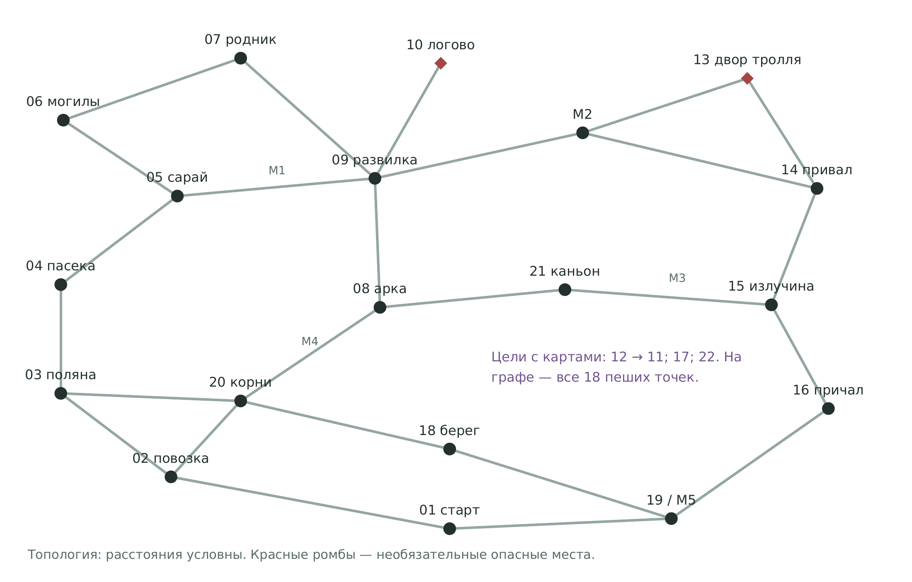

| Петля | Последовательность | Главный вопрос игрока |
| --- | --- | --- |
| Западная | 02–03–04–05–М1–09–08–М4–20–02 | Потратить Огонь на находку или открыть срез к центру? |
| Северная | 05–06–07–09–М1–05 | Подняться к тайнику, выйти к логову или продолжить безопасный круг? |
| Восточная | 09–М2–внешний край 13–14–15–М3–21–08–09 | Подготовить охоту, сменить берег по льду или пройти внешним краем? |
| Озёрная | 20–18–19–М5–16–15–М3–21–08–М4–20 | Вложить карту в остров или собрать доступные береговые находки? |

Начальные связи 01–02 и 01–19 сразу предлагают два направления. Основная сеть не требует единственного «правильного» обхода по часовой стрелке. Изменённый картой проход должен быть удобен в обе стороны, если обратное не является осмысленной особенностью высоты.

## 5.2 Предпросмотр будущей цели

Из 01 видны силуэт арки, крыша сарая, блеск озера и гребень, но не все находки. Из 09 видны предупреждение пса и верхняя полка. Из 16 виден островной предмет, и расстояние воды считывается до расхода карты. Из 07 виден путь к гребню и боковая ниша. Такая постановка позволяет планировать покупку, не требуя постоянных надписей «нужна карта X» в игровом мире.

На развилке сначала показывать форму: два берега с явным разрывом, свободную верхнюю площадку, плотные колючки или глухую каменную стенку. Подсветка находки подтверждает цель. Декоративные символы не должны подменять читаемую геометрию.

## 5.3 Ограничение одновременной нагрузки

Между логовом и восточным двором стоит скальный экран. Между кустом 15 и привалом 14 — отдельный каменный поворот. Корневая стена П16 меняет видимость на юге. Игрок может находиться физически близко к соседней сцене, но видеть и слышать её в управляемый момент.

Не ставить две активные агрессивные группы на оба выхода одной небольшой комнаты. У арены тролля два разнесённых выхода, а внешний маршрут проходит за непрозрачным экраном. При отходе туман и укрытия помогают сменить направление; они не обязаны мгновенно прекращать преследование.

## 5.4 Три ознакомительных вылазки

| Заход | Район и цели | Пример минимального расхода без промахов | Ориентир времени |
| --- | --- | --- | --- |
| Первый | Повозка, грибная поляна, пасека, сарай, надгробия, арка | П01 + П03 + П04 + гриб: 2 Огня + Импульс + Удар = 4 | 6–8 мин |
| Второй | Развилка, логово, нижняя полка, северный мост, привал, каньон | Пёс + П08: 3 Удара + Импульс = 4; остальные карты на лечение, отход и дополнительные цели | 6–8 мин |
| Третий | Корни, береговой карман, нижний мост, причал и остров | П14 + П15 + П12: Лёд + Импульс + Огонь = 3; куст отдельно требует до двух базовых Ударов | 6–8 мин |

С короткими посещениями лавки это даёт ориентир около 20–30 минут на понимание основных петель. Названные расходы показывают цену целей, а не обязательный порядок выпадения и не полную длительность колоды. На практике игрок тратит резерв на другие цели, защиту, промахи либо сбрасывает неудобные карты перед возвратом.

Второй заход не обязан начинаться непосредственно в 09: старт всегда в 01. Уже знакомые короткие связи сокращают путь до выбранного района. Покупка новой карты меняет цель следующего визита, но не переставляет точки уровня.

# 6 Паспорта точек интереса

Размеры игровых площадок ниже — предложенные свободные габариты, а не размеры декоративных моделей. В каждой площадке сначала размещаются подходы, коллизия и место игрока, затем окружение. Соседние номера на плане не означают, что между ними автоматически существует проходимый склон.

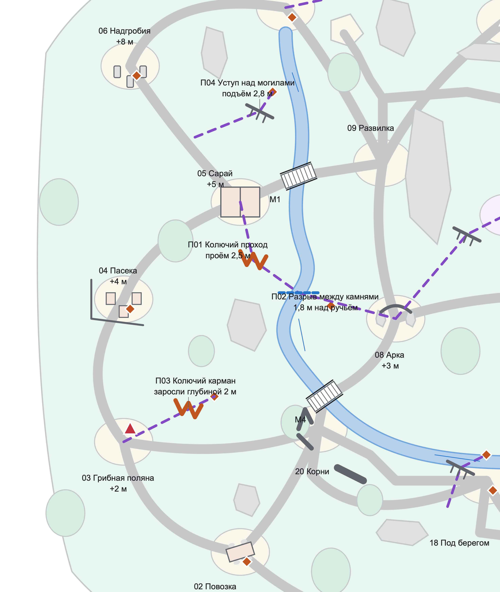

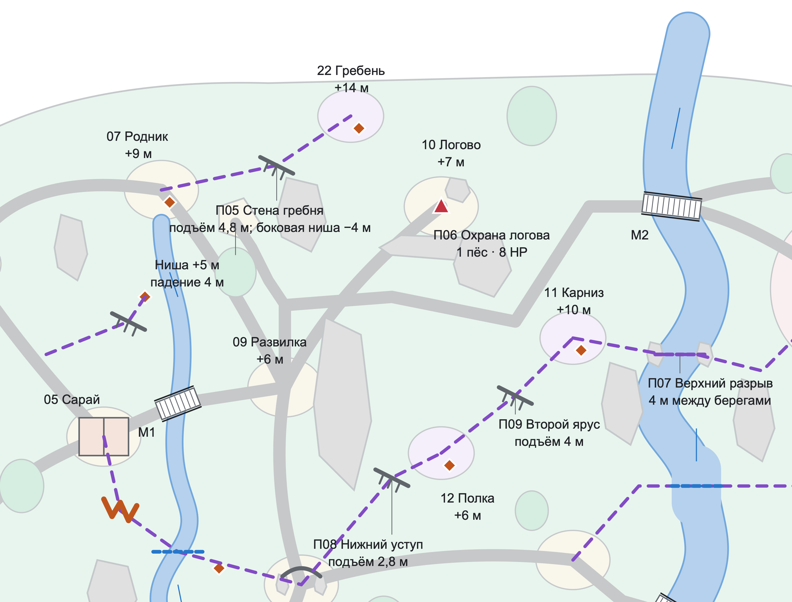

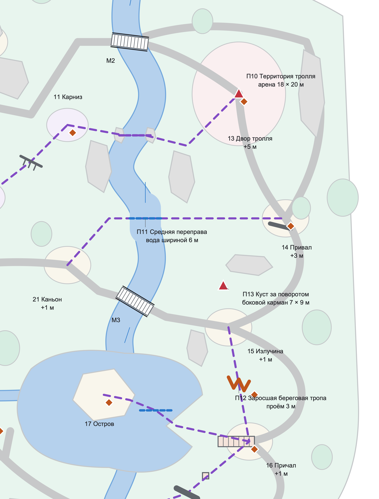

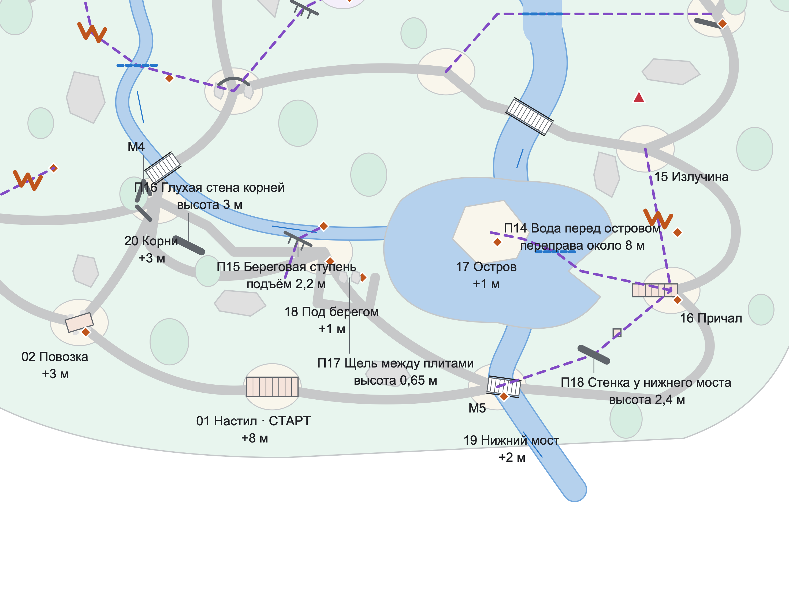

## 01 Обзорный настил

**Центр:** X=65 м, Y=110 м; пол +8 м. **Свободная геометрия:** Настил 8 × 4 м; свободный выход шириной 3 м.

**Назначение.** Вид на арку, пасеку, мосты и гребень. Выбор первой петли.

**Подход и раскрытие.** Первый кадр раскрывает арку между опорами, крышу сарая слева и воду справа. Гребень виден силуэтом выше леса.

**Пример действия.** Игрок осматривается, выбирает западную находку у телеги либо южный мост. Никакая карта не требуется для ухода со стартовой площадки.

**Выход и ошибка.** Оба спуска ведут к обычным тропам. Край настила не направляет первый шаг в падение; опасный срез отделён перилами или рельефом.

**Ассеты.** Отдельная сборка настила, TR01/TR02 как рамка вида, грунтовая тропа.

**Условие приёмки.** При старте без движения камеры видны минимум два понятных направления. Первый доступный предмет находится на маршруте к 02, а не за опасным прыжком.

## 02 Разбитая повозка

**Центр:** X=35 м, Y=100 м; пол +3 м. **Свободная геометрия:** Карман около 9 × 8 м; минимум 2,5 м свободного обхода телеги.

**Назначение.** Первая добыча; телега экранирует взгляд на грибную поляну.

**Подход и раскрытие.** Перекошенный кузов и отдельное колесо узнаются с настила. Блик первой находки виден на сухой стороне.

**Пример действия.** Игрок подбирает L01, обходит кузов и впервые видит грибную поляну. Повозка создаёт небольшой порядок раскрытия: предмет, обход, новая сцена.

**Выход и ошибка.** Три связи: назад к старту, к поляне, к корням. Физическое колесо не нужно для выхода и не является целью Подмены.

**Ассеты.** SP11; два-три малых камня; грунтовая декаль следа колеса.

**Условие приёмки.** Находка доступна без карты. Коллизия дышла и декоративных досок не цепляет капсулу при обходе.

## 03 Грибная поляна

**Центр:** X=17 м, Y=83 м; пол +2 м. **Свободная геометрия:** Поляна около 12 × 10 м, два свободных выхода шириной 3 м.

**Назначение.** Мирный гриб; охота с одного Удара или обход без боя.

**Подход и раскрытие.** Гриб виден между низкой растительностью до испуга. Оранжевый тип колючек П03 различим у края поляны.

**Пример действия.** Игрок выбирает охоту с одного базового Удара либо мирный проход. Огонь в П03 даёт другую задачу той же площадки и открывает гарантированную находку.

**Выход и ошибка.** Путь к 04 проходит с западной стороны колючек; связь к 20 идёт южнее ручья. Испуганный гриб не забегает в глубокую воду как штатный сценарий.

**Ассеты.** Утверждённый грибной спрайт, VG10, низкая трава без коллизии.

**Условие приёмки.** Ни один обязательный проход не требует убить мирное существо. С одной позиции можно увидеть гриб и ближайший выход, но не всю пасеку.

## 04 Старая пасека

**Центр:** X=17 м, Y=61 м; пол +4 м. **Свободная геометрия:** Двор около 14 × 12 м; 3–5 ульев с промежутками для прохода.

**Назначение.** Ульи и забор дробят обзор; колючки скрывают короткий выход.

**Подход и раскрытие.** Низкие коробчатые ульи и ограда задают бытовую тему. Сарай виден за поворотом, а центральная арка лишь частично.

**Пример действия.** Игрок обходит ульи, получает L02 и замечает, что прямой путь к центру закрыт П01. Он идёт к сараю за лучшим углом броска или продолжает западный круг.

**Выход и ошибка.** Ульи служат локальными заслонами, но не запирают игрока. Ограда имеет ясные разрывы; её нельзя случайно принять за ещё одну сжигаемую преграду.

**Ассеты.** SP04, простая ограда отдельной сборкой, VG10 на срезе.

**Условие приёмки.** Ни одна крышка улья не показывает подсказку несуществующего сбора мёда. Обычная тропа не проходит между слишком тесными коллайдерами.

## 05 Дощатый сарай

**Центр:** X=35 м, Y=46 м; пол +5 м. **Свободная геометрия:** Наружная площадка около 12 × 10 м вокруг сарая 3,4 × 4,2 м.

**Назначение.** Укрытие снаружи и развилка: мост, надгробия или огненный срез.

**Подход и раскрытие.** Заколоченная дверь сообщает закрытость здания. Три внешние стороны читаются как пути к могилам, М1 и колючкам.

**Пример действия.** Из-за угла сарая удобно готовить Огонь для П01, не стоя на краю воды. Альтернативой служит ближайший постоянный мост.

**Выход и ошибка.** Минимум два обхода здания. Не ставить добычу внутри закрытой оболочки. Неверный бросок в стену расходует карту, но не прекращает маршрут.

**Ассеты.** SP10, короткий забор, камни на внешних углах.

**Условие приёмки.** У 05 нет скрытого интерьера или открываемой двери. Снаружи есть ровная позиция 3 × 3 м для подготовки броска.

## 06 Три надгробия

**Центр:** X=18 м, Y=25 м; пол +8 м. **Свободная геометрия:** Площадка около 10 × 9 м, разная высота трёх надгробий.

**Назначение.** Тихая находка и вид на тайник П04. Подход к роднику сверху.

**Подход и раскрытие.** Три вертикальных силуэта становятся видны после более тесной тропы. За ними читается отдельная находка выше, у П04.

**Пример действия.** Игрок получает L03, оценивает расход Импульса на L16 и видит продолжение к роднику. Спокойная сцена помогает сравнить текущую руку с будущими целями.

**Выход и ошибка.** Через надгробия не проходит обязательный узкий слалом. Уступ П04 отделён от основной тропы, поэтому без карты можно продолжать к 07.

**Ассеты.** SP05, SP06, SP07; RK09–RK12 для бокового уступа.

**Условие приёмки.** Блик верхней находки виден, но нижняя позиция не достигает её сферой подбора. Площадка под прыжок остаётся сухой.

## 07 Родник

**Центр:** X=42 м, Y=16 м; пол +9 м. **Свободная геометрия:** Верхняя терраса около 10 × 10 м; подход к нише отдельно от основной тропы.

**Назначение.** Начало ручья, выбор между северной тропой и гребнем.

**Подход и раскрытие.** Источник воды объясняет направление ручья. Гребень виден выше, нижняя ниша — с безопасного края.

**Пример действия.** Игрок собирает L04 и выбирает тропу к 09, подъём П05 либо эксперимент с Грибом. Падение в нишу является осознанным действием с предварительным обзором дна.

**Выход и ошибка.** У ниши +5 м есть сухой выход на нижнюю тропу к 09. Источник ручья не лежит прямо поперёк обязательного шага от 06.

**Ассеты.** Каменные чаши и рельеф, отдельная вода, низкая влажная растительность.

**Условие приёмки.** Вершина, ниша и выход из неё различимы как три разных уровня. Игрок не принимает декоративный родник за безопасный брод в основной реке.

## 08 Кривая арка

**Центр:** X=59 м, Y=64 м; пол +3 м. **Свободная геометрия:** Центральная площадка около 12 × 12 м; чистый проём арки 2,2 × 2,5 м.

**Назначение.** Центральный ориентир: запад, север, каньон и южный мостик.

**Подход и раскрытие.** Кривая цельная арка видна с нескольких направлений и служит главным средним ориентиром.

**Пример действия.** Игрок выбирает М4 к корням, 09 на север, каньон 21 на восток либо П08 вверх. Уже открытый П01 возвращает к сараю.

**Выход и ошибка.** Вблизи арки нет обязательного врага. Опоры не закрывают боковой путь для крупных существ; обычный контроллер проходит центр без наклона камеры и прыжка.

**Ассеты.** TR13 и каменный рельеф; светлая сухая тропа как читаемая развилка.

**Условие приёмки.** Каждая ветка имеет визуальный ориентир. Общий BoxCollider не перекрывает пустоту под аркой.

## 09 Каменная развилка

**Центр:** X=57 м, Y=40 м; пол +6 м. **Свободная геометрия:** Развилка около 12 × 10 м, скальное ребро отделяет верхнюю полку.

**Назначение.** Обзор логова без входа в него; выбор северного моста или центра.

**Подход и раскрытие.** Из-за экрана показывается пёс, но вход в его двор не совпадает с обязательной линией движения к мосту.

**Пример действия.** Игрок сверяет руку: охота в 10, безопасный северный обход, возвращение к арке или уход к М1. С полки здесь виден следующий вертикальный интерес, но прямой проход перекрыт рельефом.

**Выход и ошибка.** Обход логова идёт южнее его территории за скалой. Соединение к 14 не должно пересекать скальную массу у координаты 64;42.

**Ассеты.** RK09–RK12, крупные валуны; разметка тропы грунтом.

**Условие приёмки.** Можно пройти от М1 к М2 без обязательного сближения с псом. Подход к 12 с запада закрыт настоящей геометрией, а не невидимым запретом.

## 10 Логово пса

**Центр:** X=76 м, Y=18 м; пол +7 м. **Свободная геометрия:** Двор около 12 × 12 м; дальняя стенка для столкновений.

**Назначение.** Одна территориальная собака, трофей, площадка для смолы и Манка.

**Подход и раскрытие.** Пёс заметен до провокации, его предупреждение звучит до первого удара.

**Пример действия.** Три Удара дают простую понятную охоту. Позже игрок заранее ставит смолу и использует Манок, либо направляет Тяжёлый удар к стенке.

**Выход и ошибка.** Назад к 09 и в сторону северного обхода можно уйти без прохода через другое агрессивное существо. За стенкой нет воды, куда гарантированно падает трофей.

**Ассеты.** Goblin dog с территориальным поведением, каменная стенка и сухой пол.

**Условие приёмки.** Три точных базовых Удара убивают пса при 8 HP. Трофей остаётся доступным. Манок после начала атаки уводит пса к шуму, пока тот звучит и пока пса не ударили.

## 11 Верхний карниз

**Центр:** X=92 м, Y=34 м; пол +10 м. **Свободная геометрия:** Карниз минимум 4 × 6 м; место остановки перед П07 около 3 × 3 м.

**Назначение.** Высокая добыча и старт перехода над ущельем к двору тролля.

**Подход и раскрытие.** Контрастная кромка и блик L05 видны снизу с 12. Восточный берег считывается за разрывом.

**Пример действия.** После П09 игрок получает самостоятельную награду и решает, тратить ли ещё карту на верхнюю переправу. Бросок ветви выполняется из стабильной позиции.

**Выход и ошибка.** Спуск на 12 имеет широкую поверхность приёма. Верхняя тропа к двору не ведёт к невидимой стене и не требует ещё одной неуказанной карты.

**Ассеты.** RK09–RK12; отдельный статичный якорь Верёвки.

**Условие приёмки.** На карнизе можно развернуться и зарядить карту без сползания. Цель Ветви находится на нужной высоте и является статичной поверхностью.

## 12 Нижняя полка

**Центр:** X=76 м, Y=48 м; пол +6 м. **Свободная геометрия:** Полка 4 × 5 м, свободный приём приземления минимум 3 × 3 м.

**Назначение.** Гарантированная находка за Импульс; площадка для следующего подъёма.

**Подход и раскрытие.** Награда видна сразу после первого подъёма. Следующий ярус 11 читается отдельным препятствием.

**Пример действия.** Один базовый Импульс окупается L06. Игрок без подходящей карты П09 завершает локальную задачу и возвращается; улучшенная колода продолжает вверх.

**Выход и ошибка.** Падение обратно с пола полки около 2,8 м идёт на сухой ровный приёмник. Не добавлять выступы, которые выталкивают игрока в ручей.

**Ассеты.** Каменный уступ и сокет гарантированной редкой находки.

**Условие приёмки.** Нижняя камера не достаёт L06, верхняя достаёт. Стартовый Импульс воспроизводимо достигает кромки при корректном попадании.

## 13 Двор тролля

**Центр:** X=125 м, Y=28 м; пол +5 м. **Свободная геометрия:** Внутренняя арена 18 × 20 м; внешняя тропа вне неё.

**Назначение.** Необязательная охота. Арена 18 × 20 м, два выхода и внешний обход.

**Подход и раскрытие.** Тролль виден крупным силуэтом, но на обязательном обходе его обзор перекрыт скалой.

**Пример действия.** Игрок исследует двор с двух углов, готовит дерево или смолу на привале и выбирает момент входа. Верхний П07 и нижний П11 дают разные позиции, а не дополнительные запертые двери.

**Выход и ошибка.** Два выхода не соединяются в одну узкую ловушку сразу за порогом. На первом ознакомлении можно пройти к 14 по внешнему краю.

**Ассеты.** Budding troll, крупные скальные экраны, плоский сухой пол.

**Условие приёмки.** Обычная пешая связь не требует выдержать удар тролля. Боевой цикл читается с дистанции. Трофей и его предлагаемая цена проверяются отдельно.

## 14 Пустой привал

**Центр:** X=134 м, Y=52 м; пол +3 м. **Свободная геометрия:** Безопасный карман около 11 × 9 м, дерево не перекрывает дорожку.

**Назначение.** Укрытие для Лечения за каменным экраном; дерево для оживления, место подготовки ловушки.

**Подход и раскрытие.** Тихая сторона каменного экрана после арены; один пригодный ствол отличается положением и свободным основанием.

**Пример действия.** Игрок использует Лечение рядом с собой, выбирает карту, оживляет дерево или готовит смолу перед новой попыткой. Лечение в текущем коде лечит игрока в радиусе, а не всех соседних существ.

**Выход и ошибка.** Выход к 15 и П11 не заставляет повторно входить в центр арены. Преследующий враг может прийти сюда, поэтому это укрытие, а не магическая зона безопасности.

**Ассеты.** Один подходящий ствол TR01/TR02, лежачее бревно, каменное ребро.

**Условие приёмки.** Союзник может встать и выйти к арене. Снаряд Лечения попадает в доступный пол рядом с игроком.

## 15 Восточная излучина

**Центр:** X=123 м, Y=73 м; пол +1 м. **Свободная геометрия:** Главная развилка около 12 × 10 м, северная ниша 7 × 9 м.

**Назначение.** Враждебный куст у бокового тайника; выбор моста М3 или причала.

**Подход и раскрытие.** Куст проявляет движение за камнем до входа в боковую нишу. Южная дорога к мосту видна отдельно.

**Пример действия.** Игрок выбирает охранную находку, обход к М3 или путь к причалу. Заросли П12 обещают сокращение пути вдоль внутреннего берега.

**Выход и ошибка.** Отход к М3 не проходит через куст. Не ставить второго скрытого врага за следующий поворот в первой версии.

**Ассеты.** Hostile bush, RK-экран, VG10 на береговом срезе.

**Условие приёмки.** Два базовых Удара соответствуют текущим 6 HP куста. До первой атаки игрок имеет возможность отступить на основную дорогу.

## 16 Старый причал

**Центр:** X=127 м, Y=95 м; пол +1 м. **Свободная геометрия:** Причал SP08 2,4 × 5 м; сухая входная площадка минимум 4 × 4 м.

**Назначение.** Безопасная точка броска на остров; виден замерзающий перешеек.

**Подход и раскрытие.** Островная награда и сужение воды видны с позиции броска. Нижний мост читается дальше по берегу.

**Пример действия.** Лёд W03 создаёт путь к острову; без карты доступны L09 и обычная озёрная петля. Возможен поздний Телепорт на открытый островной пол.

**Выход и ошибка.** После неудачного броска можно уйти к М5. Вход на причал совпадает по высоте с подходом, без непредусмотренной ступени 0,6 м.

**Ассеты.** SP08, береговой грунт и отдельные водные объекты.

**Условие приёмки.** Перила или тумба не перехватывают естественный бросок. Замёрзшая поверхность соединяется с доступным мысом и островом.

## 17 Островок

**Центр:** X=99 м, Y=86 м; пол +1 м. **Свободная геометрия:** Сухая площадка примерно 7 × 8 м, свободное место вокруг находки.

**Назначение.** Гарантированная ценная находка за водной преградой. Лёд остаётся для возврата.

**Подход и раскрытие.** L10 находится на видимой верхней поверхности, а не внутри декоративного сундука с новой механикой.

**Пример действия.** После переправы игрок получает гарантированную редкую находку и смотрит на обратную сторону локации. Новое направление обзора помогает связать 18, 19 и 16.

**Выход и ошибка.** Лёд остаётся для возвращения. При Телепорте без подготовленного льда игроку нужно оценить обратный путь или возможность завершить вылазку после исчерпания руки.

**Ассеты.** Низкий берег, несколько камней; без обязательного нового монстра.

**Условие приёмки.** На острове есть свободная капсула для Телепорта. Карта возврата работает здесь так же, как в других местах.

## 18 Карман под берегом

**Центр:** X=73 м, Y=89 м; пол +1 м. **Свободная геометрия:** Нижняя сухая полоса около 14 × 9 м плюс отдельный верхний уступ.

**Назначение.** Низовой тайник и щель для Притяжения; трофеи не проваливаются в реку.

**Подход и раскрытие.** Снизу видны два результата: обычная находка и верхний тайник. Каменная щель считывается как путь для маленького предмета.

**Пример действия.** Игрок забирает L11 без карты, поднимается за L17 через П15 либо сокращает путь к L18 Притяжением через П17.

**Выход и ошибка.** Вокруг каменного ребра есть обычный заход к задней стороне щели. Все места приёма предметов сухие и доступны для подбора.

**Ассеты.** RK-плиты, маленькая физическая находка, плоский сокет Куба.

**Условие приёмки.** Каменный куб имеет промежуточную ступень 0,5 м; без неё прыжок 1,2 м не должен считаться достаточным для подъёма на куб 1,5 м.

## 19 Нижний мост

**Центр:** X=100 м, Y=110 м; пол +2 м. **Свободная геометрия:** Площадка у мостового входа около 10 × 8 м, М5 отделён от места разворота.

**Назначение.** Связь обоих берегов; вид на остров снизу и короткий путь к старту.

**Подход и раскрытие.** Снизу видны остров, причал и выход стока. Это знакомый южный ориентир для возвратного маршрута.

**Пример действия.** Игрок получает L12, выбирает стартовую тропу или восточный берег. Стенка П18 показывает более короткий способ попасть к причалу.

**Выход и ошибка.** М5 всегда остаётся обычным переходом; движение через мост не включает скрытый расход карты.

**Ассеты.** Отдельный мостовой префаб, низкие камни и отдельный ящик П18.

**Условие приёмки.** Триггер стока не касается игрока на мосту. Бросок из входного кармана не требует стоять на узком периле.

## 20 Корневой двор

**Центр:** X=47 м, Y=81 м; пол +3 м. **Свободная геометрия:** Двор около 14 × 12 м; два обхода стены корней от 2,5 м шириной.

**Назначение.** Разрыв видимости между тремя подходами; нижний путь к береговому тайнику.

**Подход и раскрытие.** Крупные корни меняют видимость между западом, аркой и береговым карманом.

**Пример действия.** Игрок закрывает обзор, меняет ветку при погоне, выбирает П15 или выходит к телеге. Туман усиливает смену позиции, но не отменяет память врага.

**Выход и ошибка.** Оба обхода корней ведут на сухой пол. Дорожки расположены южнее ручья и не добавляют скрытое шестое пересечение воды.

**Ассеты.** TR14 как целый ориентир и авторская земляная кромка; без модульного пазла из корней.

**Условие приёмки.** Через каждый обход проходят игрок и камера. Корни не реагируют на Огонь как VG10; визуальный язык различает эти объекты.

## 21 Мшистый каньон

**Центр:** X=92 м, Y=61 м; пол +1 м. **Свободная геометрия:** Сухая нижняя тропа с расширениями 4 × 5 м, основная ширина от 2,5 м.

**Назначение.** Сухая нижняя тропа у русла; укрытия для смены берега и подхода к арке.

**Подход и раскрытие.** Река слышна и видна рядом; верхний маршрут читается далеко над головой.

**Пример действия.** Игрок выходит к М3, оценивает П11 и проходит к арке. Отсюда удобно сравнить расход Льда с длиной постоянного обхода.

**Выход и ошибка.** Нет обязательного прыжка по мокрым камням. Уровень не заставляет сражаться на единственной узкой дорожке над глубокой водой.

**Ассеты.** RK-стенки, мох, отдельные сухие площадки у русла.

**Условие приёмки.** Камера видит контакт карты с W02. На обычном пути ни один участок триггера воды не заходит под капсулу.

## 22 Сторожевой гребень

**Центр:** X=65 м, Y=7 м; пол +14 м. **Свободная геометрия:** Верхняя площадка минимум 5 × 6 м с широким безопасным краем.

**Назначение.** Видимая снизу будущая цель. Высокая награда и обзор всей гидросистемы.

**Подход и раскрытие.** Отдельный высокий силуэт и L13 видны из 07, позже — с карниза 11.

**Пример действия.** Новая транспортная карта превращает давно видимую цель в доступную. Сверху игрок читает общий рисунок рек и обе стороны уровня.

**Выход и ошибка.** Простой выход ведёт на широкую полку у родника; прыжок с самой дальней высокой стороны не обозначается как безопасный. Ниша ниже имеет собственный выход.

**Ассеты.** Крупный скальный силуэт, редкий ствол в роли рамки обзора.

**Условие приёмки.** Один Поток достигает выбранной кромки при правильной установке. Эксперимент Гриб–Луна тестируется отдельно и не заменяет основной способ.

# 7 Паспорта преград

В каждом паспорте различаются: способ пройти, доступный обход, смысл расхода карты, ошибка и условия приёмки. Указанный расход — число успешных применений, не учитывающее промахи, защиту и уже выполненные подготовительные действия. П06, П10 и П13 — поведенческие преграды: существо охраняет цель, но не запирает всю дорожную сеть.

## П01 Колючий проход

**Где:** 05 → 08, выход за сараем. Центр условного обозначения X=37, Y=55. **Размер:** проём 2,5 м.

**Геометрия.** Плотная группа VG10 закрывает единственный проём среза, но не М1. Приёмник за колючками сухой, находка L14 видна после выгорания.

**Основное решение и расход.** 1 Огонь. Проход остаётся открытым до конца вылазки.

**Выполнение.** Целиться в блокирующую группу, а не в сарай или декор. Несколько соседних VG10 в одном проходе объединить в один логический WorldObstacle.

**Обход.** Пешком через М1 и 09.

**Результат.** Короткий срез и находка сразу за колючками.

**Ошибка и восстановление.** Промах расходует карту; сообщение и визуал не должны объявлять проход открытым. При отсутствии второй копии доступен М1.

**Условие приёмки.** После горения коллизия действительно исчезает, а обугленный меш остаётся ниже уровня движения. Новая вылазка восстанавливает барьер.

## П02 Разрыв между камнями

**Где:** Продолжение среза П01. Центр условного обозначения X=44, Y=60. **Размер:** 1,8 м над ручьём.

**Геометрия.** Ровные камни по обе стороны ручья; чистый горизонтальный просвет 1,8 м, разбег минимум 2 м, приёмник минимум 2 × 2 м.

**Основное решение и расход.** Обычный прыжок с ровного камня. Лёд — запасной вариант.

**Выполнение.** Обычный прыжок должен работать с шага. Лёд W01 даёт спокойный повторяемый переход и остаётся на вылазку.

**Обход.** М1 сверху или М4 снизу.

**Результат.** Соединяет огненный проход с аркой; второй карты не требует.

**Ошибка и восстановление.** Край не должен сталкивать игрока в воду из-за декоративного скола. Неудачное приземление допускает выход на ближайший берег.

**Условие приёмки.** Триггер воды находится ниже траектории нормального прыжка. Проверить шаг и спринт, оба направления, отсутствие карты.

## П03 Колючий карман

**Где:** 03, восточный край поляны. Центр условного обозначения X=27, Y=78. **Размер:** заросли глубиной 2 м.

**Геометрия.** Колючки отделяют маленький карман глубиной около 2 м от основного пути поляны. L15 гарантирована.

**Основное решение и расход.** 1 Огонь; внутри гарантированная находка.

**Выполнение.** Один Огонь должен открывать весь нужный вход. Видимая группа не требует скрытой второй карты на соседний куст.

**Обход.** Тропа 03 → 04 проходит снаружи.

**Результат.** Выбор: потратить Огонь на добычу здесь или на срез П01.

**Ошибка и восстановление.** Без Огня игрок идёт по основной тропе. Уход гриба не закрывает доступ к карману.

**Условие приёмки.** После открытия предмет находится в достижимом месте и не спрятан за ещё одним новым взаимодействием.

## П04 Уступ над могилами

**Где:** Между 05 и 06. Центр условного обозначения X=38, Y=32. **Размер:** подъём 2,8 м.

**Геометрия.** Вертикальная стенка 2,8 м; верхняя площадка 3 × 4 м. L16 отнести от края минимум на 3 м либо увеличить полку после проверки сферы подбора.

**Основное решение и расход.** 1 Импульс; площадка наверху 3 × 4 м.

**Выполнение.** Импульс под ногами, выбранная вертикальная составляющая; обычный прыжок с соседнего декоративного камня не должен незаметно отменять задачу.

**Обход.** Тайник необязателен. Назад — спуск на ту же широкую площадку.

**Результат.** Гарантированная находка; тренировка точного подброса.

**Ошибка и восстановление.** После промаха остаётся основной маршрут. С верхней полки можно шагнуть на широкую сухую площадку снизу.

**Условие приёмки.** Из всех доступных нижних позиций камера не подбирает L16. Базовый вертикальный Импульс имеет запас до кромки.

## П05 Стена гребня

**Где:** 07 → 22. Центр условного обозначения X=56, Y=13. **Размер:** подъём 4,8 м; боковая ниша −4 м.

**Геометрия.** Основной подъём 4,8 м от площадки около +9,2 м до вершины +14 м. Боковая ниша на +5 м даёт отдельный экспериментальный объём.

**Основное решение и расход.** 1 Поток или Верёвка; альтернатива — Лёгкость → Импульс. Ниша для эксперимента: Гриб внизу → падение 4 м → Луна после отскока.

**Выполнение.** Статичная точка верёвки должна позволять достать нижний конец. Для Потока есть свободный пол радиусом не менее 1,5 м и место бокового выхода наверху.

**Обход.** Вершина необязательна. Из ниши +5 м есть пологий выход к 09.

**Результат.** У гриба отскок ≈3,2 м; Луна после отскока теоретически даёт ≈12,8 м. Цель на 9 м выше ниши; траекторию проверить. Обычный возврат с вершины — на широкую полку у 07.

**Ошибка и восстановление.** После неудачи в нише использовать пологий выход к 09. Не требовать остаточной карты для спасения из учебного эксперимента.

**Условие приёмки.** Основные способы испытываются отдельно. Для Гриба с Луной фиксировать момент отскока и попадания карты, а не только максимальную высоту.

## П06 Охрана логова

**Где:** 10, двор перед каменной стенкой. Центр условного обозначения X=77, Y=22. **Размер:** 1 пёс · 8 HP.

**Геометрия.** Территориальный пёс стоит в сухом дворе; задняя каменная стенка находится на читаемом расстоянии, не вплотную к его коллайдеру.

**Основное решение и расход.** 3 попадания Ударом. Манок до агрессии или заранее поставленная смола меняют сценарий.

**Выполнение.** Либо точные Удары, либо подготовка до агрессии. Входной угол позволяет увидеть замах и не сразу оказаться в contactRange.

**Обход.** От 09 к М2 по южной тропе за непрозрачным скальным экраном.

**Результат.** Трофей; Тяжёлый удар можно направить в каменную стенку. Дополнительный урон столкновения зависит от скорости.

**Ошибка и восстановление.** При отходе в южную ветку игрок теряет видимость за скалой; преследование проверяет последнее известное место, а не магически исчезает.

**Условие приёмки.** Обычный обход 09–М2 не провоцирует обязательную драку. Трофей остаётся на доступном сухом полу.

## П07 Верхний разрыв

**Где:** 11 → верхняя кромка 13. Центр условного обозначения X=105, Y=36. **Размер:** 4 м между берегами.

**Геометрия.** Горизонтальный просвет 4 м; обе опоры верхней переправы около +10 м. Восточная опора соединяется с внешним подходом к двору 13 пологим спуском до +5 м. Ветвь длиной 5 м имеет запас для опоры; противоположный торец плоский, статичный, без перехватывающих декалей с коллизией. Проверить также обычный прыжок с разбега: 4 м не объявляются непреодолимым пределом контроллера. Если игрок достигает кромки без карты, это допустимый сложный срез; ветвь даёт спокойный двусторонний проход.

**Основное решение и расход.** 1 Ветвь-мост, попадание в торец противоположной скалы. Альтернатива — маятник на Верёвке.

**Выполнение.** Ветвь растёт от попадания к месту броска. Держать место попадания на высоте настила, иначе горизонтальная ветвь окажется над головой или ниже берега.

**Обход.** М2 на севере или М3 внизу.

**Результат.** Верхний заход к троллю. Ветвь пропускает и существ; это не безопасная огневая точка.

**Ошибка и восстановление.** Неправильная высота может сделать путь неудобным. М2 и М3 остаются обходами. Верёвка крепится к статичному элементу, не к оживляемому дереву.

**Условие приёмки.** По карте проходит игрок в обе стороны. Если правила предполагают существ на ветви, проверена временная навигация и её удаление после сгорания.

## П08 Нижний уступ

**Где:** 08 → 12. Центр условного обозначения X=70, Y=51. **Размер:** подъём 2,8 м.

**Геометрия.** Стена 2,8 м и платформа 4 × 5 м. L06 расположена в глубине; высокая скала с запада отделяет её от тропы 09.

**Основное решение и расход.** 1 Импульс. Площадка 4 × 5 м; добыча видна с нижнего подхода.

**Выполнение.** Базовый Импульс достаточно вертикален и не тратится на попытку перескочить лишний горизонтальный разрыв.

**Обход.** Основная дорога идёт под полкой.

**Результат.** Добыча сразу на первом ярусе, даже без карты для П09.

**Ошибка и восстановление.** Игрок без следующей транспортной карты получает награду первого яруса и возвращается тем же безопасным спуском.

**Условие приёмки.** Нет скрытого пешего входа с той же высоты через соседний склон. Нет подбора награды снизу через край.

## П09 Второй ярус

**Где:** 12 → 11. Центр условного обозначения X=85, Y=41. **Размер:** подъём 4 м.

**Геометрия.** Перепад между полом 12 и полом 11 равен 4 м; верхняя площадка минимум 4 × 6 м.

**Основное решение и расход.** Улучшенный Импульс, Верёвка или Поток. Кромка карниза доступна для попадания снизу.

**Выполнение.** Улучшенный Импульс 9,5, Верёвка или Поток. Цель для верёвки видна, её нижний конец доступен с 12.

**Обход.** Карниз необязателен. Спуск 11 → 12 на широкую полку.

**Результат.** Новая награда и доступ к П07. Базового Импульса из покоя недостаточно, но прыжок с базовым Импульсом допускается как более сложное исполнение.

**Ошибка и восстановление.** Различать случайную ступень в декоре и намеренный прыжок с Импульсом. Первый обход проверяется при замене модели; второй принимается как награда за владение движением. Неудачный подъём возвращает на широкую полку 12.

**Условие приёмки.** После подъёма можно остановиться, подобрать L05 и подготовить П07. Падение на нижнюю полку не направляет в воду.

## П10 Территория тролля

**Где:** 13, внутренний двор. Центр условного обозначения X=125, Y=27. **Размер:** арена 18 × 20 м.

**Геометрия.** Чистый пол арены 18 × 20 м, разнесённые выходы и отдельный внешний обход. Скальная перегородка имеет высоту, перекрывающую зрение тролля.

**Основное решение и расход.** Смола, союзное дерево, Дождь → Лёд или Молния. Для молнии нужна мокрая цель; игрок и союзник могут попасть в цепь.

**Выполнение.** Площадка допускает смоляную зону, союзное дерево и дождь; достаточно места для отхода от мокрой цепи молнии.

**Обход.** Внешняя тропа по восточному краю за скальной стенкой; у арены два выхода.

**Результат.** Охота на будущие заходы. Первый визит не требует убивать тролля. Река сама электричество не проводит.

**Ошибка и восстановление.** Ошибка подготовки приводит к понятному бою, но не к блокировке обоих выходов одним существом. Вода не используется как обязательная яма для победы.

**Условие приёмки.** Тролль не агрится через обязательный внешний экран. Цена и доступность трофея соответствуют выбранной сложности; первый маршрут работает без его убийства.

## П11 Средняя переправа

**Где:** 21 / западный берег → 14. Центр условного обозначения X=107, Y=52. **Размер:** вода шириной 6 м.

**Геометрия.** Русло шириной 6 м, два сухих подхода минимум 3 × 3 м. W02 перекрывает воду и немного заходит на оба берега.

**Основное решение и расход.** 1 Лёд на отдельный участок русла. Ветвь 7 м после улучшения — альтернатива.

**Выполнение.** Лёд на выделенную поверхность. Ветвь 7 м подходит только при совпадении высоты опор; длина 5 м не закрывает разрыв.

**Обход.** Постоянный М3 южнее; М2 севернее.

**Результат.** Боковой выход к привалу и двору. Базовой ветви 5 м недостаточно.

**Ошибка и восстановление.** Без карты использовать М3. Если незамёрзшая вода проходима ценой здоровья, это отдельный мягкий риск, а не скрытая ошибка описания.

**Условие приёмки.** Один бросок не замораживает остров и северный мост одновременно. Края льда не создают ступень, цепляющую капсулу.

## П12 Заросшая береговая тропа

**Где:** 15 → 16, внутренний срез. Центр условного обозначения X=125, Y=84. **Размер:** проём 3 м.

**Геометрия.** Проход шириной 3 м вдоль внутренней береговой связи 15–16. Внешняя тропа огибает его с востока.

**Основное решение и расход.** 1 Огонь; проход остаётся доступным в обе стороны.

**Выполнение.** Огонь открывает двусторонний срез и L19. Растительность у самой воды не маскирует полную ширину чистого пола.

**Обход.** Внешняя тропа огибает заросли с востока.

**Результат.** Сокращает возвраты между кустом, причалом и М3; рядом небольшая находка.

**Ошибка и восстановление.** Промах не загоняет игрока в кустовую нишу. На внешний обход можно уйти до боя.

**Условие приёмки.** После выгорания проход визуально отличается от обычной травы и остаётся открытым до конца вылазки.

## П13 Куст за поворотом

**Где:** 15, северная ниша. Центр условного обозначения X=122, Y=65. **Размер:** боковой карман 7 × 9 м.

**Геометрия.** Северная ниша 7 × 9 м рядом с 15. Камень скрывает часть силуэта, а не всю сцену до контакта.

**Основное решение и расход.** Разведка из-за камня; Удары или подготовленная смола. Дождь смоет эту ловушку.

**Выполнение.** Два базовых Удара дают суммарно 6 урона. Смола подготавливается до сближения; огонь и дождь меняют её по обычным правилам.

**Обход.** Главная тропа к М3 идёт с южной стороны ниши.

**Результат.** Охрана боковой добычи. За поворотом видно движение куста до входа.

**Ошибка и восстановление.** В основной связи к М3 остаётся сухой свободный путь. Не добавлять ещё одну охрану на этот выход.

**Условие приёмки.** Игрок замечает угрозу до достижения атаки. Предмет или трофей не падает за непреодолимую кромку реки.

## П14 Вода перед островом

**Где:** 16 → 17. Центр условного обозначения X=109, Y=89. **Размер:** переправа около 8 м.

**Геометрия.** Около 8 м открытой воды между мысом и ближайшим островным берегом. W03 — полоса около 10 × 3 м с устойчивыми стыками.

**Основное решение и расход.** 1 Лёд: предлагается отдельная зона от мыса до острова; остаётся для выхода.

**Выполнение.** Лёд создаёт прямой путь. Для Телепорта предусмотрен свободный открытый пол, без закрытого навеса над капсулой.

**Обход.** Береговая петля свободна; пешего входа на остров нет.

**Результат.** Гарантированная ценная находка. Телепорт на свободный берег острова — поздняя альтернатива.

**Ошибка и восстановление.** Игрок с Телепортом, но без обратной переправы должен видеть последствия. Служебный возврат доступен лишь после обычного исчерпания карт.

**Условие приёмки.** L10 гарантирована и доступна на острове. Возврат по льду не требует повторного расхода. Поведение при попытке переплыть проверено как R03.

## П15 Береговая ступень

**Где:** 18, верхний тайник. Центр условного обозначения X=69, Y=87. **Размер:** подъём 2,2 м.

**Геометрия.** Перепад 2,2 м, верхний сокет в глубине площадки. Рядом отдельная ступень 0,5 м и свободный пол под куб 1,5 × 1,5 м.

**Основное решение и расход.** 1 Импульс. Куб как лестница: рядом предусмотрена каменная ступень 0,5 м для подъёма на куб.

**Выполнение.** Сначала взойти на ступень, затем прыгнуть на куб и на полку; либо применить Импульс. Куб не считать автоматически доступным с ровного пола прыжком 1,2 м.

**Обход.** Нижняя находка доступна без карты.

**Результат.** Вторая награда и вид на остров; широкая площадка спуска без воды под ногами.

**Ошибка и восстановление.** Неверно поставленный куб можно оставить; нижняя находка L11 и обход сохраняются. Падение с полки идёт на сухой приёмник.

**Условие приёмки.** L17 нельзя подобрать снизу. Куб появляется без пересечения стен и не зажимает игрока в углу.

## П16 Глухая стена корней

**Где:** 20, между южным и центральным подходами. Центр условного обозначения X=52, Y=88. **Размер:** высота 3 м.

**Геометрия.** Глухая корневая масса высотой 3 м. Два сухих прохода от 2,5 м по обеим сторонам; корни располагаются южнее русла.

**Основное решение и расход.** Обойти слева или справа. Туман прикрывает смену ветки после разрыва видимости.

**Выполнение.** Обход изменяет линию взгляда. Туман скрывает выбор ветки, а не подменяет необходимость фактически отойти за препятствие.

**Обход.** Два прохода шириной от 2,5 м. Корни не сгорают.

**Результат.** Меняет погоню; враг сначала проверяет последнее место, агрессия не сбрасывается сразу.

**Ошибка и восстановление.** Враг может продолжать поиск. Если игрок кружит вокруг слишком малого экрана, поведение не должно обещать автоматический сброс агрессии.

**Условие приёмки.** Оба прохода ведут к полезным направлениям. Материал корней отличается от сжигаемой преграды; Огонь не раскрывает незаказанную дыру.

## П17 Щель между плитами

**Где:** 18, нижний карман. Центр условного обозначения X=77, Y=93. **Размер:** просвет высотой 0,65 м; ширина около 0,9 м.

**Геометрия.** Низкий канал: высота 0,65 м, ширина около 0,9 м, пробная глубина 4,2 м. Предмет малый, физический; пол ровный.

**Основное решение и расход.** Притяжение в землю перед щелью: предмет в пределах 3 м. Затем обычный подбор.

**Выполнение.** Центр Притяжения на полу около 1,5 м в глубине. Разница с предметом около 2,7 м. Низкий бросок проверяется с подготовленной площадки в 4–5 м перед входом.

**Обход.** Пешком вокруг каменного ребра к задней стороне кармана.

**Результат.** Экономия обхода. Сквозь щель проходит маленькая находка, тело игрока — нет.

**Ошибка и восстановление.** Карта в задний камень потянет предмет в неверную сторону. Пеший заход сзади остаётся альтернативой; предмет не застревает навсегда под декоративной плитой.

**Условие приёмки.** Обязательна R01: нельзя подобрать предмет через стену с бокового подхода. Притяжение не телепортирует лут сквозь коллайдер, результат подтверждается физическим движением.

## П18 Стенка у нижнего моста

**Где:** 19 → 16, короткий путь. Центр условного обозначения X=115, Y=105. **Размер:** высота 2,4 м.

**Геометрия.** Статичная стенка высотой 2,4 м, свободная площадка за ней 3 × 3 м, отдельный ящик μ=1 на дистанции 6–8 м от позиции броска.

**Основное решение и расход.** Импульс; Подмена с отдельным физическим ящиком за стенкой; Телепорт на видимую площадку.

**Выполнение.** Подмена требует реального попадания. Импульс преодолевает высоту; Телепорт приходит к поверхности с корректной свободной капсулой.

**Обход.** Пешая дорожка вокруг восточного торца.

**Результат.** Срез и тренировка броска. Ящик μ=1, дистанция 6–8 м, свободная площадка 3 × 3 м.

**Ошибка и восстановление.** Если ящик сдвинут, обычный обход торца остаётся. Не привязывать единственный обратный выход к тому же ящику, который поменял сторону.

**Условие приёмки.** После Подмены каждый объект сохраняет собственную скорость. После Телепорта скорость игрока сохраняется; возможное падение не отменяется.

## 7.19 Разрез нижней полки и карниза

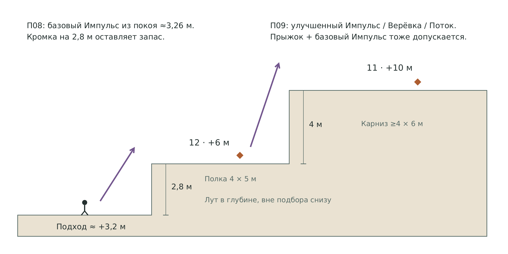

Базовый Импульс I=8 из покоя даёт идеальный вертикальный подъём около 3,26 м при нормализованной гравитации. Для П08 выбирается 2,8 м, чтобы оставить запас по кромке. Улучшение I=9,5 из покоя даёт около 4,60 м; второй подъём 4 м предлагает более простой способ использовать улучшение или другую транспортную карту. Основной учебный сценарий — два раздельных применения с остановкой на широкой полке. Это не жёсткий запрет сложного непрерывного прыжка: сложение скоростей описано в разделе 7.22.

Верхняя награда первого яруса находится до второго препятствия. Игрок с единственным базовым Импульсом получает законченный результат и свободно возвращается вниз. От кромки предмет отнесён так, чтобы его нельзя было подобрать с нижнего подхода.

## 7.20 Ниша для Гриба и Луны

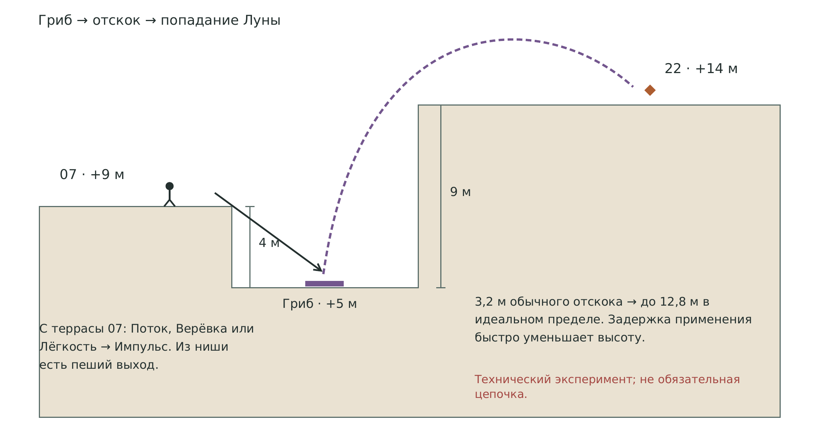

В боковую нишу +5 м можно упасть с площадки +9 м. Базовый Гриб возвращает 80% эквивалентной высоты падения: 4 × 0,8 = 3,2 м. Если Луна включается точно после отскока, идеальная последующая высота при g×0,25 возрастает до 12,8 м относительно гриба. Вершина +14 м находится на 9 м выше ниши.

Это экспериментальный маршрут, а не гарантированное решение П05. Луна срабатывает при попадании карты, а не в момент выбора в руке. При g=25 задержка примерно 0,12 с после отскока уже съедает практически весь запас для подъёма на 9 м; точное значение зависит от реализации контакта и времени применения. Нужен заранее подготовленный бросок с подходящим моментом попадания либо изменение геометрии ниши по результатам теста. Не требовать этот трюк для завершения первого уровня. Простые альтернативы П05 — Поток, Верёвка или Лёгкость с Импульсом с верхней площадки 07 около +9,2 м. Эти способы решают подъём на 4,8 м; из дна ниши до вершины 9 м, и тот же базовый бюджет туда не переносится.

Если Луна работает на всём падении, входная скорость на гриб ниже. Это не тот же результат, что переключение гравитации после отскока. Для неудачной попытки у ниши есть пологий выход к 09; она не становится камерой, из которой требуется дополнительная карта для спасения.

## 7.21 Щель и дистанция подбора

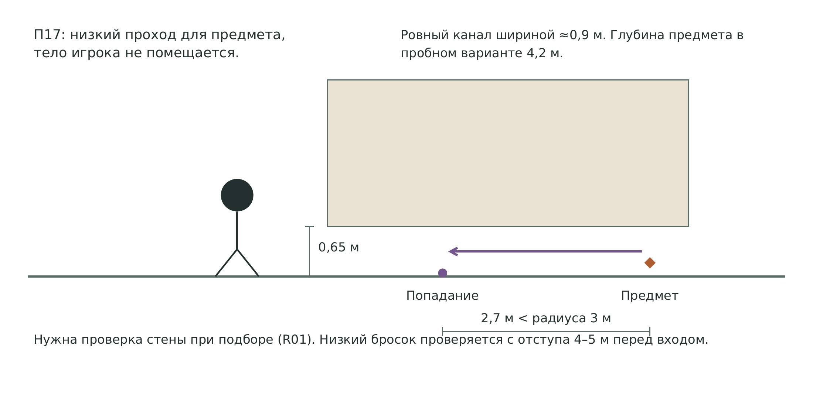

У П17 уточняется высота просвета 0,65 м; ширина около 0,9 м, ровный пол без выступов. Предмет небольшой, с физическим коллайдером, свободно проходящим через щель. В первом пробном варианте его глубина около 4,2 м, а точка попадания карты в пол находится на глубине около 1,5 м: между предметом и центром Притяжения остаётся 2,7 м при радиусе эффекта 3 м.

Перед щелью нужна площадка для низкого броска с отступа 4–5 м. Снаряд должен попадать в доступную часть пола, а не в скрытый задний камень: Притяжение тянет к точке попадания. После движения предмета игрок подбирает его обычным способом. Боковые подходы не должны позволять дотянуться через каменную массу; проверка видимости при подборе R01 обязательна. Пеший заход к задней стороне кармана сохраняется как альтернатива карте.

## 7.22 Высоты из покоя и сложение скорости

`FirstPersonMotor.ApplyImpulse` прибавляет положительный вертикальный импульс к уже положительной вертикальной скорости: `vy = max(0, vy) + deltaVy`. Обычный прыжок начинается со скорости `sqrt(2 × 25 × 1,2) ≈ 7,75 м/с`. Базовый вертикальный Импульс после нормализации даёт `8 × sqrt(25 / 9,81) ≈ 12,77 м/с`. Поэтому высоты 3,26 и 4,60 м относятся к запуску из покоя, а не к абсолютным пределам карты. Подготовка броска блокирует спринт, но не кнопку обычного прыжка. [S04, S06]

| Условие | Идеальная высота | Значение для схемы |
| --- | --- | --- |
| Базовый Импульс из покоя | 3,26 м от точки применения | П08 имеет запас до кромки 2,8 м |
| Улучшенный Импульс из покоя | 4,60 м от точки применения | Более простой подъём П09 на 4 м |
| Базовый Импульс на вершине прыжка | 1,2 + 3,26 ≈ 4,46 м от исходного пола | П09 может пройти и без улучшения |
| Идеальное сложение в начале прыжка | (7,75 + 12,77)² / (2 × 25) ≈ 8,42 м | Потенциальный обход П05 и нескольких ярусов; реальная траектория проверяется |
| Обычный прыжок при активной Луне | 7,75² / (2 × 6,25) = 4,8 м | П05 на 4,8 м оказывается на теоретической границе; запаса для удобного выхода нет |

Последние два значения — верхние расчётные случаи. Игроку нужно заранее зарядить бросок, попасть достаточно близко к себе, получить нужное направление импульса, не удариться о потолок и переместить капсулу над площадкой. После задержки положительная скорость уже меньше. Во время прыжка центр игрока может выйти из радиуса 2,5 м от попадания в пол, поэтому удобный момент должен подтверждаться записью реального прохождения.

Для версии 1.1 такие пути принимаются как награда за точное движение. П09 обучает удобству улучшенной карты, но не запирает карниз до покупки. П05 предлагает новые способы подъёма и сохраняет эксперимент с Грибом; игрок с хорошим владением базовым Импульсом может найти более дешёвый вход. Один удачный прыжок через несколько ярусов не должен лишать нижнюю полку награды или ломать безопасный спуск.

Если в будущей версии нужна строго обязательная новая карта, одной высоты стены недостаточно. Потребуется отдельная проверяемая геометрия подхода и пространства над головой либо осознанное изменение общей физики. В текущем проекте такие ограничения и изменения контроллера не вводятся. Приёмка QA18 сравнивает старт из покоя, прыжок, повторный импульс и Луну; результат записывается отдельно для каждого способа.

# 8 Карты и их задачи на уровне

Ниже перечислены 22 обычные карты текущего проекта и служебная карта возврата. Числа соответствуют текущим рабочим ассетам и последним локальным решениям; многие параметры новых карт ещё являются настройками прототипа. Старый фрейм Kayospace «19 + Возврат» не является полным перечнем текущих `CardDefinition`: Удар, Тяжёлый удар и Лечение также присутствуют в проекте. [S01, S03, S05]

## 8.1 Импульс

**База:** I 8; радиус 2,5 м; идеальный подъём игрока из покоя ≈3,26 м. **Улучшение:** I 9,5; подъём из покоя ≈4,60 м. Прыжок и накопленная восходящая скорость меняют эти значения, см. 7.22.

**Места применения:** П04, П08, П15, П18; бой у П06.

**Сценарий.** Подбросить себя к L06, после остановки решить, хватит ли карты на второй ярус. В охоте направлять цель к заметной стенке.

**Ограничение для дизайнера.** Радиальный вектор важнее одного числа силы. Масса тролля 12 сильно снижает реакцию; попадание в камень не гарантирует столкновительный урон.

## 8.2 Лёд

**База:** Существо 2 с; мокрое 4 с; вода до конца вылазки. **Улучшение:** Существо 3 с; мокрое 6 с.

**Места применения:** W01, W02, W03; остановка подготовки атаки.

**Сценарий.** Заморозить П14, пройти и вернуться по тому же пути. В бою использовать окно для отхода, не пытаясь выполнить длинный обход за две секунды.

**Ограничение для дизайнера.** Размер водного участка задаётся отдельным authored-препятствием. Нельзя приравнять обычный Лёд к бесконечному радиусу по реке.

## 8.3 Огонь

**База:** Прямой урон 1; сжигание зарослей; поджиг смолы. **Улучшение:** Прямой урон 2; действие на заросли сохраняется.

**Места применения:** П01, П03, П12; смола у 10 или 13.

**Сценарий.** Выбрать между огненным карманом и срезом. При поджиге смолы стоять за пределами будущего огня и не запирать там союзника.

**Ограничение для дизайнера.** Не вся древесина сгорает: сарай, ульи и корни П16 не получают новую механику. Горящая смола больше не замедляет.

## 8.4 Удар

**База:** 3 урона. **Улучшение:** 4 урона.

**Места применения:** Гриб 03; пёс 10; куст 15.

**Сценарий.** Один точный Удар по грибу с 2 HP, три по псу с 8 HP, два по кусту с 6 HP. Эти числа задают понятный бюджет охоты.

**Ограничение для дизайнера.** Учитывать промахи, предупреждение и подготовку атаки. Четыре стартовые копии не позволяют считать тролля с 24 HP простой стартовой целью.

## 8.5 Тяжёлый удар

**База:** 2 урона и импульс 10. **Улучшение:** Урон 2; импульс 13.

**Места применения:** Каменная стенка логова, сухие приёмники у берега.

**Сценарий.** Подготовить угол между псом и стенкой, затем атаковать в момент, когда он не уходит в сторону. Оценить дополнительную ценность позиционного урона.

**Ограничение для дизайнера.** Сильный толчок может отбросить трофей или противника в неудобное место. Отделять гарантированный прямой урон от скорости столкновения.

## 8.6 Лечение

**База:** 2 полусердца игроку в радиусе 2,5 м. **Улучшение:** 3 полусердца.

**Места применения:** Сарай 05, привал 14, корни 20.

**Сценарий.** Сначала закрыть обзор, затем бросить карту в пол рядом с собой. Место ожидания выбирается по геометрии, а не по особому безопасному триггеру.

**Ограничение для дизайнера.** Текущий HealEffect лечит игрока, если он внутри радиуса. Не обещать этой реализацией лечение всех существ или союзного дерева.

## 8.7 Манок

**Уровни I / II / III:** радиус 20 / 40 / 70 м, звук 6 / 12 / 20 с. Притягивает всех существ, в том числе агрессивных, уже атакующих и из-за пределов их территории; пока звучит шум, притянутые остаются у него и не замечают игрока. Раненное у шума существо больше на этот шум не идёт.

**Места применения:** Логово 10; мирная поляна 03.

**Сценарий.** До агрессии поставить смолу и бросить Манок в подготовленное место. Наблюдать, как цель идёт к шуму.

**Ограничение для дизайнера.** Удар по притянутому существу снимает с него действие этого Манка. Нельзя считать, что Манок заставит существо гарантированно стоять в огне.

## 8.8 Лужа смолы

**База:** Радиус 2 м; скорость ×0,5; без огня до конца вылазки. **Улучшение:** Радиус 3 м.

**Места применения:** Логово 10, вход арены 13.

**Сценарий.** Подготовить место заранее и использовать его позже, когда придёт карта поджига или контроля. Дать игроку сухую боковую дорожку.

**Ограничение для дизайнера.** После поджига 30 с урона по всем, без замедления. Дождь удаляет пересекающуюся лужу целиком; Лёд её не тушит.

## 8.9 Притяжение

**База:** Один импульс I=6 к попаданию; радиус 3 м. **Улучшение:** I=8.

**Места применения:** П17; сбор физической добычи; группировка у арены.

**Сценарий.** Целиться в пол перед предметом, чтобы приблизить его. В бою сблизить цели для следующего эффекта, заранее оставив себе дистанцию.

**Ограничение для дизайнера.** Это разовый импульс, не удержание и не автоподбор. В радиусе могут оказаться игрок и союзник. Коллизии предмета продолжают действовать.

## 8.10 Туман

**База:** Радиус 3 м, 8 с. **Улучшение:** 12 с.

**Места применения:** Корни П16; отход у 05 и 14.

**Сценарий.** Создать область на стыке двух проходов, уйти за экран и сменить ветку до подхода врага к последнему известному месту.

**Ограничение для дизайнера.** Туман закрывает обзор обеим сторонам, не делает мокрым и не стирает агрессию мгновенно. Край воды под туманом остаётся опасным.

## 8.11 Облако дождя

**База:** Радиус 3 м, 15 с; мокрый ещё 30 с после выхода. **Улучшение:** 30 с.

**Места применения:** Арена 13, тест связок на внешней площадке.

**Сценарий.** Подготовить мокрую цель, затем заморозить её дольше либо применить молнию. Свой отход вести через сухой угол.

**Ограничение для дизайнера.** Облако неподвижно, смывает смолу и тушит огонь. Дождь не должен одновременно усиливать планируемую смоляную ловушку и сохранять её.

## 8.12 Разряд молнии

**База:** Прямое попадание 3; мокрому 6; до 3 целей с переходом до 4 м. **Улучшение:** Прямое 4; мокрому 8.

**Места применения:** Арена 13 и мокрые группы в будущем.

**Сценарий.** Выбрать реальную первую цель и убедиться, что рядом нет мокрого игрока или дерева. Можно поджечь заранее поставленную смолу.

**Ограничение для дизайнера.** Нет первоначального взрыва по всем вокруг точки. Вода и металл электричество не проводят. Цепь не различает стороны.

## 8.13 Каменный куб

**База:** Сторона 1,5 м, μ=1; до конца вылазки. **Улучшение:** Сторона 2 м.

**Места применения:** П15; укрытие на арене; подготовка Подмены.

**Сценарий.** Использовать ступень 0,5 м у П15 для подъёма на базовый куб, затем перейти на полку. Оставить куб как повторяемую опору.

**Ограничение для дизайнера.** Куб подвижный, не вечный неподвижный якорь. Для появления нужен свободный объём; верёвка передаёт ему вес висящего игрока.

## 8.14 Ветвь-мост

**База:** Длина 5 м, ширина 1,2 м; до конца вылазки. **Улучшение:** Длина 7 м.

**Места применения:** П07; улучшение для П11.

**Сценарий.** Попасть в торец другого берега на высоте будущего настила. Рост идёт горизонтально к позиции броска; 4-метровый разрыв оставляет запас длины.

**Ограничение для дизайнера.** Ветвь не проходит сквозь скалу и не поднимается по произвольному склону. Существа тоже могут пройти. Огонь может сжечь путь.

## 8.15 Лёгкость

**База:** 6 с; импульсы ×1,5; предел падения 8 м/с в расчётных единицах. **Улучшение:** 9 с.

**Места применения:** П05; управляемый спуск с высоких точек.

**Сценарий.** Лёгкость перед Импульсом из покоя даёт идеальный подъём около 7,34 м при базовом I=8. Планировать приземление до окончания эффекта.

**Ограничение для дизайнера.** Бонус к импульсу и гравитация Луны — разные модификаторы. Ограничение падения влияет на энергию следующего отскока гриба.

## 8.16 Гриб-батут

**База:** 15 с; возврат высоты 80%; минимум 1,5 м, обычный максимум 10 м. **Улучшение:** Возврат 100%.

**Места применения:** Ниша у П05; будущие технические маршруты.

**Сценарий.** Поставить на видимое плоское дно, упасть с известной высоты, управлять горизонтальным выходом после отскока. Для эксперимента включить Луну после контакта.

**Ограничение для дизайнера.** Подбрасывает только игрока. Больше высота падения — больше исходная энергия, но предел и таймер сохраняются. Не переносить свойства мирного гриба-монстра на эту карту.

## 8.17 Лунная гравитация

**База:** 12 с; g игрока ×0,25. **Улучшение:** 45 с.

**Места применения:** П05; комбинации с импульсом и отскоком.

**Сценарий.** Снизить гравитацию после уже полученного вертикального разгона. Учитывать время полёта самой карты до попадания.

**Ограничение для дизайнера.** Только игрок, не общая зона. Включение до падения на гриб уменьшает скорость падения и меняет результат. Исчезновение эффекта в воздухе возвращает обычное падение.

## 8.18 Верёвка

**База:** Длина 5 м; подъём и маятник; до конца вылазки. **Улучшение:** 10 м.

**Места применения:** П05, П07, П09.

**Сценарий.** Бросить в статичную доступную опору, убедиться, что нижний конец достижим, использовать для подъёма и возврата.

**Ограничение для дизайнера.** К существам не крепится. На физическом объекте следует за ним и передаёт силы. При оживлении дерева соответствующая верёвка отцепляется.

## 8.19 Восходящий поток

**База:** 12 с, радиус 1,5 м, высота 6 м; μ≤2. **Улучшение:** Высота 8 м.

**Места применения:** П05, П09; предметные эксперименты.

**Сценарий.** Поставить на плоский пол у стены и выйти из столба в сторону свободной верхней площадки. Можно поднять небольшой предмет.

**Ограничение для дизайнера.** Тролль μ=12 и союзное дерево μ=3 не входят в допустимую массу. В конце 12 с опора не остаётся, поэтому нужен устойчивый верхний пол.

## 8.20 Оживление дерева

**База:** Союзник 12 HP, удар 2, μ=3; до смерти или конца вылазки. **Улучшение:** 18 HP.

**Места применения:** Подготовка у 14 и охота в 13.

**Сценарий.** Оживить отдельный подходящий ствол, дать ему выйти на NavMesh и поддержать его позиционно. Каждая копия может создать ещё одного союзника.

**Ограничение для дизайнера.** Требуется настоящее помеченное дерево. Дружеский огонь смолы и мокрая цепь опасны. Через узкую арку или временную ветвь проход не гарантирован без проверки.

## 8.21 Подмена

**База:** Дальность 12 м; подвижный неживой объект μ≤2. **Улучшение:** 18 м.

**Места применения:** П18; свободные эксперименты с кубом.

**Сценарий.** Попасть в отдельный ящик за стеной при свободной капсуле назначения. Предмет и игрок меняются местами; обычный обход остаётся.

**Ограничение для дизайнера.** Каждый сохраняет собственную скорость. Не работает с оживлённым деревом, статическим колесом повозки или закреплённой частью моста.

## 8.22 Телепорт

**База:** Первое попадание; свободная капсула; скорость игрока сохраняется. **Улучшение:** Улучшение недоступно.

**Места применения:** П18, остров, открытые верхние площадки.

**Сценарий.** Перенести игрока на явно видимый свободный пол. Сохранённый разгон позволяет продолжить полёт, поэтому заранее выбрать безопасную ориентацию и площадку.

**Ограничение для дизайнера.** Не проходит автоматически сквозь стену и не поднимает на вершину после попадания в фасад. Неудачный поиск свободного места всё равно расходует выпущенную карту.

## 8.23 Пора домой

Служебная карта не занимает место в собираемой колоде и не покупается. Она появляется после исчерпания добора и обычной руки. На уровне не размещается отдельный платный алтарь эвакуации. Любая безопасная позиция — у сарая, за корнями, на привале, на острове — может стать местом завершения вылазки. Проверить, что после временных платформ и верёвок возврат не оставляет игроку заблокированный ввод при следующем запуске.

## 8.24 Почему здесь нет обязательных длинных комбинаций

Сильные комбинации должны давать выигрыш, а не быть единственным входом в большой объём контента. При руке из трёх карт последовательность «Куб → Импульс → Подмена» может не собраться вовремя. В южном маршруте заранее стоит подходящий физический ящик, поэтому Подмена имеет самостоятельный сценарий. В северном маршруте Поток сам решает высокий подъём, а Гриб с Луной оставлен как технический эксперимент. Предварительно созданные верёвки, мосты и смоляные зоны полезны при следующем появлении подходящей карты внутри той же вылазки.

# 9 Разобранные игровые ситуации

## 9.1 Первая вылазка с неудобной рукой

Пример руки: Огонь, Удар, Лечение. Из 01 игрок видит две дороги и выбирает повозку 02. На поляне он может потратить Удар на гриб или пройти мимо. Если Огонь нужен для знакомства с механикой, ближайшая конкретная цель — П03. После применения может прийти Импульс, и тогда следующим намерением становится уступ П04; если пришёл Лёд, ближайшая западная петля всё равно остаётся доступной пешком.

Важен не предполагаемый следующий добор, а география выбора: сарай 05 соединяет путь к надгробиям, мост М1 и срез П01. Игрок не обязан сбрасывать полезное Лечение только ради продолжения маршрута. Он может придержать карту, пройти свободную связь и применить её позже.

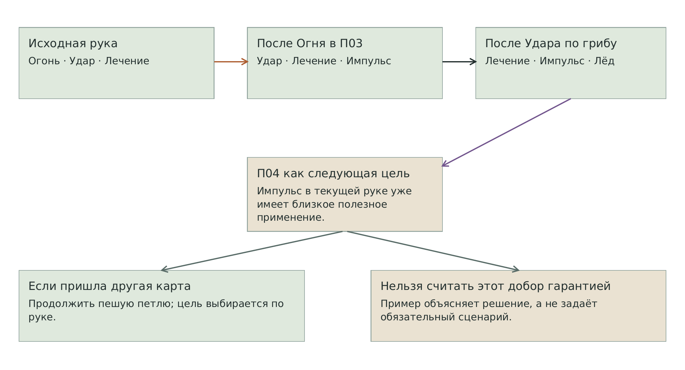

## 9.2 Огонь как подготовка будущего короткого пути

У сарая игрок видит колючки П01, просвет к ручью и находку за проходом. Он бросает Огонь, замечает обугленное состояние, проходит до воды и решает не прыгать сейчас. Затем пересекает М1, посещает развилку и арку. На обратном пути открытый срез сокращает расстояние до пасеки. Карта дала долговременное изменение маршрута внутри вылазки, хотя её не использовали как одноразовый «ключ и немедленный проход».

При ошибке броска карта расходуется, но М1 остаётся доступным. Колючки не перекрывают сарай, мост и все подходы одновременно. Если игрок сделал обычный прыжок через П02, Лёд остаётся для острова или боевого контроля.

## 9.3 Выбор между добычей и перемещением

В стартовой колоде два Огня, а на уровне три огненные задачи: П01, П03 и П12. В одной вылазке нельзя автоматически закрыть все три без покупки или другого состава. На западе игрок сравнивает гарантированную находку П03 с полезностью среза П01. Позже, зная восточную петлю, он может сохранить вторую копию для П12.

Это ограничение не блокирует карту мира: у каждой задачи остаётся пеший путь снаружи. Иначе выбор расхода превратился бы в необходимость заранее угадать последовательность препятствий.

## 9.4 Логово без Манка

Игрок останавливается у 09, видит пса и выбирает вход во двор. Три базовых Удара дают 9 урона при 8 HP цели, если все попали. Каменная стенка рядом создаёт возможность использовать Тяжёлый удар или Импульс, но дополнительный урон от столкновения не считается гарантированным. При плохом результате игрок выходит к южной обходной тропе и закрывает обзор скальным экраном.

Трофей должен падать на сухой пол. Второй агрессивный пёс не ставится на обход в первой версии, потому что он разрушил бы обещанную альтернативу бою. Случайный добор может заставить отложить охоту и вернуться к логову позже.

## 9.5 Манок и заранее подготовленная смола

До тревоги игрок создаёт смоляную зону внутри территории пса, но в стороне от своей будущей позиции. Затем Манок притягивает существо к точке звука, даже из-за пределов его территории и даже из боя. Удар по нему снимает действие Манка. Если пёс вошёл в смолу, можно поджечь её или изменить позицию, пока он замедлен.

После поджигания замедление исчезает. Нельзя описывать горящую смолу как одновременную гарантированную ловушку и огонь на 30 секунд удержания. Жертва может уйти из области; игрок должен использовать геометрию и время атак. Поджиг опасен игроку и союзному дереву. Дождь удалит пересекающуюся смоляную зону целиком.

## 9.6 Два подхода к двору тролля

С северного моста игрок видит внешний край двора и может пройти к привалу 14 за каменным экраном. Низкая переправа П11 даёт другой угол входа с каньона. Верхний путь через П07 даёт ещё один обзор и место спуска; он не считается местом, где тролль заведомо не может ответить или выйти к игроку.

Перед боем игрок может оживить отдельное дерево у привала. Дерево должно иметь навигационный путь в арену без узкой арки 08. Если игрок применяет Дождь и Молнию, мокрый союзник может передать цепь обратно. Привал и арена поэтому имеют несколько сухих разнесённых площадок для управления дистанцией.

## 9.7 Заморозка островной переправы

На 16 игрок сначала видит предмет и свободный берег острова. Точка попадания Льда относится к W03; после реакции появляется цельная проходимая поверхность с опиранием на обе стороны. Игрок проходит к 17, подбирает награду и возвращается по той же поверхности. Повторного Льда на обратный путь не требуется.

Если нужной карты нет, игрок собирает находку у причала и продолжает через М5. Водный проход не маскируется под мелкий брод. При намеренном пересечении воды без льда поведение текущего hazard проверяется отдельно: нельзя обещать, что это физически невозможно, пока такой запрет не реализован.

## 9.8 Подмена у стенки

У П18 игрок видит обычный путь вокруг восточного торца стенки и отдельный физический ящик за ней. Ящик находится в пределах 6–8 м от подготовленной позиции; для базовой Подмены запас дальности достаточен. За ящиком предусмотрена свободная площадка 3 × 3 м, не занятая травой с коллизией или декоративными бочками.

После успешного попадания игрок и ящик меняются позициями; каждый сохраняет собственную скорость. Стоящий игрок не наследует скорость заранее толкнутого куба. Если хочется именно перенести собственный разгон, используется Телепорт с сохранением скорости игрока. В обоих случаях обычный обход остаётся доступным, а неудача не закрывает дальнейшую вылазку.

## 9.9 Верёвка и оживляемое дерево

Крепление над П07 или П05 — отдельная неподвижная скальная опора либо неподвижная ветвь, которая не входит в пул оживляемых деревьев. Игроку не нужно угадывать, исчезнет ли маршрут после применения другой карты. Если для эксперимента верёвку закрепили на оживляемом дереве, действующее решение предусматривает отцепление верёвки при оживлении. Это отдельный риск комбинации, а не стандартное устройство обязательной переправы. [S05]

Верёвка на кубе движется вместе с ним и передаёт нагрузку. Для первого знакомства использовать статичную точку; физический маятник на подвижном объекте оставлять для свободных экспериментов на сухой площадке.

## 9.10 Завершение с остатками колоды

Игрок собрал намеченные находки и стоит за корнями. Пока в руке остаются обычные карты или есть добор, служебного возврата нет. Он может продолжить петлю, потратить карту на ещё один видимый тайник, вылечиться либо несколько раз сбросить неудобные руки. Только после исчерпания обычных карт появляется «Пора домой».

Для уровня это означает, что рядом с местами вероятного завершения полезны дополнительные небольшие применения карт, но не нужен бой, насильно отнимающий весь запас. Не вводить скрытый таймер, принудительное преследование или обязательное возвращение на старт, чтобы искусственно растянуть расход 12 карт.

# 10 Монстры и организация столкновений

## 10.1 Основной состав первой сборки

| Существо | Место | Текущие рабочие параметры | Роль в уровне |
| --- | --- | --- | --- |
| Мирный гриб | 03 | 2 HP, масса 0,3; не атакует | Простая необязательная охота; эмоциональный выбор |
| Гоблин-пёс | 10 | 8 HP, масса 1,5; удар 2 полусердца; обзор 15 м | Одна читаемая охота и подготовка ловушки |
| Почкующийся тролль | 13 | 24 HP, масса 12; удар 4 полусердца; обзор 18 м | Отложенная сложная цель с широким обходом |
| Враждебный куст | Ниша 15 | 6 HP, масса 2; удар 2 полусердца; обзор 9 м | Засада, которую можно заметить до входа |

Префаб пса по умолчанию агрессивный; у логова использовать сохранённое территориальное поведение, как уже делается в действующей сцене. Границы предупреждения и провокации проверять на экземпляре, а не предполагать по названию префаба. У тролля масса 12 делает базовый Импульс слабым средством прямого перемещения; не проектировать обязательное сталкивание тролля одной картой. [S08]

## 10.2 Читаемость до агрессии

Пёс виден из внешней точки до входа в зону провокации. У тролля заметен силуэт и подготовка удара; вход на арену не должен сразу ставить игрока в контактную дистанцию. Куст частично закрыт камнем, но его движение или предупреждение читается до пересечения порога ниши. Не маскировать любую обычную растительность под возможного врага: это превратит плотный лес в постоянную остановку прицела на каждом кусте.

Мирный гриб использует утверждённый испуг с белыми знаками и не получает состояние атаки. Агрессия пса использует красные знаки по утверждённому примеру. Вид сзади требуется для обычного состояния и смерти; дополнительные задние виды не добавляются автоматически. [S09]

## 10.3 Границы погони

Корни П16, сарай 05 и камни у 14 служат средствами смены видимости. Их высота должна перекрывать фактический луч зрения существа, а не только камеру игрока. Потеря обзора запускает поиск, не мгновенную забывчивость. Игроку нужен путь, по которому он успевает сменить ветку до того, как противник достигнет последней известной позиции.

Проверить маршруты погони через М1–М5, узкую ветвь и замороженную воду. Существо может пользоваться созданной Ветвью; нельзя считать её односторонним фильтром для игрока. Если NavMesh не поддерживает временную связь, это инженерная зависимость R05, которую нельзя скрывать нарисованным пунктиром.

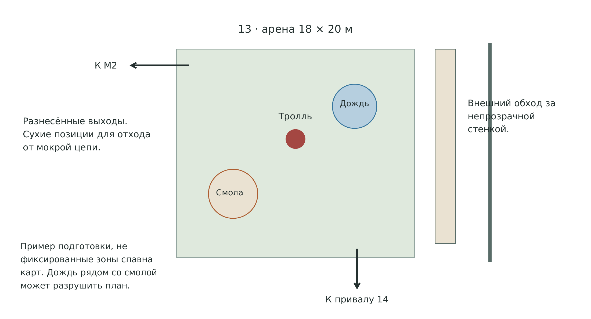

## 10.4 Расширение состава

Крыса-тыква, летающий клоун и лесной скейтер могут занять резервные сцены после утверждения собственных игровых правил и ассетов. В эту версию они не включены как обязательные противники. Слот 14 допускает будущую странную мирную встречу, верхние полки — будущую воздушную угрозу, а западная поляна — ещё один мирный вид. Замена не должна одновременно повышать опасность обеих сторон безопасного обхода.

# 11 Добыча экономика и повторные посещения

## 11.1 Размещение находок

Для блокаута предлагаются 19 видимых точек находок. Все карточные карманы получают гарантированный результат; вариативность позже может менять тип или точное положение внутри подготовленных сокетов, а не оставлять после расхода карты пустую комнату. На схеме ромбы обозначают эти места. Трофеи существ учитываются отдельно.

| Находка | Точка | Место | Условие | Базовая стоимость |
| --- | --- | --- | --- | --- |
| L01 | 02 | У повозки | Свободная стартовая находка | 20 |
| L02 | 04 | Между ульями | Пеший двор | 20 |
| L03 | 06 | У трёх надгробий | Пешая северо-западная петля | 20 |
| L04 | 07 | У родника | Пешая верхняя тропа | 20 |
| L05 | 11 | В глубине карниза | П09 или верхний переход | 40 |
| L06 | 12 | В глубине нижней полки | П08 | 40 |
| L07 | 13 | Боковая часть двора | Риск территории тролля | 40 |
| L08 | 14 | За камнем привала | Пеший внешний обход | 20 |
| L09 | 16 | На сухом входе причала | Пешая береговая петля | 20 |
| L10 | 17 | Открытая площадка острова | П14 | 40 |
| L11 | 18 | Нижняя сухая полоса | Пеший подход | 20 |
| L12 | 19 | Входная площадка моста | Пеший подход | 20 |
| L13 | 22 | Вершина гребня | П05 | 40 |
| L14 | 08 | За огненным срезом у ручья | П01 | 40 |
| L15 | 03 | Колючий карман поляны | П03 | 40 |
| L16 | 06 | Уступ над могилами | П04 | 40 |
| L17 | 18 | Береговая верхняя полка | П15 | 40 |
| L18 | 18 | Канал между плитами | П17 или пеший заход сзади | 20 |
| L19 | 15 | У берегового среза | П12 | 40 |

Предложенная сумма всех статических находок: 9 обычных по 20 и 10 редких по 40, всего 580 базовых монет. Это полное содержимое карты при доступе ко всем высотным местам, а не доход одной стартовой вылазки. Начальная колода, случайная рука и затраты на охоту ограничивают выбор целей. Торговая наценка и поражение дополнительно меняют фактический доход.

## 11.2 Трофеи и проблема награды тролля

Сохранённые трофеи: грибная шляпка 60, шкура пса 180, клык пса 120, обычная находка 20, редкая находка 40. Текущий префаб пса ссылается на шкуру; наличие ассета клыка само по себе не означает два выпадения из одного пса. Тролль сейчас ссылается на редкую находку стоимостью 40, куст — на обычную стоимостью 20. [S08]

Для предлагаемого уровня трофей тролля за 40 плохо соответствует сложности охоты на существо с 24 HP. Рабочая рекомендация — отдельный трофей около 240–280 базовых монет, первый тест с 260. Это предложение баланса; цена в игре не изменена. Пока новая награда не принята, не делать тролля обязательной частью экономического маршрута.

## 11.3 Примеры корзин

| Пример | Состав | Базовая стоимость |
| --- | --- | --- |
| Осторожный западный заход | 3 обычных + 2 редких + грибная шляпка | 200 |
| Охота и полка | Шкура пса + 2 обычных + 1 редкая | 260 |
| Береговые задачи | 2 обычных + 3 редких | 160 |
| Расширенный рискованный заход | Шкура + шляпка + 3 обычных + 2 редких | 380 |

Корзины — примеры целей, не гарантированная выдача за выбранную петлю. При случайной руке игрок может отказаться от части задач. Предметы за отдельными преградами сохраняют стоимость, но суммарная прибыль должна проверяться вместе с магазином: задача игры на 1000 накопленной выручки может завершиться раньше полного исследования локации. Это допустимо, если после цели игра продолжается свободно, как сейчас предусмотрено. [S02]

## 11.4 Повторяемость без пустоты

В первой сборке сохранить постоянные координаты главных преград и ориентиров. Небольшие варианты находок разрешены только в заранее сохранённых точках. Трупы, разрушенные заросли и созданные картами объекты сбрасываются на новую вылазку. Повторное посещение должно выигрывать от знания: игрок узнаёт сухой обход, приходит к статичному якорю, готовит ловушку заранее и выбирает более прибыльный карман.

Не поднимать плотность бесконечным респауном во время одной вылазки. Конечная колода и ограниченный набор целей должны оставаться понятными. Если участок повторно очищен, он может стать безопасной транзитной зоной внутри текущей вылазки.

# 12 Окружение и существующие ассеты

## 12.1 Художественная задача

Старая пасека читается как заброшенный, когда-то обжитой край леса. Три могилы, перекошенный сарай, улей, телега и причал дают бытовую историю без обязательного текста. Ущелье и неправильные корни создают странность форм. Палитра — приглушённые табачные, глиняные, охристые и оливковые тона; редкие тёплые световые акценты помогают ориентироваться. [S07, S09]

Окружение использует простую кривую PSX-геометрию и грубую рисованную поверхность. Монстры остаются плоскими рисованными спрайтами с собственной округлой анатомией. Не переносить угловатость скал на тела утверждённых существ. Не размножать руны, глаза и ромбы на каждом предмете ради «магичности».

## 12.2 Соответствие каталогу

| ID | Название и целевой габарит X × H × Z | Использование | Важное ограничение |
| --- | --- | --- | --- |
| TR01 | Толстое кривое; 4.2 × 6.8 × 3.8 м | Оживляемое дерево 14, рамки вида | Капсула или 2-3 box вокруг ствола; крона без коллайдера |
| TR02 | Высокое узкое; 2.6 × 8.5 × 2.8 м | Фоновые массы и рамки подходов | Капсула или 2-3 box вокруг ствола; крона без коллайдера |
| TR13 | Дерево-арка; 5.6 × 5.0 × 2.8 м | Центральная арка 08 | Арка — одно дерево, не комплект стволов и веток. Прямоугольник свободного прохода 2,2 × 2,5 м остаётся чистым на всей глубине пересечения. Две опоры могут иметь отдельные коллайдеры; нельзя закрывать проём одним общим box. |
| TR14 | Узловатый великан; 7.0 × 9.0 × 6.0 м | Ориентир корневого двора 20 | Размеры 7 × 9 × 6 м задают одиночный ориентир. Не создавать модульных корней и отдельных кусочков ствола. Основные текстурные пятна должны читаться снизу с камеры 1,6 м. |
| RK09 | Скальная стенка; 3.0 × 2.5 × 1.2 м | Скальные экраны и стены | Упрощённая замкнутая форма; у проходимых ступеней ровная коллизия |
| RK10 | Внутренний угол скалы; 3.0 × 2.5 × 3.0 м | Скальные экраны и уступы | Упрощённая замкнутая форма; у проходимых ступеней ровная коллизия |
| RK11 | Наружный угол скалы; 3.0 × 2.5 × 3.0 м | Полки, стенки и переправы | Упрощённая замкнутая форма; у проходимых ступеней ровная коллизия |
| RK12 | Верхний уступ скалы; 3.0 × 0.7 × 2.0 м | Рельеф и каменные сопряжения | Упрощённая замкнутая форма; у проходимых ступеней ровная коллизия |
| RK13 | Плоская каменная ступень; 0.8 × 0.16 × 0.65 м | Малые проходимые ступени | Упрощённая замкнутая форма; у проходимых ступеней ровная коллизия |
| RK14 | Высокая каменная ступень; 1.0 × 0.24 × 0.75 м | Малые проходимые ступени | Упрощённая замкнутая форма; у проходимых ступеней ровная коллизия |
| VG10 | Колючие заросли; 1.8 × 1.3 × 0.9 м | П01, П03, П12 | Обычно отсутствует; блокирующий куст получает отдельный простой collider |
| SP04 | Пасечный улей; 0.65 × 1.0 × 0.7 м | Ульи 04 | Разделить крышку, верхний короб, нижний короб и подставку как редактируемые части внутри будущего меша. Леток: ориентир 0,18 × 0,035 м, глубина 0,025 м; прилётная доска выступает на 0,10 м. Внутренние соты и пчёлы не входят. |
| SP05 | Малое надгробие; 0.45 × 0.65 × 0.18 м | Малое надгробие 06 | Простой физический объём отдельно от декоративного меша |
| SP06 | Среднее надгробие; 0.7 × 1.25 × 0.25 м | Среднее надгробие 06 | Простой физический объём отдельно от декоративного меша |
| SP07 | Большое надгробие; 1.1 × 1.9 × 0.4 м | Большое надгробие 06 | Простой физический объём отдельно от декоративного меша |
| SP08 | Причал; 2.4 × 1.6 × 5.0 м | Причал 16 | Начало настила — локальное (0,0,0), +Z вдоль 5-метровой длины. Верх настила локально Y=0, условная земля Y=-0,6. Общая высота 1,6 м включает сваи и тумбы. Коллизия одной ровной плитой толщиной 0,12–0,18 м; сваи отдельными box. |
| SP10 | Заколоченный сарай; 3.4 × 3.2 × 4.2 м | Закрытый сарай 05 | Дверной контур: около 0,9 × 1,9 м, вход закрыт; окно около 0,6 × 0,55 м. Стены 3,4 × 4,2 м, конёк 3,2 м, карниз ориентировочно 2,3 м. Доски двери 0,12–0,18 м шириной: три геометрических перемычки, остальные швы текстурные. |
| SP11 | Разбитая повозка; 2.1 × 1.6 × 3.6 м | Повозка 02 | Длина 3,6 м включает обломанное дышло, ширина 2,1 м — край колёс и отделившееся колесо. Кузов около 1,35 × 1,9 м, борт 0,40 м; диаметр колеса около 0,85 м. |


Forest Art Pack содержит 119 заданий на будущие ассеты и 44 листа концептов, 16 текстур земли и 21 декаль. Это не комплект готовых 119 мешей. Вода в пакете исключена; для уровня требуются отдельные authored-поверхности русел, лёд, опасные объёмы и мостовые сборки. Состояния зарослей предусмотрены в брифе, но их визуальная готовность не равна готовой коллизии и подключению к `WorldObstacle`. [S07]

## 12.3 Ограничения конкретных объектов

Сарай SP10 закрыт досками и не имеет заказанного интерьера. Точка 05 использует его наружные стороны. Улей SP04 не открывает механику сбора мёда. Повозка SP11 не предоставляет бесплатный подвижный объект для Подмены. Высокое дупло TR14 не обещает внутренней комнаты. Арка TR13 должна сохранять чистый проём 2,2 × 2,5 м; общий короб коллизии не должен закрывать проход.

Причал SP08 имеет настил 2,4 × 5 м и опору на восемь свай; входной край находится на уровне настила. Рельеф подходит к нему без вертикальной ступени 0,6 м. Не удлинять существующий причал неравномерным масштабированием до размеров озёрного моста: для М1–М5 нужны отдельные простые редактируемые сборки.

## 12.4 Плотность декора

Фоновые массы создают лесную стену и разрывают дальнюю видимость. На проходимой тропе мелкие корни и камни не должны непрерывно толкать капсулу. Декаль грязи, мха или опавшей листвы может объяснять направление, не занимая коллизию. У мест броска оставить спокойный фон, чтобы пунктир траектории и точка контакта не терялись.

Каждый крупный объект получает роль: ориентир, укрытие, рамка вида, препятствие, опора маршрута или история места. Повторы допустимы для грунта, лесных масс и опор; уникальные силуэты арки, великана, сарая и телеги распределены по разным сценам.

# 13 Свет звук читаемость и интерфейс

## 13.1 Навигация без постоянных подсказок

Направление обозначается шириной тропы, расположением корней, пятном света и силуэтом следующего ориентира. Лес не должен быть настолько тёмным, чтобы игрок не различал край опасной воды. Лёд, каменная полка и сжигаемые колючки имеют различимый материал и форму до применения карты.

Постоянные указания движения, мыши и колеса на HUD не нужны. Подсказка взаимодействия показывается только для достижимого, выбранного и незакрытого предмета. Числа П01–П18 и 01–22 — инструменты документации, а не обязательные надписи внутри игрового мира.

## 13.2 Звуковые области

Родник и узкий ручей звучат близко и локально. Северная река слышна шире и подтверждает положение ущелья за каменным экраном. У пасеки скрип дерева и сухой ветер поддерживают бытовой характер. В логове предупреждение пса предшествует атаке; у тролля тяжёлый замах и удар дают время оценить риск. Не включать одинаковый громкий речной loop во всех районах: он уничтожит пространственную информацию.

Огонь, лёд, подхват верёвки и успешное создание ветви получают чёткое подтверждение. Звук не должен обещать успешное открытие пути при фактически перекрытом коллайдере. Уничтожение зарослей и появление льда проверяются одновременно по визуалу, звуку и доступности прохода.

## 13.3 Типографика и эффекты

В игровом UI использовать утверждённые Ithaca и Pixeloid Sans как bitmap TMP с Point-фильтрацией и целочисленным масштабом. Схемы и PDF используют обычный читаемый документный шрифт; это не предложение сменить шрифт игры. Вспышки, дрожание и краткая остановка времени не должны скрывать форму уступа в момент приземления или заменять телеграф атаки.

# 14 Требования к сборке Unity

## 14.1 Сохранённая сцена

Создать отдельную редактируемую сцену блокаута, например `Assets/Expedition/Scenes/OldApiary_Blockout.unity`. Название и путь здесь — предложение, файл ещё не создан. Существующую Hakaton.unity и связку лавки сохранить. Подключение нового уровня к игровому циклу выполнить явной serialized-ссылкой после независимой проверки.

До Play в Hierarchy должны присутствовать рельеф, вода, мосты, места находок, монстры, камеры, свет, ссылки игрового мира и UI. Runtime не строит уровень заново. Повторно используемые комнаты и объекты оформляются префабами; экземпляры в сцене сохраняют связь с ними. Это относится и к серому блокауту.

## 14.2 Предлагаемая иерархия

```text
OldApiary_Blockout
  WorldReferences
  TerrainAndCliffs
  Routes
    WestLoop
    NorthLoop
    EastLoop
    LakeLoop
  Water
    Brook
    NorthRiver
    Lake
    SouthOutlet
    W01_StreamCrossing
    W02_MiddleCrossing
    W03_IslandCrossing
  Bridges
    M1 ... M5
  PointsOfInterest
    POI_01 ... POI_22
  Obstacles
    P01 ... P18
  LootSockets
    L01 ... L19
  Creatures
    Mushroom_03
    TerritorialDog_10
    Troll_13
    Bush_15
  PhysicsProps
    SwapCrate_P18
  Navigation
  AudioAndLighting
  PlayerVariant
  ExpeditionPresentation
```

Иерархия отражает ответственность, а не требует дублировать каждый объект сразу в двух ветках. Например, конкретный `WorldObstacle` может находиться внутри префаба своего POI и иметь ссылку из общего списка. Важно, чтобы дизайнер находил объект по ID и мог заменить модель без переписывания игровой логики.

## 14.3 Префабы и данные

Нужны отдельные повторно используемые сборки: статичный мост, сжигаемый проход с целым и обугленным состоянием, замерзающий водный участок, физический ящик Подмены, точка крепления Верёвки, уступ с площадкой, сокет находки, монстр с сохранёнными ссылками и звуком. В prefab Inspector доступны размеры, слои, стоимость находки, параметры опасности и ссылки эффектов.

Геометрия не создаётся в Awake/Start. Временные авторские скрипты могут помочь разложить объекты, но после сохранения сцены удаляются вместе с `.meta` и временными меню. Общий контроллер персонажа, захват ввода, stamina и обратная связь камеры остаются в существующем переиспользуемом модуле. [S10]

## 14.4 Коллизия и слои

Поверхность воды принимает попадания карт, но не держит игрока до заморозки. Лёд имеет отдельную устойчивую коллизию и достаточное перекрытие берегов. Триггер опасности не заходит на мост, сухую площадку или берег, с которого выполняется нормальный прыжок П02. Сожжённые колючки больше не блокируют проход и лучи взаимодействия.

Фоновые кроны не должны создавать невидимые стены для игрока и бросков, если их силуэт обещает просвет. Физические камни и кубы отличаются от статичных скальных стен как минимум читаемым размером и свободным окружением. Удерживающие трофей полки имеют достаточную глубину и не заканчиваются щелью, через которую предмет исчезает.

## 14.5 Навигация

Сначала проверить основной NavMesh без созданных картами путей. Обычные мосты входят в него. После этого отдельно проверять ветвь и лёд, поскольку для существ важно не только наличие Collider, но и доступная навигационная связь. Если временная навигация ещё не поддержана, зафиксировать это как зависимость; не считать автоматическое следование по любой новой платформе завершённым.

Пространство для союзного дерева проверяется в масштабе текущего префаба. Арка 2,2 × 2,5 м и узкая ветвь 1,2 м не гарантируют проход большого союзника. Для дерева есть внешние маршруты; оно не должно проталкивать игрока в воду при попытке пройти рядом.

## 14.6 Сброс вылазки

При возвращении и поражении восстанавливаются исходные предметы, монстры, заросли и вода; временные зоны, кубы, ветви, верёвки и союзники удаляются согласно текущей системе вылазки. Проверять не только первый запуск, но и переходы «поражение → лавка → вылазка» и «возврат с верёвки → лавка → вылазка».

Все исходные позиции и альтернативные сокеты сохраняются в сцене. Сброс не должен находить их через неявные глобальные поиски или собирать заново из констант в runtime.

# 15 Расхождения и зависимости реализации

| ID | Наблюдение | Значение для уровня | Что требуется |
| --- | --- | --- | --- |
| R01 | FindFocusedLoot не проверяет стену перед предметом | П17 и некоторые тайники могут подбираться через геометрию | Добавить проверку достижимости и непрозрачного препятствия; проверить все позиции камеры |
| R02 | WorldObstacle замораживается целиком; ObstacleNear выбирает первый подходящий | Одно большое тело воды откроет лишние маршруты, соседний сегмент может реагировать неожиданно | Разделить W01–W03, проверить выбор по прямому попаданию и ближнему поиску |
| R03 | Вода наносит периодический урон и подбрасывает | Игрок может попытаться пройти её ценой здоровья | Решить и проверить мягкость водного ограничения; не обещать абсолютный запрет |
| R04 | Реальные префабы монстров увеличены относительно исходных манифестов | Нарисованные ширины не доказывают проходимость | Измерить коллайдеры и агента NavMesh в текущей сцене |
| R05 | Временный Collider не равен NavMesh-переходу | Существо может не пройти по льду или ветви | Проверить создание/удаление временных связей и поиск обхода |
| R06 | Трофей тролля сейчас стоит 40 | Охота сложнее, а награда меньше, чем у пса | Проверить предложение отдельного трофея около 260 |
| R07 | Старые описания расходятся с поздними решениями по Подмене и верёвке | Можно ошибочно построить сцену на неверной скорости или неподвижном кубе | Использовать DECISIONS и текущую реализацию; синхронизация общих источников отдельной правкой |
| R08 | Гриб + Луна зависит от времени попадания второй карты | Идеальная высота 12,8 м не гарантирует прохождение | Испытать тайминг; сохранить простые альтернативы П05 |
| R09 | Награда низкого уступа может лежать в сфере подбора | Карта на подъём становится лишней | Отнести награду от кромки и проверить запас до 3,2 м плюс размеры коллайдеров |
| R10 | В Forest Art Pack отсутствуют готовые меши и вода | Нельзя считать художественный каталог собранной сценой | Отдельно создать или заменить модели, воду, мосты и материалы |

**Дополнительная особенность R11 — сложение скорости.** Импульс складывается с прыжком, а Луна уменьшает ускорение падения без уменьшения начальной скорости прыжка. Высотные значения из покоя не являются строгими ограничителями доступа. Проект принимает более сложные ранние проходы П09/П05; расчёты и условия проверки приведены в 7.22. [S06]

Из этих зависимостей не следует необходимость сейчас менять игровой код: текущая поставка фиксирует подробный проект. При реализации R01–R05 относятся к раннему этапу, потому что иначе оценка маршрутов будет измерять ошибки интеграции вместо левел-дизайна.

# 16 План проверок

## 16.1 Проверки схемы и документации

- Все 22 номера уникальны, присутствуют на общем плане и имеют паспорт.
- Все П01–П18 имеют координату, конкретную преграду, способ прохождения и альтернативу.
- Из старта по графу пеших связей достижимы 18 основных точек; остальные четыре перечислены явно.
- Пересечения обычных дорог с осевыми линиями русел приходятся на М1–М5; геометрия берегов всё равно проверяется в Unity.
- За отдельной карточной задачей есть награда или ощутимый выигрыш маршрута. Изолированная полка без награды не считается полноценной точкой интереса.
- Все расчётные высоты обозначены как рабочие; экспериментальная комбинация не выдана за воспроизводимо проверенный маршрут.

## 16.2 Приёмочные тесты блокаута

| ID | Что проверяется | Условия и действие | Ожидаемый результат |
| --- | --- | --- | --- |
| QA01 | Маршруты без карт | Пустая колода, отключённая агрессия. Обойти четыре основные петли. | Нет обязательного прыжка в воду, закрытой двери или карточного тупика. |
| QA02 | Все мосты | Пройти М1–М5 в обе стороны. Шаг, спринт, разворот на входе. | Нет урона воды, застревания на шве и незаметной ступени. |
| QA03 | Стартовые направления | Новый игрок в 01. Без подсказки выбрать путь. | Видны два понятных направления и ближайший ориентир. |
| QA04 | П01 один Огонь | Целые заросли. Попасть в читаемую блокирующую группу. | Весь нужный проём открыт, L14 доступна, М1 сохранён. |
| QA05 | П02 обычный прыжок | Без модификаторов. Перейти с шага с двух сторон. | Разрыв 1,8 м преодолим, триггер воды не цепляет нормальную траекторию. |
| QA06 | П03 награда | Использовать Огонь. Войти и подобрать находку. | Нет второго скрытого барьера; L15 гарантирована. |
| QA07 | П04 базовый Импульс | Базовая карта и обычная гравитация. Повторить подъём с подготовленной площадки. | Платформа достижима; награда не берётся снизу. |
| QA08 | П05 Поток | Один базовый Поток. Подняться и выйти в сторону. | Достигается вершина, есть устойчивый пол до конца таймера. |
| QA09 | П05 Верёвка | Базовая Верёвка на статичной опоре. Достать, подняться, спуститься. | Нижний конец доступен; возвращение не требует второй копии. |
| QA10 | Ниша после ошибки | Гриб промахнулся либо истёк. Спуститься в нишу без новой карты. | Можно пешком выйти к 09; нет обязательного мягкого тупика. |
| QA11 | Гриб и Луна | Запись времени отскока и попадания. Проверить несколько задержек эффекта. | Результат соответствует реальному таймингу; эксперимент не блокирует основной путь. |
| QA12 | П06 бюджет охоты | Пёс 8 HP, базовые Удары. Три точных попадания. | Пёс побеждён; трофей лежит на сухом доступном полу. |
| QA13 | П06 обход | Территориальный экземпляр. Пройти от 09 к М2 по внешней тропе. | Нет обязательной провокации через экран. |
| QA14 | Манок до и после тревоги | Спокойный, затем атакующий пёс. Использовать Манок в обоих состояниях. | Оба бросают своё и идут к шуму. |
| QA15 | П07 направление Ветви | Базовая Ветвь. Попасть в торец на заданной высоте. | Мост растёт к игроку, длины хватает, кромки соединяются. |
| QA16 | П07 отрицательный случай | Неверная высота или перекрытая линия. Сделать ошибочный бросок. | Результат объясним первым столкновением; нет прохода сквозь скалу. |
| QA17 | П08 отдельная награда | Один базовый Импульс. Взять L06 и вернуться без П09. | Локальная задача закончена; не нужна улучшенная карта для выхода. |
| QA18 | П09 и сложение скоростей | Сравнить базовый/улучшенный Импульс из покоя, прыжок с Импульсом, прыжок под Луной и подход П05. | Улучшение удобно из покоя; сложные прыжковые обходы записаны и приняты. Случайные ступени и пределы высоты отделены от законного сложения скорости. |
| QA19 | Тролль и обход | Тролль активен. Пройти внешний край к 14. | Обход не вынуждает принять удар и не кончается второй засадой. |
| QA20 | Выходы арены | Начат бой с троллем. Отойти через оба выхода. | Оба доступны, один удар не запирает весь коридор. |
| QA21 | Союзное дерево | Оживить дерево у 14. Дойти до арены и через основные мосты. | Есть корректный маршрут; союзник не выталкивает игрока в воду. |
| QA22 | Лёд W02 | Попасть в середину и край W02. Перейти в обе стороны. | Заморожена нужная зона, обе кромки доступны. |
| QA23 | Лёд W03 | Попасть с позиции на причале. Дойти до острова и вернуться. | Хватает одной карты; зона не исчезает до конца вылазки. |
| QA24 | Соседняя вода | Попадания у стыков сегментов. Проверить прямую и ближнюю реакцию. | Не реагирует случайный первый объект из общего списка. |
| QA25 | Вода без карты | Полное здоровье и отдельный прогон с Лечением. Попытаться пересечь П11 и П14. | Зафиксирована действительная мягкость ограничения; дизайн не полагается на несуществующий запрет. |
| QA26 | П12 срез | Сжечь заросли. Пройти туда и обратно. | Внешняя тропа сохранена; L19 доступна. |
| QA27 | П13 телеграф | Первый подход без знания сцены. Замечать и отступить до контакта. | Угроза читается до урона; основной путь к М3 свободен. |
| QA28 | П15 куб | Базовый Куб и ступень 0,5 м. Подняться на верхнюю полку. | Все прыжки соответствуют 1,2 м; куб не появляется внутри стены. |
| QA29 | П16 поиск | Спровоцировать, скрыться за корнями. Сменить левую и правую ветку. | Враг ищет последнюю позицию, оба выхода работают. |
| QA30 | П17 физика | Малый физический предмет. Попасть Притяжением в передний пол. | Предмет движется по каналу и подбирается после этого; не проходит сквозь плиту. |
| QA31 | Подбор через стены | Все подходы вокруг П17 и уступов. Проверить E и сферу фокуса. | Скрытая или недостижимая находка не выбирается через геометрию. |
| QA32 | П18 Подмена | Статичный игрок и движущийся ящик. Обменяться позициями. | Каждый сохраняет свою скорость, капсула не пересекает стену. |
| QA33 | Телепорт с инерцией | Разгон или падение перед попаданием. Перенестись на подготовленную площадку. | Скорость сохраняется; нет автоматического обнуления падения. |
| QA34 | Смола и огонь | Неподожжённая зона. Поджечь и пройти существом. | Замедление заменено уроном, горение длится по карте. |
| QA35 | Смола и дождь | Частичное пересечение зон. Поставить дождь на край смолы. | Вся пересекающаяся лужа удалена по текущему решению. |
| QA36 | Мокрая цепь | Игрок, дерево и цель мокрые. Проверить молнию на расстоянии до 4 м. | Цепь учитывает стороны одинаково; вода сама не проводит. |
| QA37 | Край подборной дистанции | Предметы П04, П08, П15. Встать во все нижние доступные позиции. | Награда не доступна при 3,2 м плюс объём сферы и коллайдера. |
| QA38 | Случайная рука | Три разные очереди стартовой колоды. Играть без подмены следующего добора. | Каждый раз есть полезный следующий пеший шаг. |
| QA39 | Возврат | Остаток карт, затем пустой запас и рука. Попытаться завершить и исчерпать обычные карты. | Служебная карта появляется только в нужном состоянии и работает в любой точке. |
| QA40 | Повторная вылазка | Сгоревшие заросли, лёд, куб, верёвка, дерево. Вернуться и начать снова. | Исходный мир восстановлен; временные объекты и зоны очищены. |
| QA41 | Поражение | Одна единица ценного товара и несколько обычных. Получить поражение. | Потери соответствуют округлению по типу; интерфейс не обещает неверные 50% стоимости. |
| QA42 | Плотность | Первый игрок, запись маршрута. Измерить тихие переходы и остановки. | Длинные пустые отрезки выявлены; ориентиры различимы без подсказок. |
| QA43 | Заменённая модель | Блок заменён на художественный меш. Повторить проходы и броски рядом. | Декор не создаёт новых невидимых перехватов карты. |
| QA44 | Edit mode и Play mode | Сохранённая сцена после закрытия редактора. Открыть, осмотреть Hierarchy, запустить. | Все ссылки, префабы и визуалы существуют до Play; сборщик не нужен. |

## 16.3 Отчёт каждого прогона

Для прогона записывать дату, версию сцены, seed добора, состав колоды, размер руки, выбранные цели, длительность активного движения, время решения задач, расходы по типам карт, промахи, сбросы, источники урона, добычу и место возврата. Для проблемы указывать ID точки или преграды, позицию, действие и ожидаемое поведение.

Разделять три результата: идея понятно читается, действие физически выполнимо и действие экономически выгодно. Удачный прыжок один раз не доказывает удобство маршрута; высокий доход не доказывает читаемость мира.

# 17 Плейтесты и настройка плотности

## 17.1 Первый цикл

Сначала один разработчик проходит всю пешую сеть без карт и боя, фиксируя вынужденные попадания в воду, застревания и невидимые препятствия. Затем отдельно проверяются карточные пути с подходящей рукой. Только после этого запускать несколько реальных случайных рук: иначе непроходимая коллизия будет ошибочно принята за плохой баланс колоды.

Для первоначального исследования поведения желательно 3–5 игроков, которые не знают карту. Это предложение процесса, не уже проведённый тест. Наблюдатель не подсказывает номер цели и не объявляет правильную карту. После первой вылазки игрок словами или наброском показывает запомненные ориентиры.

## 17.2 Метрики и рабочие пороги

| Метрика | Начальная цель | Что делать при отклонении |
| --- | --- | --- |
| Пустой отрезок активного движения | Обычно до 8–12 с | Укоротить связь, добавить видимую цель или локальный выбор; не обязательно добавлять врага |
| Интервал между читаемыми сигналами | Около 8–15 м пути | Переставить укрытие, ориентир или развилку |
| Ошибка определения типа преграды | Редкая после первого знакомства | Исправить силуэт и материал до добавления текстовой подсказки |
| Потеря маршрута | Игрок может назвать знакомый ориентир и вернуться к нему | Раскрыть окно вида на арку, сарай или мост |
| Остаток карт при прекращении осмысленных целей | Есть хотя бы две доступные альтернативы | Увеличить разнообразие задач рядом или сократить обязательный обход |
| Длительность знакомства с основными петлями | Около 20–30 мин за несколько заходов | Сначала менять длину переходов и сложность задач, затем количество точек |
| Карточный карман без результата | 0 в базовом сценарии | Проверить гарантированный сокет, падение лута и возможность подбора |

Порог 8–12 секунд не означает обязательный бой каждые 8 секунд. Подтверждение ориентирования, выбор будущей цели и осмысленный обход тоже являются событиями исследования. Если игрок всегда видит всё одновременно, добавить заслоны и порядок раскрытия, а не увеличивать расстояния между сценами.

## 17.3 Работа со случайной рукой

Проверить минимум три типа порядка: ранний Огонь с поздним Льдом; ранний Лёд с поздним Импульсом; несколько Лечений и боевых карт до карт перемещения. В каждом случае должен существовать полезный пеший следующий шаг. Не подменять этот тест выдачей специальной карты прямо перед соответствующей преградой.

Отдельно проверить руки 3, 4 и 5. Большая рука облегчает подготовку комбинаций и должна ощущаться полезной, но базовый уровень с рукой 3 не должен превращаться в обязательный массовый сброс перед каждой развилкой.

# 18 Порядок реализации и расширение

## 18.1 Этап А

Сначала собрать рельеф, главные ориентиры, все пять мостов и пешие связи. Проверить координаты и высоты, ширину проходов, воду и выходы из ниш. Разместить 19 сокетов находок и четыре базовых существа, но на первом проходе отключить их агрессию для проверки движения. Это режим авторской проверки, не новый игровой режим.

Затем подключить Огонь, Лёд и Импульс к П01–П04, П08, П11, П12, П14 и П15. Обеспечить состояние после действия и сброс. Дать каждой из этих задач корректную награду и путь назад. После этого включить поведение существ и экономическую связку.

## 18.2 Этап Б

Подключить Ветвь, Верёвку, Куб, Подмену и Телепорт к подготовленным опорам и площадкам. Проверить, что сильные карты допускают новые маршруты, а не упираются в невидимые ограничения ради сохранения старого сценария. Выход из необычного места должен быть физически понятен: широкая полка, обычная тропа, оставшаяся верёвка или доступный возврат после исчерпания руки.

Поток, Гриб, Лёгкость и Луна проверяются в вертикальном ответвлении отдельно от обязательных маршрутов. Добавлять новые высокие цели можно за гребнем или над существующим ущельем, сохраняя видимость базовых ориентиров и смысл прежних карт.

## 18.3 Этап В

Развивать подготовку охоты: Манок, смола, туман, дождь, молния, Притяжение и союзное дерево. Сначала одна понятная сцена для каждой связки, затем свободное сочетание. Дополнительный монстр заменяет или расширяет конкретную роль; он не просто появляется в последней оставшейся пустой точке.

Художественную детализацию выполнять после проверки коллизий и бюджета. При замене блока на модель повторять тесты прохода и попадания карты, потому что новая крыша, ветка или выступ могут изменить всю траекторию.

# 19 Решения допущения и открытые вопросы

## 19.1 Принятые для этой версии проектные решения

- Габарит 150 × 120 м и текущая сетка 22 точек.
- Общая география постоянна; карточные изменения сбрасываются между вылазками.
- Пять мостов образуют постоянные связи, вода даёт дополнительные задачи.
- На первом уровне четыре базовых типа существ и одна сложная отложенная охота.
- Платный по карте карман содержит гарантированную находку.
- У нижней полки есть собственная награда до второго яруса.
- Подмена получает заранее размещённый отдельный физический ящик.
- Гриб с Луной — экспериментальный путь с выходом при неудаче.

## 19.2 Решения по балансу для проверки

Сегментация льда W01–W03, размеры ледовых полос, реальная опасность прохождения воды без льда, ценность тролля, число активных находок, время трёх заходов и скорость покупки новых карт остаются рабочими предложениями. Их можно менять по тесту, сохраняя назначение каждого маршрута.

## 19.3 Вопросы следующей итерации

1. Должна ли вода оставаться преодолимой ценой здоровья, или остров обязан требовать перемещения картой?
2. Какие зоны льда становятся общим правилом игры: заранее подготовленные переходы или локальная заморозка в любой точке воды?
3. Какая ценность трофея тролля даёт желаемый интерес к охоте без обязательного фарма?
4. Должны ли существа полноценно пользоваться каждой временной ветвью и льдом уже в первом блокауте?
5. Устраивает ли временная точность Гриба с Луной, или нишу нужно опустить/цель приблизить после теста?

Эти вопросы не мешают собрать постоянную географию и основные карточные пути. Они влияют на отдельные зависимости и баланс; в документе уже указаны безопасные проектные альтернативы.

# 20 Источники и состав комплекта

## 20.1 Приоритет сведений

Последние прямые указания пользователя задают цель и объём локации. Для механик использованы актуальные локальные решения и текущие ассеты/код. Kayospace задаёт контекст, принципы и историю дизайна. При расхождении старая заметка на доске не переопределяет более позднее явное решение владельца. Числа из ассетов описывают текущий прототип и не становятся автоматически окончательным балансом.

**S01. [Kayospace Hakaton Concept Doc](kayospace://board/hakaton-f5xwo).** Фреймы: единая колода 01M6XW2BPW9RGMMMFP3FFB1JE5; открытый мир 01M6XZ499DKR5PESH91F0B27H4; подробные карты 01M6YJ35HZ67T08Y2GHGY1D69P; расширенный каталог 01M6YRCD8RA3RAES9B2MXENRDP. Сверка 09.11.2026, 768 элементов.

**S02. [Игра и вылазка](../../../hukaton/Assets/Game/README.md).** Дополнительно Assets/Expedition/README.md. Общий цикл и существующие компоненты; старое перечисление шести карт в Game README дополнено фактическим каталогом.

**S03. [Колода и определения карт](../../../hukaton/Assets/Game/Data/Cards.asset).** Decks/Domain/DeckModel.cs; Game/Data/*.asset. Сохранённые параметры имеют приоритет над значениями конструктора по умолчанию.

**S04. [Вылазка, подбор и препятствия](../../../hukaton/Assets/Expedition/Runtime/ExpeditionWorld.cs).** WorldObstacle.cs, FreezeEffect.cs, HealEffect.cs, WorldLoot.cs и Game/Data/Expedition.asset. Подбор 3,2 м; сфера 0,35 м; обнаруженное отсутствие проверки заслона.

**S05. [Новые карты и последние решения](../../../tmp/new-cards/DECISIONS.md).** Expedition/Runtime/Cards/, Runtime/CardSystems/ и Game/Data/Effects/*.asset. Подмена сохраняет собственные скорости; верёвка передаёт силы; дерево теряет старую верёвку при оживлении.

**S06. [Общий контроллер игрока](../../../hukaton/Assets/Character/Runtime/FirstPersonMotor.cs).** Character/Prefabs/FirstPersonPlayer.prefab. Нормализация импульса; реальная g=25; шаг 4; спринт 6,5; прыжок 1,2; капсула 1,8 × 0,56 м.

**S07. [Forest Art Pack V1](../../../output/forest-art-pack-v1/06-catalog-and-prompts/assets.json).** README.txt и модельные карточки. 119 будущих ассетов, 44 листа, 16 грунтовых текстур, 21 декаль. Готовые меши и вода в поставку не входили.

**S08. [Монстры и трофеи](../../../hukaton/Assets/Game/Prefabs).** Purple mushroom, Goblin dog, Budding troll, Hostile bush и Trophy *.prefab. Снимок текущих HP, масс, поведения и стоимости.

**S09. [Утверждённый стиль и состояния](../../../output/monsters/style-current.json).** Утверждённые mushroom и goblin-dog masters/approval. Также руководство по стилю Kayospace 01M700AECF87JXTFV3KXFXM3SP.

**S10. [Правила авторинга проекта](../../../AGENTS.md).** Редактируемые сцены и префабы, serialized-ссылки, общий модуль персонажа, сдержанный HUD, утверждённые шрифты.

## 20.2 Уточнения версии 1.1

Версия оформляет расширенный план 150 × 120 м и дополняет его требованиями к реализации. После проверки кода уточнены дистанция подбора, отсутствие проверки стен в текущем поиске находки, поведение глубокой воды, фактические массы и здоровье существ, награда тролля, собственная скорость Подмены, сложение прыжка с Импульсом и ограничение времени срабатывания Луны после Гриба.

Преграда П17 уточнена как низкая щель с рабочим коридором движения предмета; для низких уступов добавлено удаление награды от края. Высоты на схемах остаются проектными. В этой поставке не изменены игровые сцены, баланс карт, торговля и префабы.

## 20.3 Состав файлов

`LEVEL_DESIGN.md` — полный редактируемый текст. PDF — версия для чтения, печати и передачи. `figures/` — общий план, четыре районных плана и технические схемы в PNG и SVG. `data/level-plan.json` — координаты точек, преграды и пешие связи. `data/loot-plan.json` — предлагаемые находки. `data/card-catalog.json` — карточные сценарии. `data/source-audit.json` и `data/validation.json` — источники и выполненные проверки документации. `tools/build_pdf.py` — воспроизводимая сборка PDF из текста.

## 20.4 Краткий словарь

**Точка интереса** — место с самостоятельным назначением, которое игрок может запомнить. **Преграда** — конкретное условие, меняющее доступ или тактику. **Петля** — путь, возвращающий игрока к знакомой связи без обязательного повторения всего маршрута. **Срез** — более короткая связь, открытая действием. **Карман** — небольшое ответвление с законченным результатом. **Блокaут** — сохранённая игровая геометрия с настоящими коллизиями и ссылками, выполненная простыми формами. **Проверка схемы** — проверка данных и топологии; **проверка в Unity** — испытание реальных объектов, движения и поведения.
