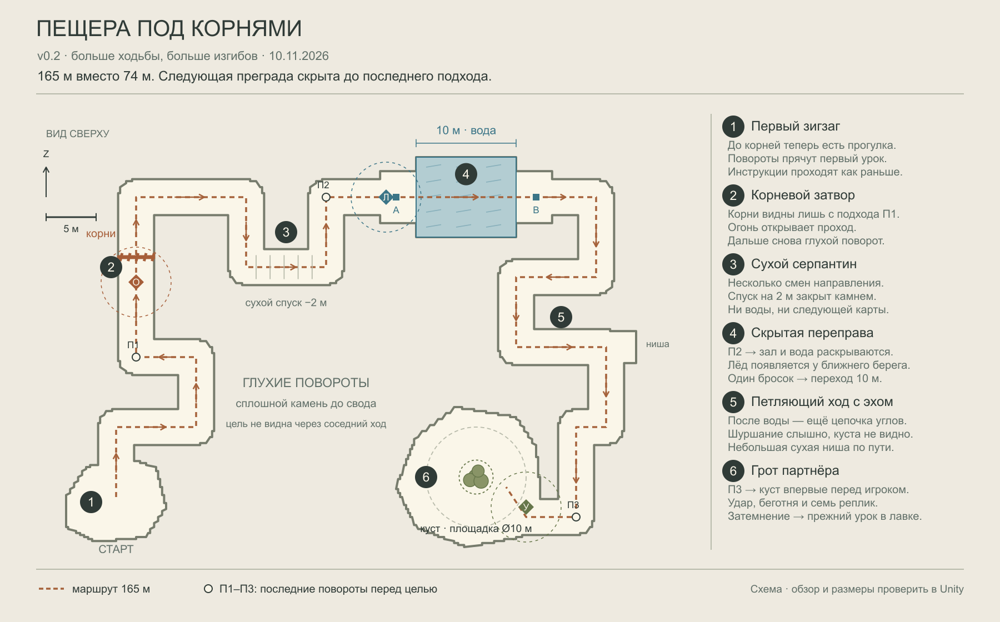
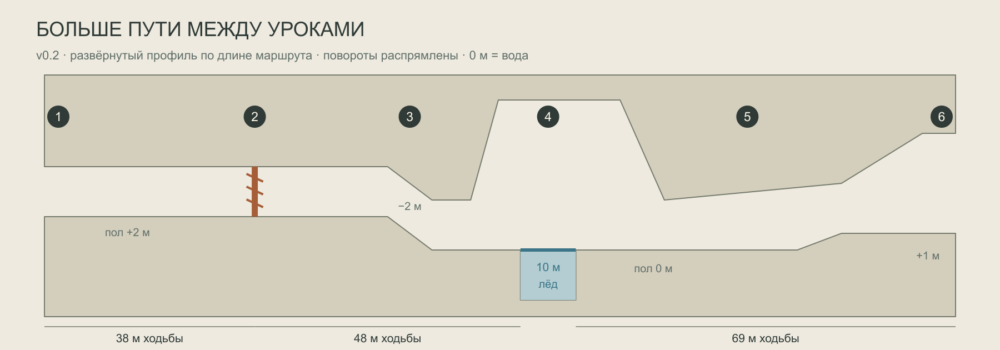

# Пещера под корнями

Схема v0.2 принята как основа концептов · 10 ноября 2026. Правка по запросу: дольше, больше изгибов, следующая преграда не видна заранее. [Открыть актуальную схему на доске Kayospace](kayospace://board/hakaton-f5xwo?element=01M72C7C06201VRA41PZN4FDPS). Новая планировка ещё не собрана в Unity; размеры требуют плейтеста.

## Что изменилось

Длина осевой линии увеличена с **73,6 до 164,6 м**. Ходы стали узкими, с чередованием левых и правых поворотов. Скала между соседними участками сплошная от пола до свода. Все три урока остаются в прежнем порядке; прибавка времени приходится на прогулку между ними.

**Раннего вида на воду с уступа больше нет.** После корней игрок ещё проходит несколько закрытых углов и сухой пандус. Зал с водой раскрывается только за последним поворотом. После переправы следует отдельный извилистый подход; куст скрыт до входа в свой грот. П1, П2 и П3 на схеме обозначают последние повороты перед целями, а не точные триггеры видимости: из-за ширины хода часть цели может открыться у самого угла.

Площадка — **64 × 43 м**, основной ход около **3,5 м** шириной. До корней — 38 м пути; от корней до ближнего края воды — 48 м; переправа — 10 м; от дальнего берега до позиции перед кустом — около 69 м. На переходах нет дополнительных заданий. Чистая ходьба по оси при условных 4 м/с занимает около 41 секунды вместо 18; реальные повороты, осмотр, броски и чтение увеличивают общее время. Итоговую длительность нужно замерить в плейтесте, прежний ориентир 3–5 минут не выдаётся за проверенный результат.

## Шесть эпизодов

| № | Пространство | Постановка |
|---|---|---|
| 1 | Пробуждение и первый зигзаг | Карман около 10 × 8 м. Инструкции уже в руке: два броска ЛКМ, затем R. За выходом несколько коротких ходов и поворотов; корней из стартового кармана не видно. Сразу можно ходить, обязательного прыжка нет. |
| 2 | Корневой затвор | Последний подход П1 направляет взгляд прямо на сухие корни. Они перекрывают весь проход до свода. Огонь появляется после инструкций на ближнем подходе. Одного прямого броска достаточно. За корнями виден следующий каменный угол, а не вода. |
| 3 | Сухой серпантин | Ход сначала уводит вправо, затем возвращает направление. Пандус длиной 8 м опускает пол с +2 до 0 м. Скала закрывает затопленный зал; видны только ближайшая стена и освещённый поворот. Нет высокого места, с которого можно заглянуть или перепрыгнуть через урок воды. |
| 4 | Скрытая переправа | П2 открывает вид на воду с расстояния около 9–10 м до её ближней кромки по осевой линии. Карта выдаётся ещё ближе, на сухом берегу. Перемычка 10 × 8 м замерзает целиком от одного попадания. Свод здесь выше — +9 м. С дальней стороны виден новый каменный поворот, а не куст. |
| 5 | Петляющий ход с эхом | После воды несколько чередующихся углов. Каждая прямая короткая; направления связаны одним читаемым маршрутом. Сухая ниша и мягкое шуршание дают маленькие поводы остановиться. Перед гротом дополнительный поворот перекрывает диагональный просвет. Пологий подъём на +1 м. |
| 6 | Грот партнёра | После П3 раскрывается куст. Удар появляется на этом подходе. Вокруг куста свободный ровный круг диаметром 10 м; декор стоит снаружи. Далее прежняя сценка: около 5 секунд беготни, семь реплик и затемнение в лавку. |

## Правило видимости

Преграду не показываем из предыдущего учебного эпизода. В финальном подходе оставляем чистую прямую траекторию для карты, чтобы игрок не был вынужден бросать за угол. Перед этим ведём через ближний свет на камне, звук капель или шуршание. Карта не должна появляться, пока герой идёт по соседнему участку за стеной.

Стены, закрывающие обзор, соединяются со сводом; низкие камни, окна и верхние щели не заменяют эту геометрию. Убрать опоры, позволяющие заглянуть сверху. Соседние ветви не соединяются случайными просветами и не образуют сокращений. Направления меняются, но развилки и поиск правильного пути не вводятся.

Актуальное направление пещеры: крупные неровные PSX-плоскости, холодный сланец и приглушённый серо-фиолетовый камень, умеренные грубые рисованные текстуры. Углы лишь чуть притуплены. Детали — различимые предметы и их группы, а не равномерный шум и реалистичная геология. Локальные тёплые свечи и фонари чередуются с глубокой темнотой. В водном зале и гроте куста есть холодный синий свет через щель в потолке; в кадре воды явно виден godray и освещённая рябь. Это последняя правка пользователя, заменяющая раннюю тёплую палитру пещеры.

[Утверждённый визуальный эталон](../../../output/tutorial-cave-cold-approval-v4/04-textures-lights-refined.png), [актуальный лист из 10 ракурсов](../../../output/tutorial-cave-concept-v2/index.html) и [правила стиля](../../../output/tutorial-cave-concept-v2/style-current.json). Кадр 09 дословно сохраняет утверждённое изображение; остальные виды — созданные по нему концепты. План задаёт размеры и маршрут, изображения — художественную постановку. Цифры, линии и зоны на схеме относятся к рабочей разметке дизайнера, не к игровому UI.

## Что сохраняется из туториала

- Строгий порядок трёх инструкций; движение доступно сразу. Огонь только после инструкций и подхода к корням.
- Затем Огонь → Лёд → Удар; полученные заклинания восстанавливаются, R сохраняет уже выданный набор, «Пора домой» в пещере не появляется.
- Обязательные корни и воду нельзя обойти или перепрыгнуть. Одна точная карта открывает каждую преграду.
- Гоблин обычный, без образа карточника; его нельзя убить. Попадания не продлевают беготню. Семь реплик, фиксация взгляда и управление через E сохраняются.
- Пещера не выдаёт товары: шляпка и клык поступают из старых запасов гоблина уже в лавке. Далее остаются две реальные учебные продажи, остановленный таймер, финальный пуфф и самостоятельное исследование подсобки.
- При выходе из игры пещера начинается заново; возврат из воды внутри сеанса сохраняет прогресс. Сохранение начинается в лавке.

## Сверка с текущим проектом

Прочитаны `docs/tutorial/TUTORIAL.md` и `REFERENCE.md`, все runtime-файлы `Assets/Tutorial`, тесты `PrologueTests`, связанные участки игрового цикла, колоды, бросков, препятствий и движения, а также сохранённая сцена и префаб игрока. На доске изучены все 12 блоков фрейма «Туториал · согласовано · 09.11.2026», связанные правила карт, мира и художественного направления. Снимок договорённостей и параметры старой сцены сохранены в `source-audit.json`.

`REFERENCE.md` описывает более ранний прототип. Его утверждения, что обучение ещё отсутствует и новая игра начинается в лавке с 15 картами, уже не отражают действующий `CaveTutorial` и `GameLoop`; они не использованы как требования нового уровня. Свободные последующие вылазки также отделены от постановочного пролога.

Сейчас пещера в `Hakaton.unity` — прямой коридор длиной около 62 м и шириной 5 м, корни на локальном x=14, вода x=30…38, куст x=55,5. Новая схема меняет его пространственную форму, сохраняя уроки.

| Особенность реализации | Что учесть при сборке этой схемы |
|---|---|
| `CaveTutorial.Near` проверяет только расстояние в XZ; радиус 3,5 м. `Stage` переходит дальше при выдаче карты, а не по пересечению преграды. | Маркеры стоят на финальных подходах. Извилистые соседние ходы особенно требуют проверки выдачи через стены. Для устойчивой проверки добавить явное условие «корни пройдены» перед Льдом и «дальний берег достигнут» перед Ударом. Высота и стена сами по себе не защищают от ранней выдачи. |
| `ExpeditionWorld.BackToShore` использует один фиксированный `prologueShore`. | Два маркера A/B на плане — проектное требование. Выбирать ближайшую безопасную точку, корректно учитывать сторону падения и сохранять этап. Эта логика ещё не реализована. |
| `WorldObstacle.Freeze` отключает весь водный `barrier` и поверхность и включает заранее подготовленный `changed`. | В схеме замораживается вся перемычка 10 × 8 м. Нельзя просто нарисовать узкую ледяную полоску и оставить по бокам визуальную воду с уже отключённым триггером. |
| Беготня и остановка гоблина задаются по окружности и прямой линии, без обхода декора. | Пол грота ровный; вокруг куста свободен круг диаметром 10 м. Декор вне траектории. Проверить остановку с разных доступных позиций игрока и попадания во время беготни. |
| `CaveTutorial.geometry`, start, zones и ссылки на препятствия уже сериализованы. | При будущей сборке сохранить редактируемую сцену и prefab-сборки. Этот пакет — схема, а не импортированная Unity-сцена. |

## Проверка будущего блок-аута

1. Пройти 165-метровый маршрут с базовым игроком: инструкции, три прямых броска, переправа, сценка. Ни одно действие не требует прыжка, подкрутки или посещения ниши.
2. Проверить корни и воду на обход вдоль стен, разгон с прыжком, опоры из декора и срез с уступа. Длина воды 10 м — стартовый размер, проходимость прыжком не считается проверенной по рисунку.
3. На каждом повороте проверить обзор с середины хода, вдоль обеих стен и в прыжке. Корни не видны из начала, вода — от корней и сухого спуска, куст — с переправы и среднего хода. Полноразмерная цель раскрывается только на последнем подходе. Затем проверить ранний подход с инструкциями и вход в радиусы через ближайшую стену: будущие карты не выдаются заранее.
4. Упасть с обоих берегов до заморозки: ближайший безопасный возврат, тот же прогресс, без застревания в повторном падении. После заморозки вся поверхность проходима.
5. Обойти куст с доступных сторон, попасть всеми тремя картами, несколько раз ударить во время беготни. Только одна сценка; гоблин не пересекает стены и игрока при остановке.
6. Проверить семь реплик, владение вводом, затемнение и начало учебной торговли. E не выполняет одновременно действие мира.

В рамках этой правки Unity Edit/Play mode не запускались. Проверяются геометрия плана, непрерывность маршрута, отсутствие обхода корней и воды и перекрытие линий обзора в XZ. Проверка плана не заменяет обзор от реальной камеры и прыжки в Unity. Итоговый отчёт — `verification.json`. Предыдущая схема v0.1 сохранена в `revisions/v0.1/`.

## Источники

- [Согласованный туториал на доске](kayospace://board/hakaton-f5xwo?element=01M70J1NDR3HNBK0PJHZ6GVH09).
- [Сценарий туториала](../../tutorial/TUTORIAL.md), [историческая справка](../../tutorial/REFERENCE.md).
- [Описание реализации](../../../hukaton/Assets/Tutorial/README.md), [CaveTutorial](../../../hukaton/Assets/Tutorial/Runtime/Cave/CaveTutorial.cs), [ShopTutorial](../../../hukaton/Assets/Tutorial/Runtime/ShopTutorial.cs).
- [ExpeditionWorld](../../../hukaton/Assets/Expedition/Runtime/ExpeditionWorld.cs), [WorldObstacle](../../../hukaton/Assets/Expedition/Runtime/WorldObstacle.cs), [GameLoop](../../../hukaton/Assets/Game/Runtime/GameLoop.cs).
- [Сохранённая сцена](../../../hukaton/Assets/Game/Scenes/Hakaton.unity), [layout.json](layout.json), [снимок источников](source-audit.json).
