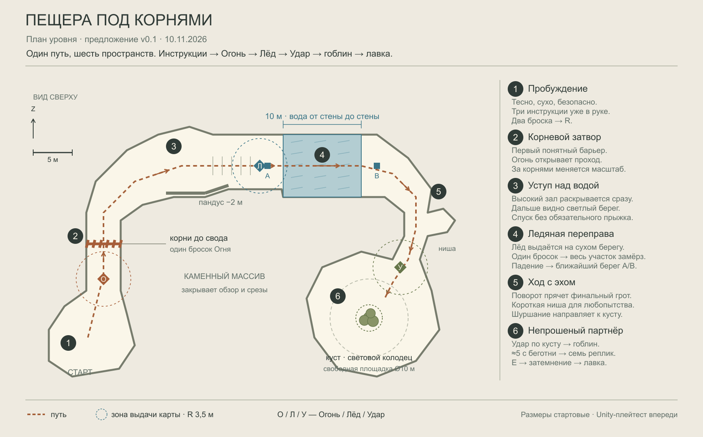
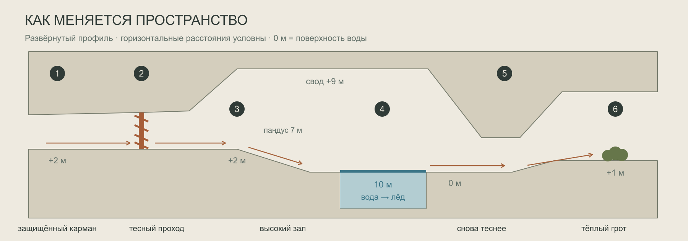

# Пещера под корнями

Предложение v0.1 · 10 ноября 2026. Схема для обсуждения и последующего блок-аута. Новая планировка ещё не утверждена и не собрана в Unity. [Открыть схему на доске Kayospace](kayospace://board/hakaton-f5xwo?element=01M72C7C06201VRA41PZN4FDPS).

## Замысел

Один извилистый путь проходит через шесть разных по ощущению пространств: защищённый карман пробуждения → тесный корневой затвор → высокий зал с обзорного уступа → ледяная переправа → тихий ход с эхом → обжитой грот гоблина. Интерес создают смена масштаба, высоты, света и видимости следующей цели. Порядок обучения остаётся согласованным. Боковая ниша даёт короткую паузу для любопытства, но не превращается в развилку.

Главный пространственный момент — раскрытие затопленного зала после сожжённых корней. Игрок сначала видит воду сверху, затем подходит к ней и сам меняет знакомое пространство картой. Второй момент — переход от холодного камня к единственному кусту в тёплом пятне света: после серьёзного открытия переправы следует комическая встреча.

Ориентир первого прохождения — **3–5 минут**, включая инструкции, промахи и чтение; это проектная цель, не результат замера. Площадка около **58 × 38 м**, длина осевой линии маршрута — **73,6 м**. Точный маршрут и размеры хранятся в `layout.json`; размеры уточняются плейтестом.

## Шесть эпизодов

| № | Пространство | Что происходит и зачем |
|---|---|---|
| 1 | Карман пробуждения, около 10 × 8 м, пол +2 м | Каменный тупик за спиной, впереди светлая трещина. В руке сразу три инструкции. Первые две выбрасываются ЛКМ, третья — R. Неровный край пола и камни позволяют освоить обзор и движение; обязательного прыжка и проверки каждого движения нет. Целиться в специальную мишень не требуется. |
| 2 | Корневой затвор, ширина 4,4 м | Путь слегка изгибается и сужается. Корни перекрывают проход от пола до свода. Светлые сухие волокна выделяются на тёмном камне. Огонь выдаётся после инструкций и при подходе; одного прямого попадания достаточно. После сгорания за проёмом впервые появляется перспектива большого зала. |
| 3 | Уступ над водой, около 10 × 7 м, пол +2 м | Свод поднимается до отметки +9 м. Видны затопленная перемычка и светлый дальний берег, но не гоблин. Широкий пандус длиной 7 м спускается на 2 м к воде. Со стороны центрального массива край закрывает каменная спина высотой от 2,5 м; взгляд вперёд вдоль пандуса остаётся открыт. Уступ заканчивается за 10 м до ближнего края воды, поэтому высокой стартовой точки прямо над переправой нет. |
| 4 | Затопленный разлом, 10 × 8 м, поверхность воды 0 м | Вода от стены до стены, берега без выступов для прыжка. Лёд появляется на сухом подходе и выбирается автоматически; здесь же работает согласованная подсказка колеса. Одно попадание замораживает всю учебную перемычку, формируя широкую безопасную переправу. Ошибка возвращает на ближайший безопасный берег A/B без потерь. |
| 5 | Ход с эхом, ширина от 3 м | Два поворота прячут грот и разводят зоны выдачи карт. После большого зала снова теснее и тише. Сухая ниша глубиной около 2 м содержит только следы обжитости — потёртый камень, смятый мешок. Она просматривается с входа и возвращает в тот же ход; награда, подбор и новое обучение отсутствуют. Из грота слышно ненавязчивое шуршание. |
| 6 | Грот партнёра, около 16 × 14 м, пол +1 м | Пологий подъём выводит к кусту под недоступной трещиной в своде. Удар выдаётся при входе, куст виден прямым броском. Вокруг него ровный свободный круг диаметром 10 м для беготни и остановки гоблина. Только Удар запускает сценку; Огонь и Лёд дают прежний отклик. Гоблин бегает около 5 секунд, затем семь утверждённых реплик. Последняя + E → затемнение → лавка. Световой колодец не является дополнительным выходом. |

## Навигация и постановка

В каждом эпизоде видна одна ближайшая цель. Начало не показывает воду и куст одновременно. За корнями открывается зал; дальний берег привлекает светом. После воды поворот скрывает финальную площадку до подхода. Все три обязательные цели доступны прямым броском без подкрутки. Нет дополнительных карт, противников, добычи, ключей, таймера или повторного испытания перед лавкой.

Камень имеет крупные неровные плоскости, приглушённые табачные и серо-оливковые тона, грубую рисованную фактуру. Корни сухие охристые; вода холоднее, но без неонового свечения. В гроте — небольшое тёплое пятно света, куст и несколько простых следов быта. Пространство поддерживает PSX / CARIMARA-направление проекта. Цифры, стрелки, цветные зоны и размеры на схеме — рабочая разметка дизайнера, не игровой UI.

## Что сохраняется из туториала

- Строгий порядок трёх инструкций; движение доступно сразу. Огонь только после инструкций и подхода к корням.
- Затем Огонь → Лёд → Удар; полученные заклинания восстанавливаются, R сохраняет уже выданный набор, «Пора домой» в пещере не появляется.
- Обязательные корни и воду нельзя обойти или перепрыгнуть. Одна точная карта открывает каждую преграду.
- Гоблин обычный, без образа карточника; его нельзя убить. Попадания не продлевают беготню. Семь реплик, фиксация взгляда и управление через E сохраняются.
- Пещера не выдаёт товары: шляпка и клык поступают из старых запасов гоблина уже в лавке. Далее остаются две реальные учебные продажи, остановленный таймер, финальный пуфф и самостоятельное исследование подсобки.
- При выходе из игры пещера начинается заново; возврат из воды внутри сеанса сохраняет прогресс. Сохранение начинается в лавке.

## Сверка с текущим проектом

Прочитаны `docs/tutorial/TUTORIAL.md` и `REFERENCE.md`, все runtime-файлы `Assets/Tutorial`, тесты `PrologueTests`, связанные участки игрового цикла, колоды, бросков, препятствий и движения, а также сохранённая сцена и префаб игрока. На доске изучены все 12 блоков фрейма «Туториал · согласовано · 09.11.2026», связанные правила карт, мира и художественного направления. Снимок договорённостей и параметры старой сцены сохранены в `source-audit.json`.

`REFERENCE.md` описывает более ранний прототип. Его утверждения, что обучение ещё отсутствует и новая игра начинается в лавке с 15 картами, уже не отражают действующий `CaveTutorial` и `GameLoop`; они не использованы как требования нового уровня. Свободные последующие вылазки также отделены от постановочного пролога.

Сейчас пещера в `Hakaton.unity` — прямой коридор длиной около 62 м и шириной 5 м, корни на локальном x=14, вода x=30…38, куст x=55,5. Новая схема меняет его пространственную форму, сохраняя уроки.

| Особенность реализации | Что учесть при сборке этой схемы |
|---|---|
| `CaveTutorial.Near` проверяет только расстояние в XZ; радиус 3,5 м. `Stage` переходит дальше при выдаче карты, а не по пересечению преграды. | Маркеры разведены пространственно. Для устойчивой проверки добавить явное условие «корни пройдены» перед Льдом и «дальний берег достигнут» перед Ударом. Высота и стена сами по себе не защищают от ранней выдачи. |
| `ExpeditionWorld.BackToShore` использует один фиксированный `prologueShore`. | Два маркера A/B на плане — проектное требование. Выбирать ближайшую безопасную точку, корректно учитывать сторону падения и сохранять этап. Эта логика ещё не реализована. |
| `WorldObstacle.Freeze` отключает весь водный `barrier` и поверхность и включает заранее подготовленный `changed`. | В схеме замораживается вся перемычка 10 × 8 м. Нельзя просто нарисовать узкую ледяную полоску и оставить по бокам визуальную воду с уже отключённым триггером. |
| Беготня и остановка гоблина задаются по окружности и прямой линии, без обхода декора. | Пол грота ровный; вокруг куста свободен круг диаметром 10 м. Декор вне траектории. Проверить остановку с разных доступных позиций игрока и попадания во время беготни. |
| `CaveTutorial.geometry`, start, zones и ссылки на препятствия уже сериализованы. | При будущей сборке сохранить редактируемую сцену и prefab-сборки. Этот пакет — схема, а не импортированная Unity-сцена. |

## Проверка будущего блок-аута

1. Пройти маршрут с базовым игроком: инструкции, три прямых броска, переправа, сценка. Ни одно действие не требует прыжка, подкрутки или посещения ниши.
2. Проверить корни и воду на обход вдоль стен, разгон с прыжком, опоры из декора и срез с уступа. Длина воды 10 м — стартовый размер, проходимость прыжком не считается проверенной по рисунку.
3. Проверить ранний подход с инструкциями, броски издалека и вход в радиусы через ближайшую стену. Будущие карты не выдаются заранее.
4. Упасть с обоих берегов до заморозки: ближайший безопасный возврат, тот же прогресс, без застревания в повторном падении. После заморозки вся поверхность проходима.
5. Обойти куст с доступных сторон, попасть всеми тремя картами, несколько раз ударить во время беготни. Только одна сценка; гоблин не пересекает стены и игрока при остановке.
6. Проверить семь реплик, владение вводом, затемнение и начало учебной торговли. E не выполняет одновременно действие мира.

В рамках подготовки схемы Unity Edit/Play mode и игровые тесты не запускались. Проверены согласованность данных, SVG/PNG и размещение фрейма на доске; оба загруженных изображения повторно получены через get_image. Все 837 исходных элементов доски сохранились без изменений. На сетке плана 0,25 м маршрут связен после открытия преград; каждая из двух закрытых преград разрывает его. Это проверка топологии рисунка, а не прыжков и коллизий в игре. Отчёт — `verification.json`.

## Источники

- [Согласованный туториал на доске](kayospace://board/hakaton-f5xwo?element=01M70J1NDR3HNBK0PJHZ6GVH09).
- [Сценарий туториала](../../tutorial/TUTORIAL.md), [историческая справка](../../tutorial/REFERENCE.md).
- [Описание реализации](../../../hukaton/Assets/Tutorial/README.md), [CaveTutorial](../../../hukaton/Assets/Tutorial/Runtime/Cave/CaveTutorial.cs), [ShopTutorial](../../../hukaton/Assets/Tutorial/Runtime/ShopTutorial.cs).
- [ExpeditionWorld](../../../hukaton/Assets/Expedition/Runtime/ExpeditionWorld.cs), [WorldObstacle](../../../hukaton/Assets/Expedition/Runtime/WorldObstacle.cs), [GameLoop](../../../hukaton/Assets/Game/Runtime/GameLoop.cs).
- [Сохранённая сцена](../../../hukaton/Assets/Game/Scenes/Hakaton.unity), [layout.json](layout.json), [снимок источников](source-audit.json).
