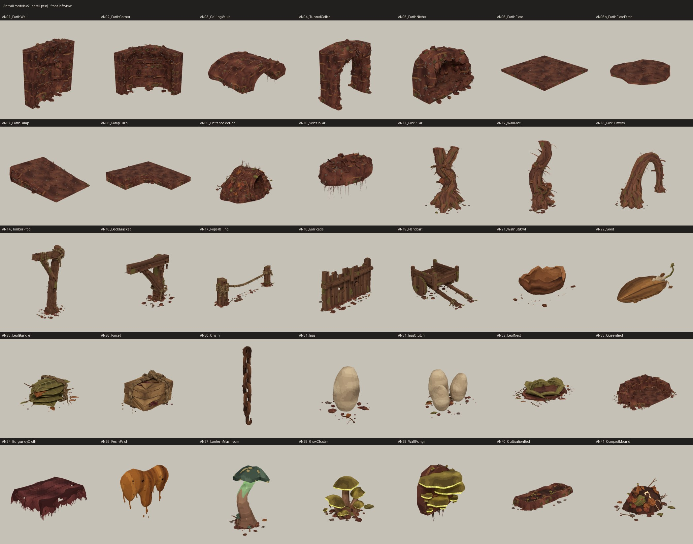

# Муравейник — модели v2 (проход по деталям)

16.11.2026. 33 ассета из концепт-пакета `environment-pack-v3` смоделированы в Blender (35 FBX). v2: после замечания «детали обязательно, как можно больше» на всех моделях добавлены мелкие детали — камешки, комья, трещины, корешки, норки, натёки, щепки, гвозди, скобы, обмотки, бахрома, грибы-детки, мусор у оснований. **Статус: ждут одобрения.** В Unity пока ничего не импортировано.

В каждой папке: FBX, `.blend`, `card.jpg` (сверху концепт, снизу модель с тех же 4 ракурсов + крупные планы), `manifest.json` (размер, треугольники, твёрдость, коллайдер, стыки), `build.py`.
`assembly-test.png` — проверка стыковки модулей оболочки (угол + стены + проход + ниша + пол + пандус); стыки после деталей побитово те же.

## Переиспользуем готовое (не моделили)
| Концепт | Готовая модель |
|---|---|
| 15 Секция настила | ST10 Boardwalk (кронштейн 16 подогнан под него) |
| 20 Деревянный закром | PR14 CrateOpen |
| 24 Мешок | PR11 SackSmall / PR12 SackLarge |
| 25 Закрытый ящик | PR13 CrateClosed / PR17 CrateBound |
| 27 Глиняная банка | PR09 PotLow |
| 28 Фонарь | PR01 LanternHanging / PR02 LanternGround |
| 29 Крепление фонаря | PR03 LanternBracket |
| 36 Островок листвы | декали D10–D12 |

## Соглашения
- 1 единица = 1 м, Z вверх в Blender (Y в Unity), перед смотрит в −Y. Pivot — низ по центру; у висящих (цепь, смола, пристенные грибы и корень) — точка крепления.
- Общие материалы на весь муравейник: Earth, Floor, Root, Wood, Cloth, Props (атлас + маска свечения). Текстуры и кит — в `_kit/`.
- Модули оболочки стыкуются по сетке 4 м: толщина стены 0,8 м, верх 4 м; проход 2,64 × 3,2 м. Детали не пересекают плоскости стыков; на дорожках только плоские крошки (≤ 6 см).
- Светятся только грибы (низ шляпок, верх ножки высокого гриба, прожилки субстрата, грибы-детки).
- Корневая арка 13: свободный проход 2,1 м шириной при высоте 2,4 м.

## Список
| № | Ассет | FBX | Треуг. | X × Y × Z, м |
|---|---|---|---|---|
| 01 | Земляная стена | `SM_AN01_EarthWall.fbx` | 11693 | 4.0 × 1.61 × 4.34 |
| 02 | Земляной угол | `SM_AN02_EarthCorner.fbx` | 14250 | 4.75 × 4.75 × 4.49 |
| 03 | Свод потолка | `SM_AN03_CeilingVault.fbx` | 12471 | 5.51 × 4.0 × 2.5 |
| 04 | Обрамление прохода | `SM_AN04_TunnelCollar.fbx` | 13295 | 4.0 × 2.53 × 4.42 |
| 05 | Ниша с полкой | `SM_AN05_EarthNiche.fbx` | 9574 | 3.19 × 1.87 × 2.66 |
| 06 | Земляной пол | `SM_AN06_EarthFloor.fbx` | 4878 | 4.0 × 4.0 × 0.2 |
| 06 | Земляной пол | `SM_AN06b_EarthFloorPatch.fbx` | 3922 | 3.94 × 3.89 × 0.17 |
| 07 | Прямой пандус | `SM_AN07_EarthRamp.fbx` | 6280 | 3.38 × 4.0 × 1.01 |
| 08 | Поворот пандуса | `SM_AN08_RampTurn.fbx` | 9803 | 6.1 × 6.09 × 1.01 |
| 09 | Вход-куча | `SM_AN09_EntranceMound.fbx` | 10220 | 10.82 × 7.85 × 5.44 |
| 10 | Обрамление световой щели | `SM_AN10_VentCollar.fbx` | 12448 | 4.09 × 2.72 × 2.44 |
| 11 | Корневой столб | `SM_AN11_RootPillar.fbx` | 4549 | 3.24 × 3.36 × 5.02 |
| 12 | Пристенный корень | `SM_AN12_WallRoot.fbx` | 2970 | 2.17 × 1.71 × 4.04 |
| 13 | Корневая арка | `SM_AN13_RootButtress.fbx` | 5207 | 6.53 × 3.49 × 4.89 |
| 14 | Деревянная подпорка | `SM_AN14_TimberProp.fbx` | 5007 | 1.86 × 1.0 × 3.05 |
| 16 | Кронштейн настила | `SM_AN16_DeckBracket.fbx` | 3343 | 1.92 × 0.84 × 1.52 |
| 17 | Верёвочное ограждение | `SM_AN17_RopeRailing.fbx` | 4741 | 3.36 × 0.68 × 1.07 |
| 18 | Дощатое укрытие | `SM_AN18_Barricade.fbx` | 7773 | 2.76 × 1.18 × 1.49 |
| 19 | Тележка | `SM_AN19_Handcart.fbx` | 6837 | 1.89 × 2.62 × 1.2 |
| 21 | Чаша из скорлупы | `SM_AN21_WalnutBowl.fbx` | 2656 | 2.03 × 1.38 × 0.7 |
| 22 | Крупное семя | `SM_AN22_Seed.fbx` | 993 | 0.59 × 0.33 × 0.25 |
| 23 | Связка листьев | `SM_AN23_LeafBundle.fbx` | 3461 | 1.62 × 1.26 × 0.59 |
| 26 | Свёрток | `SM_AN26_Parcel.fbx` | 2828 | 0.68 × 0.51 × 0.38 |
| 30 | Цепь | `SM_AN30_Chain.fbx` | 1652 | 0.17 × 0.14 × 1.22 |
| 31 | Яйцо | `SM_AN31_Egg.fbx` | 1148 | 0.69 × 0.81 × 0.66 |
| 31 | Яйцо | `SM_AN31_EggClutch.fbx` | 2588 | 1.11 × 0.95 × 0.67 |
| 32 | Листовая подстилка | `SM_AN32_LeafNest.fbx` | 4034 | 2.64 × 2.18 × 0.45 |
| 33 | Ложе Матки | `SM_AN33_QueenBed.fbx` | 11831 | 8.23 × 6.29 × 1.86 |
| 34 | Бордовая ткань | `SM_AN34_BurgundyCloth.fbx` | 5044 | 2.14 × 1.63 × 0.56 |
| 35 | Наплыв смолы | `SM_AN35_ResinPatch.fbx` | 1588 | 1.19 × 0.17 × 1.09 |
| 37 | Высокий светящийся гриб | `SM_AN37_LanternMushroom.fbx` | 2444 | 1.82 × 1.75 × 2.58 |
| 38 | Колония светящихся грибов | `SM_AN38_GlowCluster.fbx` | 2817 | 1.34 × 1.24 × 0.81 |
| 39 | Пристенные грибы | `SM_AN39_WallFungi.fbx` | 1812 | 0.98 × 0.63 × 1.14 |
| 40 | Грядка | `SM_AN40_CultivationBed.fbx` | 4899 | 4.79 × 2.46 × 0.5 |
| 41 | Запас субстрата | `SM_AN41_CompostMound.fbx` | 3534 | 1.99 × 1.87 × 0.88 |
