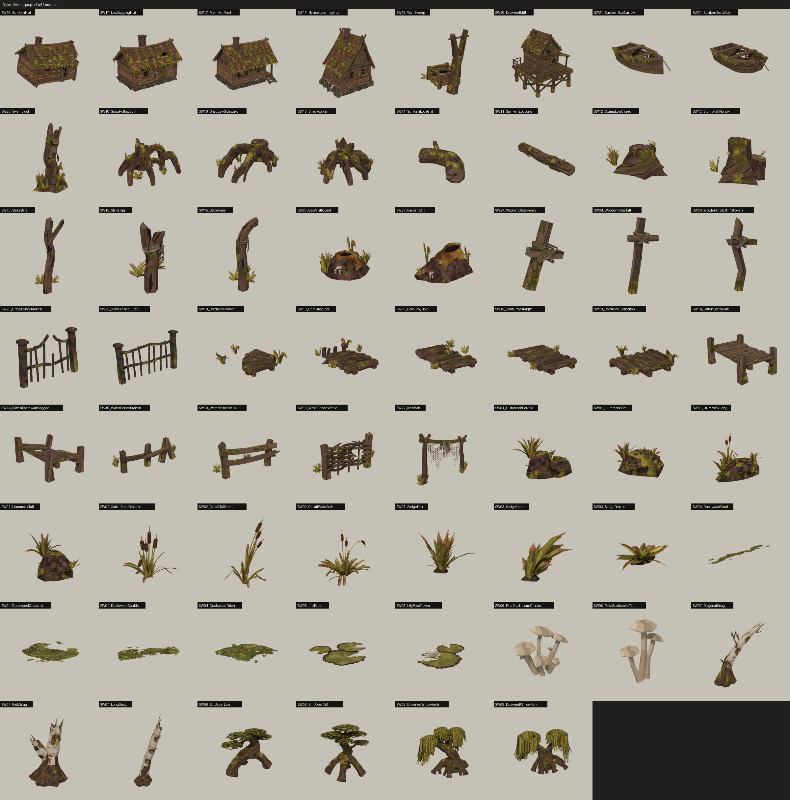

# Гнилая топь — модели и пропсы v1

13.11.2026. Отдельные модели и пропсы биома по концепт-пакету `concept-pack-v1` (26 позиций таблицы KayoSpace, 65 FBX). Части ландшафта (ил, торф, болотная вода, трясина, смоляная лужа, кромка окна трясины) не делались. Статус: смоделировано в Blender, ждёт одобрения пользователя; материалы, префабы и коллайдеры в Unity — после одобрения.

## Где что лежит

- Unity: `hukaton/Assets/SwampArt/Models/<Группа>/SM_SWNN_*.fbx` и общие текстуры `hukaton/Assets/SwampArt/Textures/T_Swamp_*.png` (point, без сжатия, как ForestArt).
- Здесь: по папке на позицию — FBX, `.blend` со всеми вариантами, `card.jpg` (концепт сверху, модель снизу), `manifest.json` (размеры, треугольники, линия воды, твёрдость, горит ли, коллайдеры, подвижные части и pivot), `build.py` (исходник сборки).
- `_kit/` — общий набор: `textures.py` (рисует все текстуры топи), `sk.py` (хелперы Blender), `README.md` (правила стиля для моделирования).

## Соглашения

- 1 единица = 1 м, Z вверх в Blender (Y в Unity), перед смотрит в −Y Blender. Pivot — низ по центру (у гати и мостков — центр входного стыка, у заборов — левый стык).
- В каждом FBX по объекту на материал: `SWNNx_Bark`, `_BarkMossy`, `_Birch`, `_Planks`, `_LogWall`, `_Roof`, `_Mud`, `_Peat`, `_Stone`, `_Moss`, `_Props`, `_Plants`. Материалы общие, как у леса.
- `Plants` — альфа-вырез, двусторонний; ветер во втором UV (`Wind`, 1000 + метры), как `ForestWindLit`.
- Подвижные части отдельными FBX: колесо мельницы (`SM_SW20_DrownedMillWheel`, pivot на оси), журавль колодца (`SM_SW18_WellSweepLever`, pivot на оси) и ведро (`SM_SW18_WellSweepBucket`). Точки крепления — в manifest.
- Гать: сетка 4 × 4 м, ширина стыка 2,25 м, верх настила z 0,45, вода 0,30; схема стыков в `SW13-corduroy-road/manifest.json`.

## Список

| Позиция | FBX | Треугольники | Размер X × Y × Z, м |
|---|---|---|---|
| SW01-hummocks | SM_SW01_HummockTall.fbx | 618 | 1.64 × 1.304 × 1.313 |
| SW01-hummocks | SM_SW01_HummockLong.fbx | 968 | 1.877 × 1.194 × 1.426 |
| SW01-hummocks | SM_SW01_HummockDouble.fbx | 778 | 1.88 × 1.505 × 1.242 |
| SW01-hummocks | SM_SW01_HummockFlat.fbx | 792 | 1.841 × 1.769 × 0.936 |
| SW02-cattails | SM_SW02_CattailTallLean.fbx | 612 | 1.017 × 0.936 × 1.709 |
| SW02-cattails | SM_SW02_CattailShortBroken.fbx | 817 | 1.045 × 1.042 × 1.212 |
| SW02-cattails | SM_SW02_CattailWideArch.fbx | 1088 | 1.941 × 1.602 × 1.791 |
| SW03-sedge | SM_SW03_SedgeFan.fbx | 327 | 0.767 × 0.805 × 0.637 |
| SW03-sedge | SM_SW03_SedgeRosette.fbx | 415 | 0.678 × 0.648 × 0.307 |
| SW03-sedge | SM_SW03_SedgeLean.fbx | 275 | 0.753 × 0.449 × 0.581 |
| SW04-duckweed | SM_SW04_DuckweedPatch.fbx | 40 | 1.812 × 1.771 × 0.006 |
| SW04-duckweed | SM_SW04_DuckweedCrescent.fbx | 24 | 2.022 × 1.918 × 0.007 |
| SW04-duckweed | SM_SW04_DuckweedBand.fbx | 38 | 3.455 × 1.236 × 0.007 |
| SW04-duckweed | SM_SW04_DuckweedDouble.fbx | 32 | 2.503 × 1.854 × 0.007 |
| SW05-waterlilies | SM_SW05_LilyPads.fbx | 36 | 0.379 × 0.395 × 0.014 |
| SW05-waterlilies | SM_SW05_LilyPadsFlower.fbx | 120 | 0.479 × 0.419 × 0.066 |
| SW06-pale-mushrooms | SM_SW06_PaleMushroomsTall.fbx | 221 | 0.236 × 0.126 × 0.29 |
| SW06-pale-mushrooms | SM_SW06_PaleMushroomsCluster.fbx | 504 | 0.344 × 0.206 × 0.272 |
| SW07-dead-birches | SM_SW07_LongSnag.fbx | 603 | 2.28 × 2.784 × 6.952 |
| SW07-dead-birches | SM_SW07_ForkSnag.fbx | 463 | 2.195 × 2.219 × 3.712 |
| SW07-dead-birches | SM_SW07_DiagonalSnag.fbx | 903 | 4.707 × 1.838 × 4.226 |
| SW08-stilt-alders | SM_SW08_StiltAlderTall.fbx | 2454 | 7.615 × 5.818 × 7.428 |
| SW08-stilt-alders | SM_SW08_StiltAlderLow.fbx | 1703 | 7.843 × 4.294 × 5.36 |
| SW09-drowned-willows | SM_SW09_DrownedWillowArch.fbx | 3333 | 8.83 × 7.57 × 7.718 |
| SW09-drowned-willows | SM_SW09_DrownedWillowFork.fbx | 2398 | 8.066 × 7.691 × 6.317 |
| SW10-uprooted-snags | SM_SW10_SnagRootFan.fbx | 2270 | 2.765 × 2.151 × 1.906 |
| SW10-uprooted-snags | SM_SW10_SnagLowSideways.fbx | 2397 | 3.203 × 2.194 × 1.507 |
| SW10-uprooted-snags | SM_SW10_SnagHollowSplit.fbx | 2229 | 3.229 × 2.401 × 2.124 |
| SW11-sunken-logs | SM_SW11_SunkenLogLong.fbx | 1467 | 1.323 × 6.151 × 0.888 |
| SW11-sunken-logs | SM_SW11_SunkenLogBent.fbx | 1078 | 1.761 × 3.69 × 1.46 |
| SW12-rotten-stumps | SM_SW12_StumpLowClosed.fbx | 952 | 1.583 × 1.217 × 0.779 |
| SW12-rotten-stumps | SM_SW12_StumpTallHollow.fbx | 827 | 1.655 × 1.577 × 1.477 |
| SW13-corduroy-road | SM_SW13_CorduroyStraight.fbx | 660 | 3.65 × 4.003 × 0.867 |
| SW13-corduroy-road | SM_SW13_CorduroyCorner.fbx | 813 | 4.069 × 4.173 × 1.329 |
| SW13-corduroy-road | SM_SW13_CorduroyTJunction.fbx | 987 | 4.005 × 3.986 × 1.278 |
| SW13-corduroy-road | SM_SW13_CorduroyHole.fbx | 1211 | 3.627 × 4.016 × 1.277 |
| SW13-corduroy-road | SM_SW13_CorduroyEnd.fbx | 931 | 3.604 × 4.215 × 1.471 |
| SW14-rotten-boardwalks | SM_SW14_RottenBoardwalk.fbx | 867 | 2.017 × 3.114 × 1.298 |
| SW14-rotten-boardwalks | SM_SW14_RottenBoardwalkSagged.fbx | 879 | 2.137 × 3.123 × 1.316 |
| SW15-stakes | SM_SW15_StakeBare.fbx | 313 | 1.058 × 0.545 × 2.585 |
| SW15-stakes | SM_SW15_StakeRope.fbx | 494 | 0.934 × 0.733 × 2.182 |
| SW15-stakes | SM_SW15_StakeRag.fbx | 292 | 0.804 × 0.521 × 1.38 |
| SW16-sunken-hut | SM_SW16_SunkenHut.fbx | 4311 | 6.374 × 4.553 × 5.108 |
| SW17-village-huts | SM_SW17_MainHutPorch.fbx | 5418 | 6.804 × 5.291 × 5.816 |
| SW17-village-huts | SM_SW17_NarrowLeaningHut.fbx | 4242 | 4.523 × 4.041 × 5.462 |
| SW17-village-huts | SM_SW17_LowSaggingHut.fbx | 5404 | 6.171 × 3.946 × 4.911 |
| SW18-well-sweep | SM_SW18_WellSweep.fbx | 982 | 2.452 × 3.284 × 4.529 |
| SW18-well-sweep | SM_SW18_WellSweepLever.fbx | 202 | 0.54 × 4.407 × 2.298 |
| SW18-well-sweep | SM_SW18_WellSweepBucket.fbx | 200 | 0.462 × 0.412 × 1.86 |
| SW19-water-fences | SM_SW19_WaterFenceRails.fbx | 384 | 3.426 × 0.752 × 1.621 |
| SW19-water-fences | SM_SW19_WaterFenceWattle.fbx | 1561 | 3.031 × 0.771 × 1.474 |
| SW19-water-fences | SM_SW19_WaterFenceBroken.fbx | 482 | 3.924 × 0.853 × 1.306 |
| SW20-drowned-watermill | SM_SW20_DrownedMill.fbx | 7450 | 6.225 × 6.126 × 7.275 |
| SW20-drowned-watermill | SM_SW20_DrownedMillWheel.fbx | 1260 | 1.6 × 3.771 × 3.782 |
| SW21-sunken-boats | SM_SW21_SunkenBoatNarrow.fbx | 2040 | 1.412 × 3.329 × 0.946 |
| SW21-sunken-boats | SM_SW21_SunkenBoatWide.fbx | 2186 | 1.767 × 4.029 × 1.014 |
| SW22-net-rack | SM_SW22_NetRack.fbx | 1140 | 3.571 × 0.919 × 2.623 |
| SW23-swamp-idol | SM_SW23_SwampIdol.fbx | 2530 | 1.763 × 1.559 × 2.796 |
| SW24-wooden-crosses | SM_SW24_WoodenCrossTall.fbx | 514 | 0.828 × 0.347 × 1.834 |
| SW24-wooden-crosses | SM_SW24_WoodenCrossThinBroken.fbx | 532 | 0.621 × 0.275 × 1.399 |
| SW24-wooden-crosses | SM_SW24_WoodenCrossHeavy.fbx | 659 | 0.961 × 0.534 × 1.588 |
| SW25-grave-fences | SM_SW25_GraveFenceTilted.fbx | 575 | 2.118 × 0.333 × 1.198 |
| SW25-grave-fences | SM_SW25_GraveFenceBroken.fbx | 567 | 1.651 × 0.296 × 1.178 |
| SW27-gas-vents | SM_SW27_GasVentRound.fbx | 680 | 1.714 × 1.427 × 1.24 |
| SW27-gas-vents | SM_SW27_GasVentSlit.fbx | 801 | 2.356 × 1.673 × 1.26 |
