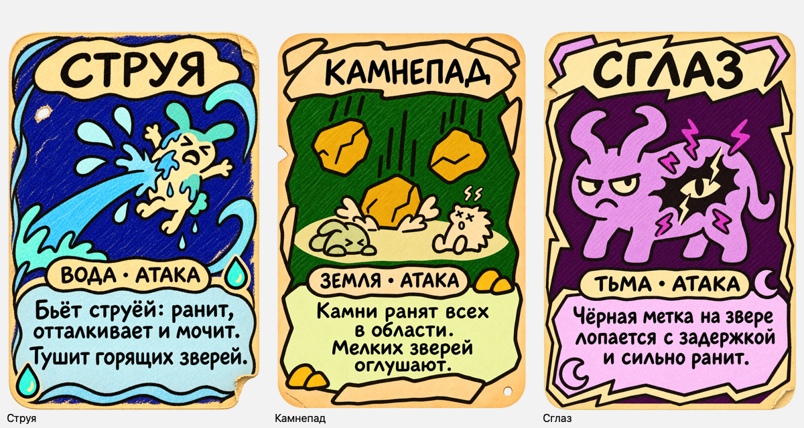
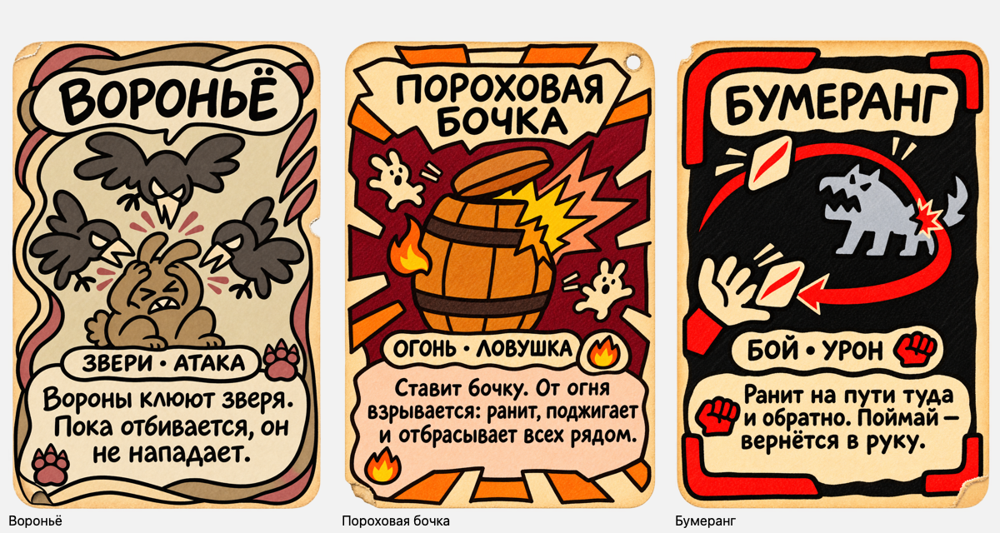

# Семь новых карт — 14.11.2026

Источник: новые строки [таблицы карт KayoSpace](kayospace://board/tb_hakaton-cards). На момент чтения все семь отмечены как дизайн без реализации. Работа — рисунки блоками по три с утверждением пользователя. Названия файлов — рабочие идентификаторы арта, не объявление игровых CardDefinition.

| Блок | Карта | Школа · тип | Статус |
|---|---|---|---|
| 1 | Струя | Вода · Атака | Утверждена пользователем («ок») |
| 1 | Камнепад | Земля · Атака | Утверждена пользователем («ок») |
| 1 | Сглаз | Тьма · Атака | Утверждена пользователем («ок») |
| 2 | Вороньё | Звери · Атака | Нарисована, ждёт утверждения |
| 2 | Пороховая бочка | Огонь · Ловушка | Нарисована, ждёт утверждения |
| 2 | Бумеранг | Бой · Урон | Нарисована, ждёт утверждения |
| 3 | Веер | Бой · Урон | В очереди |

## Первый блок

- [Струя PNG](block-01/water_jet.png): «Бьёт струёй: ранит, отталкивает и мочит. Тушит горящих зверей.»
- [Камнепад PNG](block-01/rockfall.png): «Камни ранят всех в области. Мелких зверей оглушают.»
- [Сглаз PNG](block-01/evil_eye.png): «Чёрная метка на звере лопается с задержкой и сильно ранит.»

Короткие описания составлены по полным эффектам таблицы, без чисел и цен. Свои рамки, по два школьных символа, утверждённые палитры и рисунок чёрным маркером. Для переноса стиля использованы актуальные Живая капля, Каменный куб и Кривое зеркало. Износ выбран как художественная подача, без назначения новых игровых значений силы.

Все три — PNG RGBA 1024×1536. Проверены полный размер результатов генерации, сохранённые уменьшенные версии на светлом и тёмном фоне, кириллица, отсутствие числовых плашек, два школьных символа и реальная прозрачность. Углы полностью прозрачны; alpha генератора сохранён, слабый ореол может достигать краёв холста. Сохранённые копии побайтово совпадают с результатами генератора. У Камнепада отдельной правкой уточнён текст; первоначальный вариант сохранён в revisions. Пиксельная неизменность вне текста не заявляется.

[Промпты встроенного image_gen](block-01/prompts.json) · [Правка текста](block-01/text-fix.json) · [Манифест](block-01/manifest.json) · [Тёмная подложка](block-01/preview-1.png) · [Источник и ID строк](kayospace-source.json) · [Очередь](queue.json)

Новые картинки пока не опубликованы в KayoSpace и не импортированы в Unity; игровые данные не создавались. Первый блок утверждён. Второй блок ожидает утверждения; затем остаётся Веер.

## Второй блок — ожидает утверждения

- [Вороньё PNG](block-02/crows.png): «Вороны клюют зверя. Пока отбивается, он не нападает.» Палитра «Кость и кармин», три вороны, две красные когтистые лапы.
- [Пороховая бочка PNG](block-02/powder_barrel.png): «Ставит бочку. От огня взрывается: ранит, поджигает и отбрасывает всех рядом.» Бочка загорается от внешнего огня, без фитиля или таймера.
- [Бумеранг PNG](block-02/boomerang.png): «Ранит на пути туда и обратно. Поймай — вернётся в руку.» На дуге показаны два положения одной летящей карты — путь туда и возврат к ладони.

Три PNG RGBA 1024×1536, копии совпадают с результатами генератора по байтам. Проверены текст, названия с Ё/Ь, два школьных знака, отсутствие верхних чисел, разные рамки, полный размер результатов генерации и сохранённый уменьшенный вид на светлом и тёмном фоне. Прозрачность реальная, внешние углы полностью прозрачны. Alpha генератора сохранён, слабый ореол может достигать краёв холста.

[Промпты встроенного image_gen](block-02/prompts.json) · [Манифест](block-02/manifest.json) · [Проверки PNG](block-02/png-checks.json) · [Тёмная подложка](block-02/preview-1.png)

Эти файлы пока вне Unity Assets и не опубликованы в KayoSpace. Игровая реализация не создавалась.
