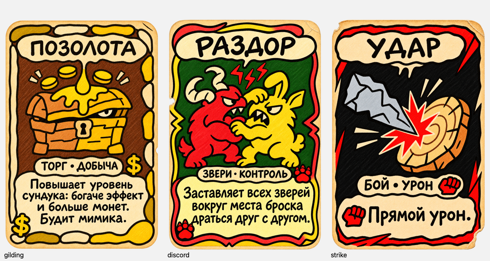
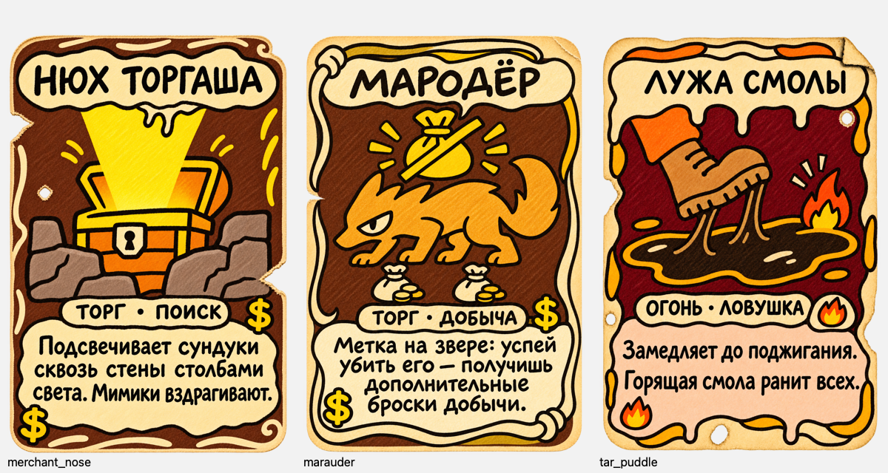
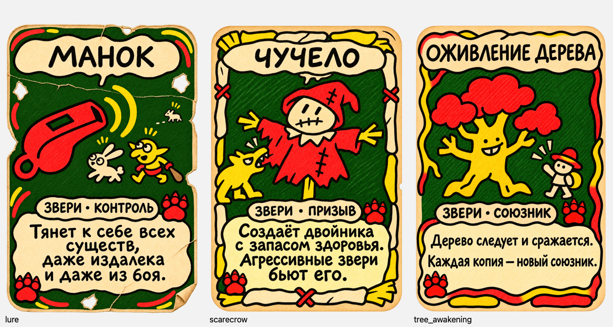
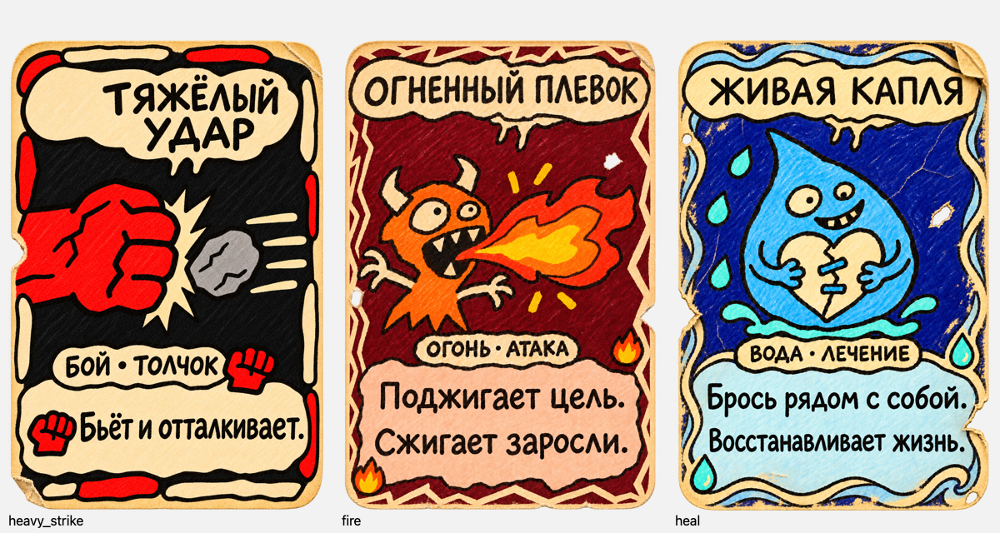
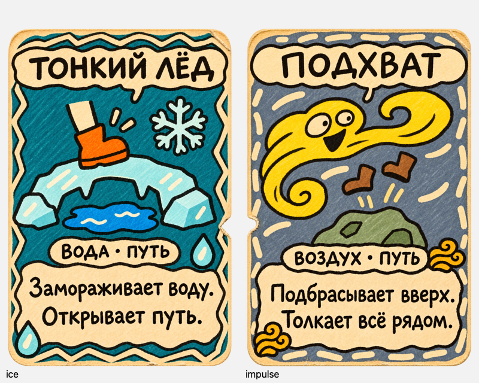

# Правки школ карт — 14.11.2026

> **Поставка завершена 14.11.2026:** все 14 утверждённых PNG заменены в Unity Assets и существующих строках KayoSpace. Звери — «Кость и кармин». Проверены импорты в открытом Editor, неизменность GUID/настроек/определений карт и побайтовое совпадение 14 изображений, полученных обратно из таблицы. [Отчёт о поставке](deployment/README.md). Описания блоков ниже сохраняют историю работы до интеграции.

## Результат анализа

Проверены все 34 текущие иллюстрации: 32 обычные карты, Пустышка и Пора домой. Пути разрешены из `CardDefinition.artwork` и `Cards.returnArtwork` по GUID. Контактные листы: [1](audit-1.png), [2](audit-2.png), [3](audit-3.png). Обучающие инструкции не входят в текущую задачу по школам.

Нужны изменения **14 карт**. Из них 8 меняют школу, 2 получают согласованное оформление Боя, 4 требуют только удаления верхней числовой плашки.

| Карта | Что меняется |
|---|---|
| Лужа смолы | Земля → Огонь: палитра, два знака, слово школы |
| Позолота | Земля → Торг: палитра, два знака, слово школы |
| Нюх торгаша | Воздух → Торг: палитра, два знака, слово школы |
| Мародёр | Тьма → Торг: палитра, два знака, слово школы |
| Раздор | Тьма → Звери: палитра, два знака, слово школы |
| Манок | Воздух → Звери: палитра, два знака, слово школы |
| Чучело | Земля → Звери: палитра, два знака, слово школы |
| Оживление дерева | Земля → Звери: палитра, два знака, слово школы |
| Удар | Сейчас бордовый фон и три знака вспышки. Проба сланцевой палитры Боя и двух кулаков; верхнюю плашку удалить, знак у типа перенести вправо |
| Тяжёлый удар | Сейчас оливковый фон и три кулака. После одобрения Боя согласовать палитру и два знака; верхнюю плашку удалить |
| Огонь / Огненный плевок | Удалить верхнюю плашку «1», освободив место названию |
| Лечение / Живая капля | Удалить верхнюю плашку «1», освободив место названию |
| Лёд / Тонкий лёд | Удалить верхнюю плашку «1», освободив место названию |
| Импульс / Подхват | Удалить верхнюю плашку «0», освободив место названию |

Остальные 20 карт по этому заданию не требуют правок: Притяжение, Ветвь-мост, Пузырь, Кривое зеркало, Сквозняк, Пустышка, Эхо, Туман, Лёгкость, Разряд молнии, Лунная гравитация, Гриб-батут, Облако дождя, Пора домой, Верёвка, Тягучий час, Каменный куб, Подмена, Телепорт, Восходящий поток.

## Гайд и сохранение исходников

Прочитан живой [гайд KayoSpace](kayospace://board/hakaton-f5xwo?element=01M6XNYDD33GW8FSFFFXSEH6KC), включая главу 06 универсального руководства. [Снимок нужных разделов](kayospace-guide.md). Уточнение пользователя об удалении цифр важнее исторической разметки старых эталонов. Палитры и символы новых школ утверждены в блоке 1 v2 и внесены в `output/card-designs/style-current.json`; дополнение на доске KayoSpace пока не публиковалось.

Каждая генерация использует исходную игровую карту как цель правки и утверждённый PNG `elemental-deck-v3/03-earth.png` как дополнительный эталон техники. Сюжет, название, тип действия и текст правил сохраняются. Точные запросы и порядок референсов: [prompts.json](prompts.json). Использован встроенный image_gen.

## Блоки

1. **Утверждено, v2:** Позолота (Торг), Раздор (Звери), Удар (Бой). Ответ пользователя: «ок, едем дальше».
2. **Утверждено:** Нюх торгаша, Мародёр, Лужа смолы. Ответ пользователя: «ок».
3. **Утверждено:** Манок, Чучело, Оживление дерева. Ответ пользователя: «ок».
4. **Утверждено:** Тяжёлый удар, Огненный плевок, Живая капля. Ответ пользователя: «ок».
5. **Утверждено:** Тонкий лёд, Подхват. Ответ пользователя: «Ок».

После каждого блока остановка до явного пользовательского одобрения. Первый блок одновременно проверяет все три новые школы перед применением к остальным картам.

## Блок 1 — утверждённые карты v2

Уточнения пользователя: знак доллара вместо монет-эмблем; красные лапы; красно-жёлто-зелёная школа Зверей; контрастная чёрно-красная школа Боя. Реализация этих указаний утверждена пользователем: «ок, едем дальше». Исходные пробы сохранены в `block-01/`.

- [Позолота — PNG](block-01/v2/gilding.png)
- [Раздор — PNG](block-01/v2/discord.png)
- [Удар — PNG](block-01/v2/strike.png)

Все три сохранены как RGBA PNG 1024×1536; проверена прозрачность внешних углов, текст, два школьных значка, отсутствие верхней плашки. Просмотрены полноразмерные результаты и уменьшенные версии на светлой и тёмной подложках. Сохранён исходный alpha генератора; точное равенство пикселей старой и новой карты не заявляется. Сохранён мягкий полупрозрачный край генератора; полные контуры визуально проверены на двух подложках. [Технические проверки](block-01/v2/png-checks.json).

Кандидаты и резервные копии сохранены вне `Assets`; игровые файлы, метаданные импорта, баланс и таблица KayoSpace не изменялись. Импорт в Unity не проверялся. Статус первого блока: **утверждён пользователем, v2**. [Манифест и очередь](manifest.json).

Точные запросы текущей правки: [v2/prompts.json](block-01/v2/prompts.json). Использован встроенный image_gen; копии совпадают с результатами генератора по байтам.

## Блок 2 — утверждён

- [Нюх торгаша — Торг · Поиск](block-02/merchant_nose.png)
- [Мародёр — Торг · Добыча](block-02/marauder.png)
- [Лужа смолы — Огонь · Ловушка](block-02/tar_puddle.png)

Две карты Торга следуют утверждённой Позолоте v2: шоколадно-коричневый фон и два знака доллара. Лужа смолы использует установленную палитру Огня и два символа пламени. Сюжеты, тексты и индивидуальные рамки сохранены визуально. Старые плашки школы заменены; верхних цифр нет.

Три PNG RGBA 1024×1536 сохранены в проекте, копии совпадают с результатами генератора по байтам. Проверены полный размер, уменьшенный просмотр на светлой и тёмной подложках, текст, два символа и реальная прозрачность. Alpha генератора сохранён, включая очень слабый ореол у границ. Нижний левый угол Мародёра имеет alpha 1/255. Исходники сохранены в `block-02/originals/`. Игровые файлы и настройки импорта не менялись; Unity импорт не проверялся.

[Промпты встроенного image_gen](block-02/prompts.json), [проверки PNG](block-02/png-checks.json), [манифест](block-02/manifest.json). Блок 2 утверждён пользователем: «ок».

## Блок 3 — утверждён

- [Манок — Звери · Контроль](block-03/lure.png)
- [Чучело — Звери · Призыв](block-03/scarecrow.png)
- [Оживление дерева — Звери · Союзник](block-03/tree_awakening.png)

Красно-жёлто-зелёная палитра и две красные когтистые лапы по утверждённому Раздору v2. Сюжеты, тексты и индивидуальные рамки сохранены визуально. Верхних плашек и цифр нет. У Оживления дерева отдельной правкой уточнены когти на эмблемах; предыдущая версия сохранена в `block-03/revisions/`.

Все три файла: PNG RGBA 1024×1536. Проверены полный размер, уменьшенный просмотр на светлой и тёмной подложках, текст, два знака и реальная прозрачность; внешние углы полностью прозрачны. Сохранён alpha генератора, включая слабый ореол у некоторых границ; пиксельная неизменность относительно исходников не заявляется. Копии совпадают с выбранными результатами генератора по байтам. Игровые файлы и импорт не менялись, проверка в Unity не выполнялась.

[Промпты image_gen](block-03/prompts.json), [правка лап](block-03/paw-fix.json), [проверки PNG](block-03/png-checks.json), [манифест](block-03/manifest.json). Блок 3 утверждён пользователем: «ок».

## Блок 4 — утверждён

- [Тяжёлый удар — Бой · Толчок](block-04/heavy_strike.png)
- [Огненный плевок — без верхней числовой плашки](block-04/fire.png)
- [Живая капля — без верхней числовой плашки](block-04/heal.png)

Тяжёлый удар приведён к утверждённой чёрно-красной палитре Боя; верхний круг удалён, оставлены две красные эмблемы кулака. У Огня и Лечения удалены числовые плашки, названия занимают освободившееся место. Школы, палитры и сюжеты этих двух карт сохранены визуально; пиксельная неизменность вне заголовков не заявляется.

Все три PNG RGBA 1024×1536 сохранены в проекте, копии совпадают с результатами генератора по байтам. Проверены полный размер, уменьшенный вид, текст, отсутствие верхних плашек, два нижних символа и прозрачность на светлой и тёмной подложках. Внешние углы полностью прозрачны; сохранён alpha генератора и мягкий ореол у некоторых границ. Исходники сохранены в `block-04/originals/`. Игровые файлы и настройки импорта не менялись; Unity импорт не проверялся.

[Промпты image_gen](block-04/prompts.json), [проверки PNG](block-04/png-checks.json), [манифест](block-04/manifest.json). Блок 4 утверждён пользователем: «ок».

## Блок 5 — утверждён

- [Тонкий лёд — PNG](block-05/ice.png)
- [Подхват — PNG](block-05/impulse.png)

Удалены верхние числовые плашки «1» и «0»; заголовки занимают освободившееся место. Школы, палитры, сюжеты и тексты сохранены визуально. Проверены полный размер и уменьшенный вид на светлой/тёмной подложках, кириллица, два нижних знака и отсутствие верхних плашек. PNG RGBA 1024×1536, внешние углы прозрачны; сохранён alpha генератора, включая слабый ореол у некоторых границ. Сохранённые копии совпадают с результатами генератора по байтам. Пиксельная неизменность вне заголовков не заявляется.

[Промпты image_gen](block-05/prompts.json), [проверки PNG](block-05/png-checks.json), [манифест](block-05/manifest.json). Исходники сохранены в `block-05/originals/`.

Все 14 запланированных правок созданы и утверждены пользователем. Проверено наличие всех итоговых PNG и совпадение их SHA-256 с сохранёнными манифестами. Файлы в Unity Assets, настройки импорта, данные карт и реестр KayoSpace в этой серии пока не заменялись; проверка импорта в Editor не выполнялась.

Первоначальный итог: **арт всех 14 карт был утверждён; затем пользователь вернулся к выбору палитры Зверей**. [Проверка итоговых файлов](final-file-verification.json). Остальные 20 текущих карт не требовали правок в рамках смены школ и удаления верхних цифр.

## Повторный выбор палитры Зверей

Подготовлены [три пробы на карте «Раздор»](beasts-palette-options/README.md). Выбран вариант **1 — Кость и кармин**. Раздор утверждён в этой палитре. [Манок, Чучело и Оживление дерева утверждены и установлены](beasts-bone-carmine/README.md). Предыдущие версии и история утверждения сохранены.
