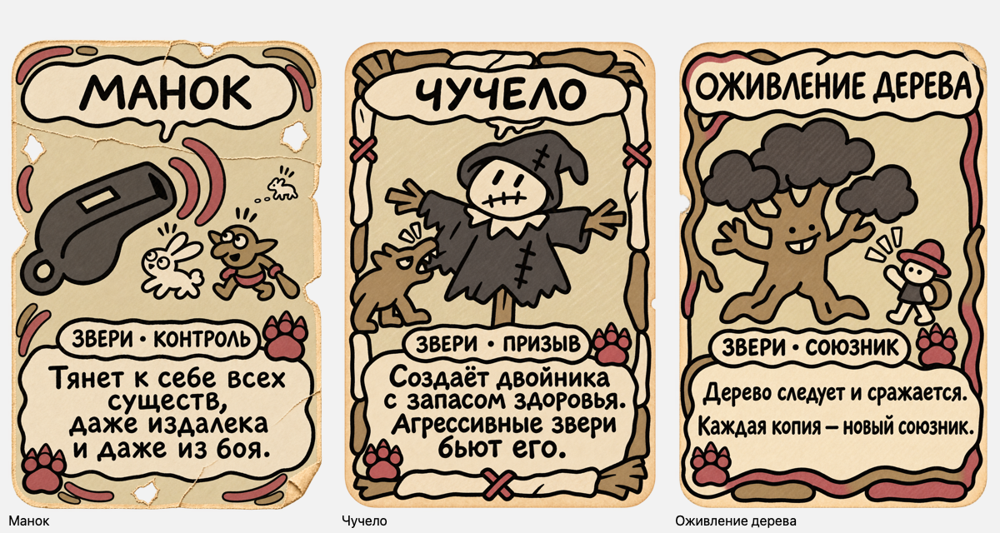

# Звери — Кость и кармин

Пользователь выбрал вариант 1 («1», 14.11.2026). [Раздор — утверждённый эталон](../beasts-palette-options/01-bone-carmine.png).

Следующие три карты созданы и сохранены, **утверждены пользователем («заливай апдейт карт») и установлены**.

- [Манок](lure.png)
- [Чучело](scarecrow.png)
- [Оживление дерева](tree_awakening.png)

Светлая костяная основа, угольные и табачные фигуры, приглушённые карминовые лапы и акценты. Исходные версии сохранены в `../block-03/`. Формы сюжетов, текст и собственные рамки сохранены визуально; пиксельная идентичность не заявляется. У дерева генератор изменил износ бумаги: появилась боковая выемка и загиб справа сверху.

Все PNG RGBA 1024×1536. Проверены кириллица, два когтистых символа, отсутствие верхних цифр, полный размер результатов генерации и уменьшенные сохранённые изображения на светлой и тёмной подложках. Прозрачность реальная, углы полностью прозрачны. Сохранён alpha генератора, включая слабый ореол у некоторых границ. Копии проверены по байтам.

[Тёмная подложка](preview-1.png) · [Промпты встроенного image_gen](prompts.json) · [Манифест](manifest.json) · [Проверки PNG](png-checks.json)

PNG заменены в игровых Assets и KayoSpace; настройки импорта сохранены. Импорт и ссылки на спрайты проверены в открытом Unity Editor. [Отчёт](../deployment/README.md).
