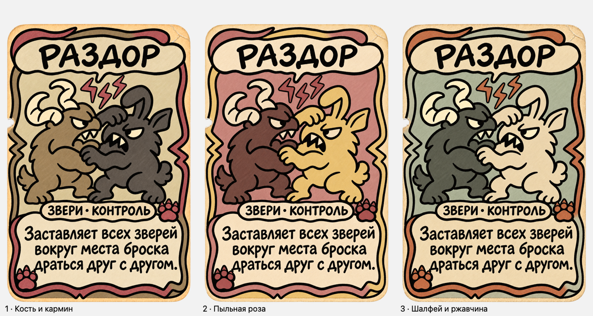

# Три пробы палитры Зверей

Статус: пользователь выбрал **1 — Кость и кармин** (ответ «1», 14.11.2026). Пробы выполнены на одной карте «Раздор» через встроенный image_gen; прежняя утверждённая версия сохранена.

1. [Кость и кармин](01-bone-carmine.png) — светлая основа, табачный и угольный звери, приглушённые красные акценты.
2. [Пыльная роза](02-dusty-rose.png) — розово-глиняный фон, коричневый и соломенный звери, карминовые лапы.
3. [Шалфей и ржавчина](03-sage-rust.png) — серо-зелёный фон, графитовый и костяной звери, ржавые акценты.

После просмотра рекомендация для отдельного цветового образа школы — вариант 2: цветное поле заметнее, чем нейтральная основа варианта 1; вариант 3 ближе к природной палитре Земли. Эта рекомендация была предложена до выбора; пользователь выбрал вариант 1.

Все PNG: 1024×1536, RGBA, реальные прозрачные пиксели и прозрачные внешние углы. Сохранён исходный alpha генератора; слабые полупрозрачные пиксели достигают некоторых границ холста. Проверены полный размер, уменьшенное сравнение на светлом и тёмном фоне, кириллица и два символа. Пиксельная идентичность рисунка исходнику не заявляется. Сохранённые копии совпадают с генератором по байтам.

[Тёмная подложка](preview-1.png) · [Промпты](prompts.json) · [Манифест и проверки](manifest.json)

Другие карты пока не перекрашены. Unity Assets и KayoSpace не обновлялись; проверка Unity не выполнялась.
