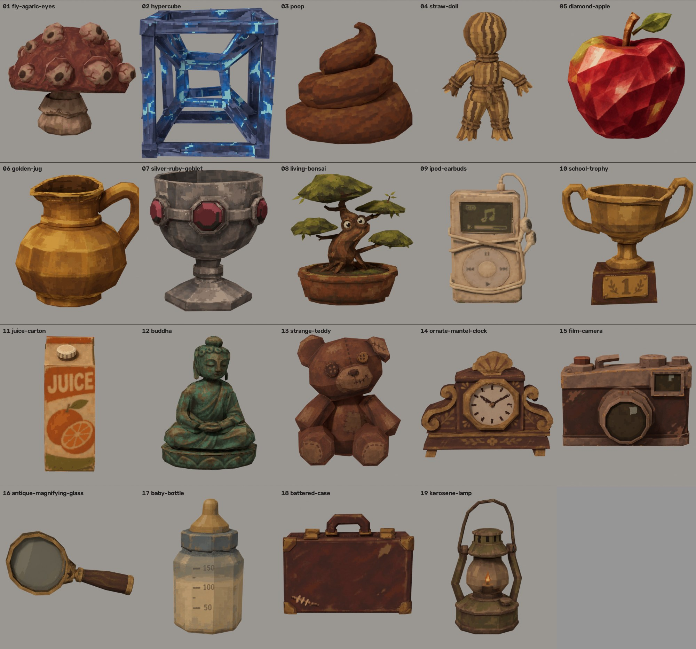

# Собираемые товары — 3D-модели

19 предметов из `output/collectible-concepts`, смоделированы в Blender (bpy 5.3) по одному концепту каждый. Стиль PSX: простая кривая геометрия, мелочи нарисованы в текстуре, текстура спроецирована с концепта, невидимые стороны дорисованы.

Габарит под слот витрины: высота ≤ 0,22 м, основание ≤ 0,26 × 0,26 м, pivot — низ по центру, min Z = 0. FBX как в ShopArt: 1 unit = 1 м, Forward −Z, Up Y, Apply Transform; перед модели смотрит в −Y Blender (+Z Unity). Один меш, один материал, одна текстура (Point, матовая, Metallic 0 / Smoothness 0).

В каждой папке: `<ID>.fbx`, `<ID>.blend`, `T_<ID>.png`, `card.jpg` (концепт vs модель, обход, витрина с камеры Б), `preview.png`, `shelf.png`, `stats.json`, `build.py` (исходник сборки). Статус: смоделировано, пользователем не утверждено; импорт в Unity и LootItem.ShelfModel не делались.

| Папка | FBX | Треугольники | Размер X×Y×Z, м | Текстура |
|---|---|---|---|---|
| 01-fly-agaric-eyes | CI01_FlyAgaricEyes.fbx | 1576 | 0.214 × 0.220 × 0.192 | 512x512 |
| 02-hypercube | CI02_Hypercube.fbx | 696 | 0.201 × 0.201 × 0.209 | 512x512 |
| 03-poop | CI03_Poop.fbx | 788 | 0.216 × 0.201 × 0.184 | 512x512 |
| 04-straw-doll | CI04_StrawDoll.fbx | 1786 | 0.149 × 0.067 × 0.210 | 256x256 |
| 05-diamond-apple | CI05_DiamondApple.fbx | 294 | 0.184 × 0.173 × 0.203 | 512x512 |
| 06-golden-jug | CI06_GoldenJug.fbx | 842 | 0.210 × 0.177 × 0.198 | 512x512 |
| 07-silver-ruby-goblet | CI07_SilverRubyGoblet.fbx | 1354 | 0.191 × 0.196 × 0.220 | 512x512 |
| 08-living-bonsai | CI08_LivingBonsai.fbx | 1950 | 0.195 × 0.114 × 0.205 | 512x512 |
| 09-ipod-earbuds | CI09_IpodEarbuds.fbx | 1720 | 0.141 × 0.061 × 0.203 | 256x256 |
| 10-school-trophy | CI10_SchoolTrophy.fbx | 1174 | 0.221 × 0.143 × 0.211 | 512x512 |
| 11-juice-carton | CI11_JuiceCarton.fbx | 278 | 0.080 × 0.092 × 0.209 | 256x256 |
| 12-buddha | CI12_Buddha.fbx | 1174 | 0.150 × 0.094 × 0.198 | 512x512 |
| 13-strange-teddy | CI13_StrangeTeddy.fbx | 612 | 0.170 × 0.154 × 0.208 | 512x512 |
| 14-ornate-mantel-clock | CI14_OrnateMantelClock.fbx | 810 | 0.251 × 0.103 × 0.199 | 512x512 |
| 15-film-camera | CI15_FilmCamera.fbx | 617 | 0.204 × 0.096 × 0.143 | 512x512 |
| 16-antique-magnifying-glass | CI16_AntiqueMagnifyingGlass.fbx | 698 | 0.213 × 0.031 × 0.106 | 256x256 |
| 17-baby-bottle | CI17_BabyBottle.fbx | 538 | 0.113 × 0.112 × 0.206 | 512x512 |
| 18-battered-case | CI18_BatteredCase.fbx | 368 | 0.204 × 0.044 × 0.155 | 256x256 |
| 19-kerosene-lamp | CI19_KeroseneLamp.fbx | 1226 | 0.120 × 0.101 × 0.215 | 256x256 |
