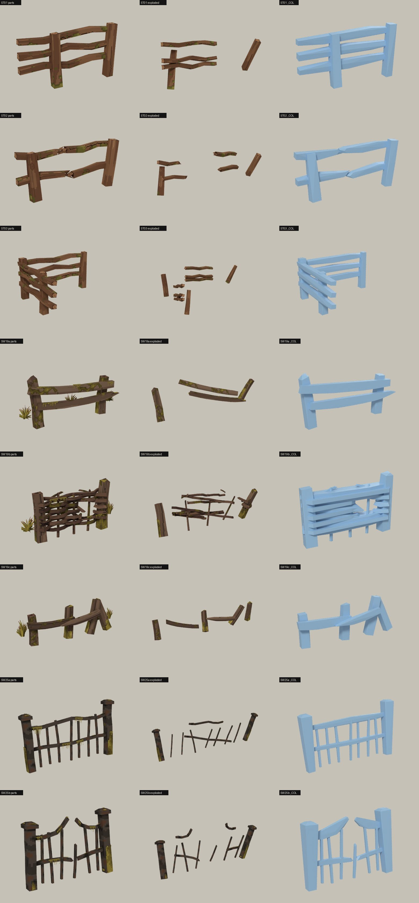

# Заборы по деталям — v1

15.11.2026. Каждая секция забора разобрана на детали (столбы, жерди, штакетины, прутья плетня, колья) — те же меши
и UV, что у исходных моделей, вид секции не изменился. У каждой детали свой выпуклый `_COL`; вместе они дают
коллизию секции, в которой просветы между штакетинами и жердями остаются открытыми. Статус: FBX в проекте, префабы
не трогались, Play-проверки не запускались.

## Файлы в Unity (рядом с исходными FBX, исходники не менялись)

| Секция | FBX | Детали |
|---|---|---|
| Лесной забор | `ForestArt/Models/Structures/SM_ST01_FenceSection_Parts.fbx` | 2 столба, 3 жерди |
| Лесной забор, сломанный | `…/SM_ST02_FenceBroken_Parts.fbx` | 2 столба, 4 обломка жердей |
| Лесной забор, угол | `…/SM_ST03_FenceCorner_Parts.fbx` | 3 столба, 6 жердей |
| Водный забор, жерди | `SwampArt/Models/Paths/SM_SW19_WaterFenceRails_Parts.fbx` | 2 столба, 2 жерди |
| Водный плетень | `…/SM_SW19_WaterFenceWattle_Parts.fbx` | 2 столба, 3 кола, 18 прутьев |
| Водный забор, сломанный | `…/SM_SW19_WaterFenceBroken_Parts.fbx` | 4 столба, 2 жерди |
| Могильная оградка | `SwampArt/Models/Graveyard/SM_SW25_GraveFenceTilted_Parts.fbx` | 2 столба, 2 перекладины, 7 штакетин |
| Могильная оградка, сломанная | `…/SM_SW25_GraveFenceBroken_Parts.fbx` | 2 столба, 4 обломка перекладин, 6 штакетин |

## Соглашения

- Имена объектов: `<ID>_<Post|Rail|Picket|Rod|Stake>_<N>`, коллизия — `<имя детали>_COL` (выпуклая, до 255
  треугольников, тот же пивот). Номера идут вдоль забора.
- Пивот детали — центр детали; объекты стоят на своих местах относительно пивота секции (как у исходной FBX).
- Мох и шляпки/подкладки столбов приклеены к той детали, на которой лежат (улетают вместе с ней).
- Трава у основания — отдельный объект `<ID>_Grass`, без коллизии: остаётся на месте.
- Материалы прежние (лесное дерево строений, болотные Planks/Bark/Props/Moss/Plants); второй UV `Wind` сохранён.

## Здесь

По папке на секцию: `card.jpg` (целиком, разлёт деталей, коллизия), `manifest.json` (детали, треугольники, размеры,
пивоты, коллизия), `.blend`. `_tools/` — скрипт разборки (`fk.py`, `run_split.py`).
