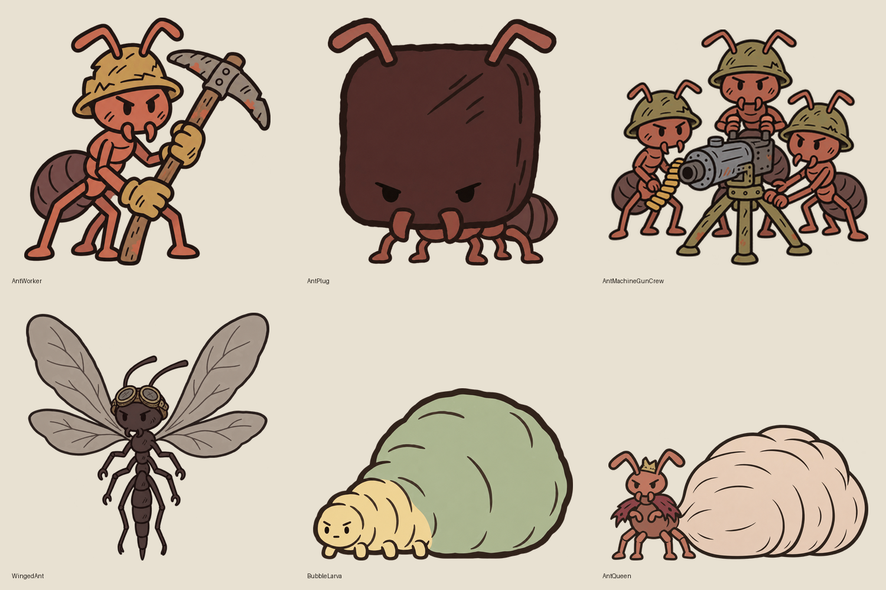
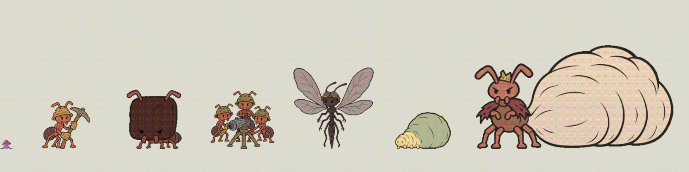

# Муравейник — пакет спрайтов

Создано 16.11.2026: пять новых врагов по семь состояний (35 PNG-мастеров). Существующий пулемётный расчёт сохранён без перерисовки и повторно проверен. Всего шесть типов, 42 импортированных спрайта.

## Атласы

| Враг | Unity PNG | Ячейка | Атлас | Рабочая высота обычного силуэта |
|---|---|---|---|---|
| Муравей-работяга | [AntWorkerAtlas.png](../../../hukaton/Assets/Content/Enemies/AntWorker/AntWorkerAtlas.png) | 207 × 172 | 512 × 1024 | 1.3 м |
| Муравей-пробка | [AntPlugAtlas.png](../../../hukaton/Assets/Content/Enemies/AntPlug/AntPlugAtlas.png) | 213 × 188 | 512 × 1024 | 1.6 м |
| Муравьиный пулемётный расчёт | [AntMachineGunCrewAtlas.png](../../../hukaton/Assets/Content/Enemies/AntMachineGunCrew/AntMachineGunCrewAtlas.png) | 184 × 173 | 512 × 1024 | 1.5675 м |
| Крылатый муравей | [WingedAntAtlas.png](../../../hukaton/Assets/Content/Enemies/WingedAnt/WingedAntAtlas.png) | 236 × 233 | 512 × 1024 | 2.2 м |
| Личинка-пузырь | [BubbleLarvaAtlas.png](../../../hukaton/Assets/Content/Enemies/BubbleLarva/BubbleLarvaAtlas.png) | 177 × 159 | 512 × 1024 | 1.0 м |
| Матка | [AntQueenAtlas.png](../../../hukaton/Assets/Content/Enemies/AntQueen/AntQueenAtlas.png) | 556 × 415 | 2048 × 2048 | 2.8 м |

Размеры и агрессивный характер — рабочие художественные допущения, не заданный игровой баланс. У новых врагов PPU 100, номинальный scale 1, общая плотность 100 texels/m.

## Состав и сборка

У каждого: default front/back, aggression front, hurt front, attack front, death front/back. У смерти видимые глаза — чёрные X; на задней стороне головы глаза не рисовались. Агрессия содержит один красный восклицательный знак и короткие красные штрихи.

Полноразмерные атласы новых врагов: `<Enemy>/atlas.png`, 5400 × 6000 RGBA; ячейки 1800 × 2000, 3 × 3, последние две пусты. Мастера в `<Enemy>/masters/`, исходные результаты генерации в `<Enemy>/raw/`. Сохранены все исходные RGBA-пиксели, использовано только прозрачное дополнение с целочисленными смещениями. Сетка и ground anchor заданы до упаковки; отдельные позы не масштабировались и не обрезались.

Unity-текстуры получены штатным `output/sprite-density/tool/resample.py`: premultiplied resampling, hard alpha и защита тёмного контура. Это отдельные уменьшенные производные, а не замена мастеров. Их ячейки сохранены для проверки в `<Enemy>/runtime-masters/`. Оригиналы для повторного пересчёта и метаданные с актуальными Unity GUID/fileID лежат в `output/sprite-density/originals/Enemies/<Enemy>/`; записи добавлены в общий config.

## Проверки

- Все 35 исходников имеют RGBA и настоящие прозрачные области; непрозрачные пиксели не касаются границы исходного холста.
- Все занятые ячейки мастер-атласов точно совпадают с мастер-PNG по RGBA; пустые ячейки прозрачны.
- Runtime-атласы имеют равные ячейки, alpha 0/255, прозрачные неиспользованные области и размеры power-of-two не более 2048.
- В настоящем Unity Editor 6000.3.21f1 проверены шесть атласов и 42 спрайта: Sprite/Multiple, PPU 100 у пакета муравьёв, общие pivot и FullRect bounds внутри каждого врага, NPOT None, no mipmaps, Uncompressed, Bilinear, Max Size 2048. Ячейки заданы явно по фиксированной сетке, без Automatic/Trim.
- Последовательная смена спрайтов не меняет transform, PPU и границы ячейки. Выполнен GPU-рендер состояний и сравнение в одноразовом preview сохранённой EnemyDebug; сцены проекта не сохранялись и не изменялись. Использован материал Sprites/Default для проверки изображений, это не игровой тест HandDrawnSprite.
- Временный Editor-скрипт и его `.meta` удалены из Assets. Исходник проверки оставлен здесь для аудита.

## KayoSpace

Обновлена [существующая таблица врагов](kayospace://board/tb_hakaton-enemies): добавлены пять строк и обновлён концепт существующего расчёта. Все шесть строк повторно прочитаны, все шесть PNG-вложений получены через get_image и визуально проверены. Остальные строки, ширины колонок и высота 172 px сохранены. Вёрстка всей таблицы отдельным скриншотом не проверялась. ID и источники записаны в `docs/enemies/kayospace-registry.json`.

## Границы результата

Это художественные ассеты и подтверждённый импорт. Gameplay, здоровье, урон, добыча, спавн, призыв, VFX кислотной лужи и отдельные projectile-спрайты не создавались. Поведение в таблице отмечено как концепт. Play-mode игровой тест не выполнялся. Изображения созданы после одобрения концептов; отдельное пользовательское одобрение каждого итогового рисунка ещё не получено.

[Точные промпты](prompts.json) — встроенный imagegen, `transparent_background: true`. Актуальные стилевые примеры просмотрены в KayoSpace: расчёт, жук с копьём, петух-бейсболист и робот дварфов. Старые `output/shop-visitors` и `output/monsters/style-current.json` в этом checkout отсутствовали; использованы актуальные Assets и native-вложения таблицы.
