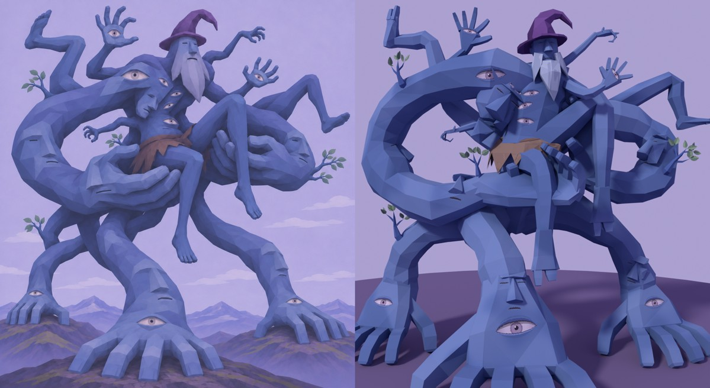

# MG01 — Бог в собственных руках · 3D-модель v1

12 ноября 2026 · Hakaton · модель по концепт-паку `MG01-God-in-His-Hands-Concept-Pack-v1`.

**Статус:** модель создана, пользователем ещё не утверждена. Технические проверки пройдены (список ниже). Скелета нет, но модель подготовлена под него. Импорт в Unity, prefab и сцена не делались.

## Файлы

| Файл | Что это |
| --- | --- |
| `MG01.blend` | Исходник. Внутри `MG01_Root` с тремя объектами: `MG01_Body`, `MG01_Cloth`, `MG01_Leaves`. Ещё две коллекции: `MG01_LOD` (LOD1/LOD2) и скрытая `MG01_RigGuides` (направляющие для будущего скелета). Текстуры подключены относительными путями `//textures/`. |
| `MG01.fbx` | Для Unity. Объекты `MG01_Root` и `MG01_Body/Cloth/Leaves_LOD0..2`, все триангулированы, flat-нормали. Пути текстур в FBX обрезаны до имени файла. |
| `textures/` | `T_MG01_Body_BaseColor.png` 2048², `T_MG01_Cloth_BaseColor.png` 512², `T_MG01_Leaves_BaseColor.png` 256² (RGBA). |
| `MG01_rig_guides.json` | Цепочки суставов для будущего скелета: позиции, родители, IK-цели опор. |
| `previews/` | Рендеры: фронт с канонической камеры, 3/4 слева и справа, тыл, бок, крупный план верха, таз. |
| `checks/` | `assembly_log.json` (все счётчики сборки), `rigtest_sheet.jpg` и `rigtest.json` (тест скелета), `uv_layout.jpg` (развёртка). |
| `source/` | Скрипты, которые полностью собирают модель (Python + `bpy` 5.3), раздел «Пересборка». |

## Масштаб, оси, pivot

- **Рабочий масштаб 1:100.** 1 метр в Blender = 1 unit в FBX = 100 м по предложению спеки. Масштаб только равномерный.
- **Габарит** (Unity X × Y × Z): 22,1 × 19,7 × 11,9 unit, что при ×100 даёт 2210 × 1970 × 1190 м. В спеке предложено 1650 × 1800 × 1100 м. Ширина больше из-за широкой стойки боковых опор и ступни L04, как на каноне.
- **Оси.** В Blender: −Y = фронт, +Z = верх. FBX экспортирован с настройками Forward −Z, Up Y, Apply Transform, поэтому в Unity фронт смотрит в +Z, верх в +Y. Правая по канону сторона видна справа, если смотреть на фронт модели. Числом в Unity это −X: Unity левосторонняя, как и у жаровни BR01.
- **Pivot** (0, 0, 0) стоит на земле, в центре трёх опорных кистей. Точки контакта `IK_S01..S03_contact` записаны в `MG01_rig_guides.json`. Ноги земли не касаются.

## Геометрия

Треугольники считаются после триангуляции.

| | Факт | Цель спеки |
| --- | --- | --- |
| LOD0 | 9296 (тело 9104, повязка 136, листья 56) | 6608–10556, потолок 12000 |
| LOD1 | 3791 | 3000–4500 |
| LOD2 | 1435 | 1000–1800 |

- **Тело** (`MG01_Body`) — один замкнутый меш, собранный точным булевым объединением.
  - Из него собраны: торс и задняя нижняя масса таза; 9 рук: опоры S01–S03, руки-ложе C01–C02, малые руки A01–A04; 4 ноги L01–L04; голова, борода, колпак; 6 обрывков лиц; синие стебли 4 веток.
  - Проверено: одна связная часть, 0 неманифолдных рёбер, нормали наружу.
  - Места срастания не оставлены пересекающимися трубами.
- **Повязка** — отдельный двухслойный лист, видна с любой стороны при одностороннем URP/Lit.
- **Листья** — отдельные карты, по 2 треугольника на карту.
- **Состав по спеке:** 9 рук, 4 ноги, 3 опоры. Других контактов с землёй нет. Ровно 10 открытых глаз E01–E10: на 3 опорных кистях, 2 поднятых ладонях, 1 плечевом выступе и 4 на торсе. На спине, ногах и предплечьях глаз нет. Обрывков лиц 6, веток B01–B04 4. Повязка, колпак и борода на месте.
- **Стиль:** крупные массы с плоскими гранями. Конечности слегка кривые: радиус и центр меняются от кольца к кольцу, без ровных «труб». Мелочь не моделировалась, а нарисована: веки, зрачки, рты, закрытые глаза обрывков.

## Материалы и текстуры

| Материал | Текстура | Заметки |
| --- | --- | --- |
| `M_MG01_Body` | `T_MG01_Body_BaseColor.png` 2048² | Одна UV на тело, бороду, колпак и стебли. Около 47 px на метр модели. Глаза нарисованы в своих уникальных зонах UV, без зеркальных копий. |
| `M_MG01_Cloth` | `T_MG01_Cloth_BaseColor.png` 512² | Грубая шкура, без орнамента. |
| `M_MG01_Leaves` | `T_MG01_Leaves_BaseColor.png` 256² | Альфа. |

Настройки для Unity по спеке:
- **Все материалы:** URP/Lit, Metallic 0, Smoothness 0, Specular Highlights и Environment Reflections выключены.
- **Импорт текстур:** Filter Point, Wrap Clamp, Mip Maps включены, Compression None на время проверки.
- **Листья:** Alpha Clipping 0,5, Render Face Both, Mip Maps Preserve Coverage.

Normal/roughness/height-карт нет, так и задумано. В FBX у текстур записаны только имена файлов: положите папку `textures` рядом с FBX или назначьте текстуры вручную.

## Готовность к скелету

- **Группы вершин (логические маски):** `CORE`, `HEAD` (голова, борода, колпак), `S01–S03`, `C01–C02`, `A01–A04`, `L01–L04`. Каждая вершина тела ровно в одной группе. Повязка в группе `CORE`, каждый лист — в группе своей конечности.
- **Петли на суставах:** кольца стоят на плечах, локтях, запястьях, коленях, лодыжках и фалангах пальцев, у сгибов по 2 и больше кольца.
- **`MG01_rig_guides.json`:**
  - 82 цепочки: позвоночник, масса таза, 13 конечностей, пальцы, стопы, шея и голова, колпак, борода.
  - Для каждой цепочки указан родитель: пальцы привязаны к кости ладони, ладонь к предплечью.
  - 3 независимые IK-цели опорных кистей.
  - Ещё отдельно цепочки веток.
  - Те же суставы лежат в `.blend` как пустышки и кривые в коллекции `MG01_RigGuides`.
- **Тест (`checks/rigtest_sheet.jpg`):**
  - Из направляющих собран временный скелет на 223 кости, вес назначен через Automatic Weights с маскированием по группам.
  - Без веса осталось 0 вершин. При повороте корневой кости каждой конечности на 35° вершины чужих конечностей не сдвигаются: перетекание 0.
  - Позы рендерятся без разрывов.
  - Сам временный скелет в поставку не входит.
- **Важно для настоящего рига:** чистые Automatic Weights протекают между сросшимися частями: бедро в ладони, корни малых рук в плечах. После автовеса обнулите веса костей чужой конечности по этим группам и нормализуйте. Рецепт в `source/rigtest.py`, проверка в `source/rig_bleed_check.py`.
- **FBX без арматуры не несёт групп вершин.** Скиннинг делайте в `MG01.blend`, потом экспортируйте FBX вместе со скелетом.

## Что додумано по логике, а не по пикселям концепта

- **Ровная земля.** Все три опорные кисти стоят на ровной земле, хотя на каноне боковые стоят на холмах выше центральной. Пальцы веером уходят от запястья вперёд и кончиками упираются в землю, большой палец разведён в сторону.
- **Бог сидит в ладонях.** Ладони C01 и C02 лежат под ягодицами и корнями бёдер, пальцы обхватывают бёдра сверху, большой палец — с другой стороны. Хват C01 срощен с бедром L01 в один меш, как и положено единому телу. Веса это не портит, если маскировать их по группам (раздел «Готовность к скелету»).
- **Опоры сходятся в «задней нижней массе таза»** за ладонями, а не столбом под тазом, так что под телом остаётся просвет.
- **Руки-ложе — большие петли из плеч**, предплечья входят в ладони снизу. Задние ноги L03 и L04 идут от задней части таза вверх и назад, позади петель, не протыкая их. Свисающая нога L01 висит перед опорой S02, не касаясь её.
- **Голова слегка повёрнута к +X**, как нос на каноне. Борода лежит на груди, колпак кривой, кончик загнут.

## Известные ограничения

- На обрывке лица F04 нарисован один закрытый глаз из двух (и рот).
- Свисающие ступни L01 и L02 спереди читаются как простые блоки.
- Ладони-ложе лучше читаются в 3/4, чем строго спереди: оттуда предплечье C01 заслоняет часть ладони.
- Атлас тела заполнен примерно на 41%: плотность ровная, но запас есть.
- Не сделаны: импорт в Unity, prefab, проверочная сцена, коллизия, просмотр в Game View.

## Пересборка

В `source/` лежат скрипты: `layout.py` (раскладка, единый источник координат), `core.py`, модули частей (`hands.py`, `head.py`, `details.py`), `paint.py` (UV и покраска), `assemble.py`, `export.py`, `package.py`, `rigtest.py`, `render_final.py`.

Порядок запуска: `python3 -I assemble.py OUT`, затем `export.py OUT`, затем `package.py OUT DELIVER`. Нужен Python 3.13 с модулем `bpy` 5.3. Пути в скриптах указывают на машину сборки (`/home/claude/work/...` и путь к концепт-паку), их надо поправить.
