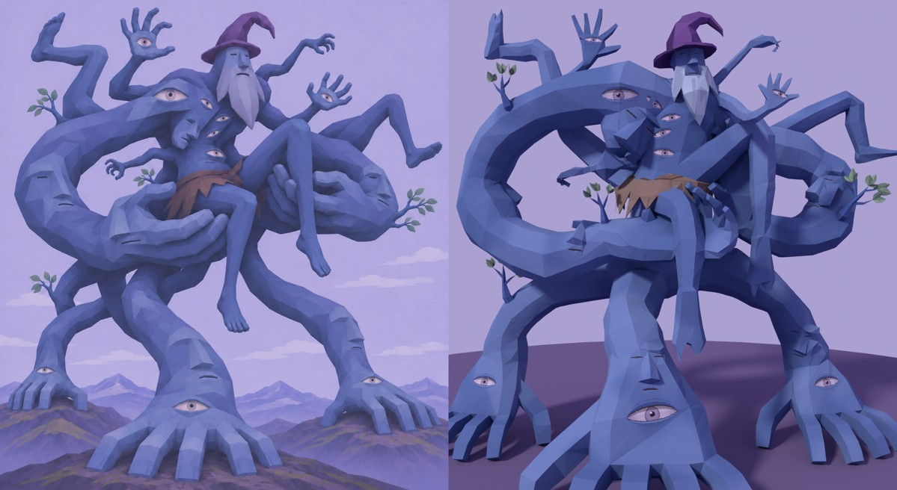

# MG01 — Бог в собственных руках · 3D-модель v2

12 ноября 2026 · Hakaton · вторая итерация по замечаниям к v1 (`output/mountain-god-model-v1`).

**Статус:** модель создана, пользователем ещё не утверждена. Технические проверки пройдены, список ниже. Скелета нет, но модель под него подготовлена. Импорт в Unity, prefab и сцена не делались.

## Что изменилось после v1

- **Стыки без разрывов.** Тело больше не собирается из труб с жёстким булевым швом. Сначала все части сливаются в одно воксельное тело (воксель 3 см). Затем на каждом стыке делается плавный переход (филе): у корней конечностей, на запястьях и лодыжках, у основания пальцев, на шее, вокруг массы таза. Сила перехода считается от толщины соединяемых частей.
- **Органичные формы.** Конечности сглажены с сохранением объёма. Комки и изгибы остаются, «шланги» пропадают. Потом сетка прореживается до бюджета и получает неровные треугольные грани, как на каноне.
  - Детализация распределена неравномерно: больше граней на кистях, пальцах, лице, обрывках лиц и стыках, меньше на ровных участках рук.
  - Колпак и стебли веток остались чёткими и приращены к телу после сглаживания.
- **Бюджет ×2:** 19 502 треугольника вместо 9 296.
- **LOD убраны** из `.blend` и `.fbx`.
- **Логика сплетений перепроверена дважды, у каждой конечности есть начало и конец.** Подробности в разделе «Сплетения».
  - Опоры S01–S03 растут из большой округлой задней массы таза, каждая со своей стороны. S02 больше не срастается с S01.
  - A01 и A02 отодвинуты от корня C01 и от бороды.
  - A04 растёт из верха спины, а не из затылка.
  - Задние ноги L03/L04 проходят позади петель рук-ложа, свисающая L01 — перед опорой S02, не касаясь её.
  - Пальцы рук-ложа разведены шире и скруглены: они читаются как пальцы, а не как ряд кубиков.

## Файлы

| Файл | Что это |
| --- | --- |
| `MG01.blend` | Исходник. Внутри `MG01_Root` с тремя объектами: `MG01_Body`, `MG01_Cloth`, `MG01_Leaves`. Ещё скрытая коллекция `MG01_RigGuides` с направляющими для будущего скелета. Текстуры подключены относительными путями `//textures/`. |
| `MG01.fbx` | Для Unity. Объекты `MG01_Root`, `MG01_Body`, `MG01_Cloth`, `MG01_Leaves`, всё триангулировано, flat-нормали, LOD нет. Пути текстур в FBX обрезаны до имени файла. |
| `textures/` | `T_MG01_Body_BaseColor.png` 2048², `T_MG01_Cloth_BaseColor.png` 512², `T_MG01_Leaves_BaseColor.png` 256² (RGBA). |
| `MG01_rig_guides.json` | Цепочки суставов для будущего скелета: позиции, родители, IK-цели опор. |
| `previews/` | Рендеры: фронт с камеры канона, 3/4 слева и справа, тыл, бок, верх крупно, таз и руки-ложе, задняя масса таза снизу. |
| `checks/` | `assembly_log.json` (все счётчики сборки), `logic_audit.json` (проверка сплетений), `rigtest_sheet.jpg` и `rigtest.json` (тест скелета), `uv_layout.jpg`. |
| `source/` | Скрипты, которые полностью собирают модель (Python + `bpy` 5.3), подробности в разделе «Пересборка». |

## Масштаб, оси, pivot

- **Рабочий масштаб 1:100.** 1 метр в Blender = 1 unit в FBX = 100 м по предложению спеки. Масштаб только равномерный.
- **Габарит** (Unity X × Y × Z): 22,2 × 19,6 × 12,1 unit, при ×100 это 2220 × 1960 × 1210 м. В спеке предложено 1650 × 1800 × 1100 м. Ширина больше из-за широкой стойки боковых опор и ступни L04, как на каноне.
- **Оси.** В Blender −Y это фронт, +Z — верх. FBX экспортирован с настройками Forward −Z, Up Y, Apply Transform, поэтому в Unity фронт смотрит в +Z. Если смотреть на фронт, правая по канону сторона окажется справа.
- **Pivot** (0, 0, 0) стоит на земле, в центре трёх опорных кистей. Точки контакта `IK_S01..S03_contact` записаны в `MG01_rig_guides.json`. Ноги земли не касаются.

## Геометрия

| | Факт | Цель (бюджет ×2) |
| --- | --- | --- |
| Всего | 19 502 tris | 13 216–21 112, потолок 24 000 |
| Тело `MG01_Body` | 19 232 | — |
| Повязка `MG01_Cloth` | 180 | — |
| Листья `MG01_Leaves` | 90 | — |

Треугольники считаются после триангуляции.

Тело — один меш. Проверено:
- нет открытых рёбер;
- нет рёбер больше чем с двумя гранями;
- одна связная часть;
- нормали наружу.

Состав по спеке:
- **9 рук:** опоры S01–S03, руки-ложе C01–C02, малые руки A01–A04.
- **4 ноги:** L01–L04. Земли касаются только три опорные кисти.
- **10 открытых глаз:** на трёх опорных кистях, двух поднятых ладонях, плечевом выступе и четыре на торсе.
- 6 обрывков лиц, 4 ветки с листвой, повязка, колпак, борода.

## Сплетения: у каждой конечности есть начало и конец

Проверено двумя способами.

**1. Автоматический аудит** `source/logic.py`, результат в `checks/logic_audit.json`. Скрипт перебирает все пары исходных частей и ищет пересечения и сближения ближе 12 см.
- Пересечение разрешено только в трёх случаях: конечность у самого своего корня на теле (до 3 м от корня), две конечности у общего корня (до 1 м), ладонь-ложе на бедре или тазе.
- Итог: 0 нарушений. При пороге 30 см остаются три сближения на 12–30 см без касания: локоть A02 у колена L02, кончик пальца C02 у плеча A02, пальцы C01 и C02 под тазом.

**2. Проверка на готовом меше.** Посчитаны рёбра между вершинами разных конечностей (смотри «Готовность к скелету»). Вне корней срощены только задуманные хваты: C01 держит бедро L01, C02 держит бедро L02. Ещё S01 и S02 соприкасаются пятью рёбрами прямо у задней массы таза.
- Независимый агент отдельно проверил промежуточную сборку. В этой версии исправлено: срастание S01/S02, коробчатая масса таза, «варежка» C02, A02 из бороды (плечо отодвинуто), осколки обрывка лица F01, мусор внутри повязки. Сплющенная клешня A03 стала толще, но до конца не исправлена. Остатки перечислены в «Известных ограничениях».

| Конечность | Начало | Конец |
| --- | --- | --- |
| S01 | задняя масса таза, слева сзади | кисть на земле, глаз E01 |
| S02 | задняя масса таза, снизу спереди | кисть на земле, глаз E02 |
| S03 | задняя масса таза, справа сзади | кисть на земле, глаз E03 |
| C01 | левое плечо (плечевой выступ с E06) | ладонь под тазом и бедром L01 |
| C02 | правое заднее плечо | ладонь под бедром L02 |
| A01 | верх спины слева | поднятая ладонь, глаз E04 |
| A02 | правое плечо, рядом с бородой | поднятая ладонь, глаз E05 |
| A03 | левый бок у пояса | кисть-клешня |
| A04 | верх спины справа, за шеей | кисть-клешня |
| L01 | таз спереди | свисающая стопа |
| L02 | таз спереди | свисающая стопа (колено поднято) |
| L03 | таз сзади | стопа, поднятая вверх-назад |
| L04 | таз сзади | стопа, поднятая назад-вправо |

## Материалы и текстуры

| Материал | Текстура | Заметки |
| --- | --- | --- |
| `M_MG01_Body` | `T_MG01_Body_BaseColor.png` 2048² | Одна UV на тело, бороду, колпак и стебли. Около 45 px на метр модели. Глаза нарисованы в уникальных зонах UV, без зеркальных копий. |
| `M_MG01_Cloth` | `T_MG01_Cloth_BaseColor.png` 512² | Грубая шкура без орнамента. |
| `M_MG01_Leaves` | `T_MG01_Leaves_BaseColor.png` 256² | Альфа. |

Настройки для Unity по спеке:
- **Все материалы:** URP/Lit, Metallic 0, Smoothness 0, Specular Highlights и Environment Reflections выключены.
- **Импорт текстур:** Point, Clamp, Mip Maps включены, Compression None на время проверки.
- **Листья:** Alpha Clipping 0,5, Render Face Both, Mip Maps Preserve Coverage.

Normal/roughness/height-карт нет, так и задумано. В FBX у текстур записаны только имена файлов: положите папку `textures` рядом с FBX или назначьте текстуры вручную.

## Готовность к скелету

- **Группы вершин** (логические маски): `CORE`, `HEAD` (голова, борода, колпак), `S01–S03`, `C01–C02`, `A01–A04`, `L01–L04`. Каждая вершина тела ровно в одной группе. Мелкие «островки» чужой группы внутри конечности убраны. Повязка в группе `CORE`, каждый лист в группе своей конечности.
- **Петель на суставах больше нет:** после органичного пересчёта сетка треугольная. Плотность на сгибах выше, чем на ровных участках, а тест ниже показывает, что сгибы деформируются чисто.
- **`MG01_rig_guides.json`:**
  - 82 цепочки: позвоночник, масса таза, 13 конечностей, пальцы, стопы, шея и голова, колпак, борода.
  - Для каждой цепочки указан родитель: пальцы привязаны к кости ладони.
  - 3 независимые IK-цели опорных кистей.
  - Те же суставы лежат в `.blend` как пустышки и кривые в коллекции `MG01_RigGuides`.
- **Тест:**
  - Из направляющих собран временный скелет на 225 костей, вес назначен через Automatic Weights с маскированием по группам.
  - Без веса осталось 0 вершин. При повороте корневой кости каждой из 13 конечностей на 35° вершины чужих конечностей не сдвигаются.
  - Позы в `checks/rigtest_sheet.jpg`. Сам временный скелет в поставку не входит.
- **Важно для настоящего рига:** после Automatic Weights обнулите веса костей чужой конечности по этим группам и нормализуйте. Иначе вес перетечёт через задуманные хваты (бедро в ладони) и через соседние корни в плечах. Рецепт в `source/rigtest.py`, проверка в `source/rig_bleed_check.py`.
- **FBX без арматуры не несёт групп вершин.** Скиннинг делайте в `MG01.blend`, потом экспортируйте FBX вместе со скелетом.

## Известные ограничения

- Стопа L03 сверху с небольшой V-выемкой.
- Клешни A03 и A04 читаются как крючки с 2–3 когтями, не с четырьмя пальцами.
- В местах хвата ладонь вдавлена в бедро и таз, там видны тёмные складки.
- Атлас тела заполнен примерно на 40%: плотность ровная, но запас есть.
- Не сделаны: импорт в Unity, prefab, проверочная сцена, коллизия, просмотр в Game View.

## Пересборка

В `source/`:
- `layout.py` — раскладка, единый источник координат;
- `core.py` и модули частей `hands.py`, `head.py`, `details.py`;
- `organic.py` — воксельное тело, переходы на стыках, прореживание;
- `paint.py` — UV и покраска;
- `assemble.py`, `export.py`, `package.py`;
- `logic.py` — аудит сплетений;
- `rigtest.py`, `render_final.py`.

Порядок: `python3 -I assemble.py OUT` (около 3 минут), потом `export.py OUT`, потом `package.py OUT DELIVER`. Нужен Python 3.13 с модулем `bpy` 5.3. Пути в скриптах указывают на машину сборки (`/home/claude/work/...` и путь к концепт-паку), их надо поправить.
