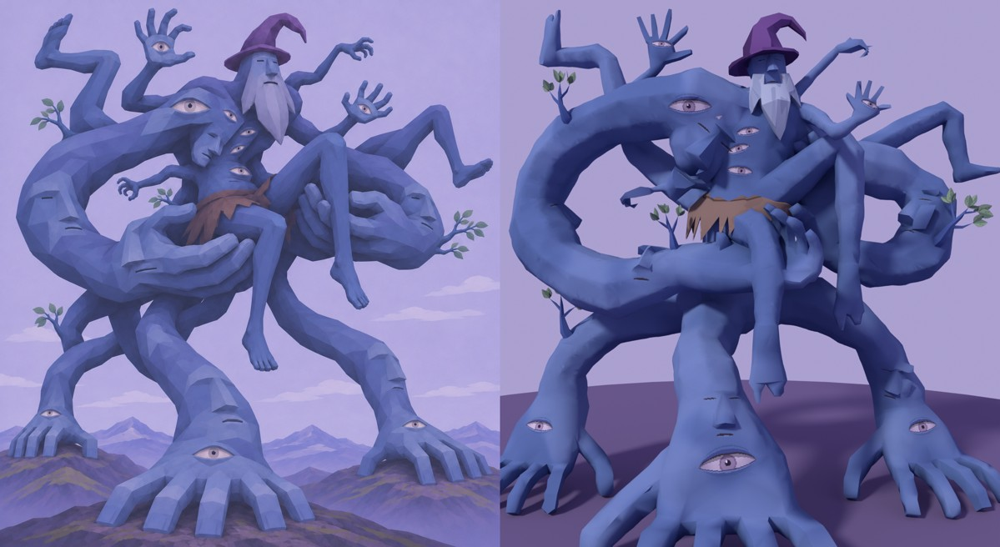

# MG01 — Бог в собственных руках · 3D-модель v3

12 ноября 2026 · Hakaton · третья итерация: больше детализации, гладкая модель, жёсткие грани только там, где они нужны по смыслу.
Предыдущие версии лежат рядом: `output/mountain-god-model-v1`, `output/mountain-god-model-v2`.

**Статус:** модель создана, пользователем ещё не утверждена. Технические проверки пройдены, список ниже. Скелета нет, но модель под него подготовлена. Импорт в Unity, prefab и сцена не делались.

## Что изменилось после v2

- **Бюджет ×2:** 38,6 тыс. треугольников вместо 19,5 тыс. Тело собирается из более плотной промежуточной сетки (~560 тыс. граней), так что после прореживания на нём остаётся больше формы.
- **Модель гладкая, явных полигонов нет.** Все грани сглажены. Жёсткие рёбра расставлены по правилам: смотрится, к какой части относится грань и какой угол между соседними гранями (таблица ниже).
- **Глаза получили объём.** Вокруг каждого из 10 нарисованных глаз есть небольшой купол глазного яблока и валики верхнего и нижнего века. Рисунок глаза лежит точно на этой форме: геометрию век и покраску строят по одним и тем же координатам глаз.
- **Мягкая неровность на конечностях.** Крупные бугры поверх сглаженной формы, чтобы руки не выглядели идеальными трубами.
- **Пальцы.** На опорных кистях и руках-ложе пальцы скруглены (на v2 они были квадратными брусками). Тонкие пальцы поднятых ладоней A01/A02 скругляются слабее, иначе они превращаются в иглы.
- **Обрывки лиц мягче вплавлены в поверхность.**
- **Повязка детальнее.** Складки гладкие, кромка и разрезы остаются жёсткими.
- Логика сплетений, корни и концы конечностей не менялись: аудит снова даёт 0 нарушений.

## Где грани жёсткие, а где гладкие

Каждая грань тела получает тип по ближайшей исходной детали. Ребро остаётся жёстким, только если угол между его гранями больше порога для этого типа.

| Часть | Порог, ° | Почему |
| --- | --- | --- |
| Колпак | 30 | Стилизованная ткань с изломами: складки и край полей должны читаться. |
| Борода | 24 | По стилю это 2–3 крупные плоскости, грани между ними и есть рисунок. |
| Нос, уши главного лица | 34 | Клиновидный нос держит характер лица. |
| Обрывки лиц F01–F06 | 62 | Лица вплавлены в плоть: мягко, твёрдой остаётся только переносица. |
| Голова | 55 | Скулы и лоб мягкие. |
| Клешни A03/A04 | 60 | Когти чуть твёрже плоти. |
| Стебли веток | 55 | Круглые стебли, но излом развилки виден. |
| Ладони, стопы | 72 | Плоть. Жёстко только в настоящих складках. |
| Пальцы | 78 | Плоть, скруглены. |
| Конечности и торс | 76 | Плоть. Жёсткими остаются только глубокие складки, например там, где ладонь вдавлена в бедро. |

Дополнительное правило: на стыке твёрдой части с плотью (колпак на черепе, борода на лице, стебель в руке) ребро становится жёстким уже от 28°.

На повязке жёсткие только кромка и разрезы (порог 42°), листья плоские.

Итог: 1749 жёстких рёбер на 57 216 рёбер тела, около 3%. Всё остальное сглажено.

В FBX нормали записаны вместе с жёсткими рёбрами. Это проверено обратным импортом: нормали и жёсткие рёбра на месте. В Unity поставьте **Normals: Import** и не пересчитывайте нормали.

## Файлы

| Файл | Что это |
| --- | --- |
| `MG01.blend` | Исходник. Внутри `MG01_Root` и три объекта: `MG01_Body`, `MG01_Cloth`, `MG01_Leaves`. Ещё скрытая коллекция `MG01_RigGuides` с направляющими для будущего скелета. Текстуры подключены относительными путями `//textures/`. |
| `MG01.fbx` | Для Unity: `MG01_Root`, `MG01_Body`, `MG01_Cloth`, `MG01_Leaves`. Сетка триангулирована, нормали с жёсткими рёбрами, LOD нет. Пути текстур обрезаны до имени файла. |
| `textures/` | `T_MG01_Body_BaseColor.png` 2048², `T_MG01_Cloth_BaseColor.png` 512², `T_MG01_Leaves_BaseColor.png` 256² (RGBA). |
| `MG01_rig_guides.json` | Цепочки суставов для будущего скелета: позиции, родители, IK-цели опор. |
| `previews/` | Рендеры: фронт с канонической камеры, 3/4 слева и справа, тыл, бок, крупно верх, таз, задняя масса таза снизу. Плюс крупные планы `closeups.jpg`: голова, глаз E06 с веками, опорная кисть S02, поднятая ладонь A01, повязка, лицо F05. |
| `checks/` | `assembly_log.json` (все счётчики сборки, включая жёсткие рёбра по типам), `logic_audit.json` (сплетения), `rigtest_sheet.jpg`, `rigtest.json` (тест скелета), `uv_layout.jpg`. |
| `source/` | Скрипты полной сборки (Python + `bpy` 5.3), подробности в разделе «Пересборка». |

## Масштаб, оси, pivot

- **Рабочий масштаб 1:100:** 1 метр в Blender = 1 unit в FBX = 100 м по предложению спеки. Масштаб только равномерный.
- **Габарит (Unity X × Y × Z):** около 22,2 × 19,6 × 12,1 unit, при ×100 это 2220 × 1960 × 1210 м.
- **Оси.** В Blender −Y это фронт, +Z — верх. FBX экспортирован с Forward −Z, Up Y и Apply Transform, поэтому в Unity фронт смотрит в +Z.
- **Pivot** (0, 0, 0) стоит на земле, в центре трёх опорных кистей. Земли касаются только опорные кисти.

## Геометрия

| | Факт | Цель |
| --- | --- | --- |
| Всего | 38 578 tris | ×2 от v2 (~39 000) |
| Тело `MG01_Body` | 38 248 | — |
| Повязка `MG01_Cloth` | 240 | — |
| Листья `MG01_Leaves` | 90 | — |

Тело — один меш: открытых рёбер нет, рёбер больше чем с двумя гранями нет, одна связная часть, нормали наружу.

Состав по спеке:
- **9 рук:** S01–S03, C01–C02, A01–A04.
- **4 ноги:** L01–L04.
- **10 открытых глаз**, на прежних местах.
- 6 обрывков лиц, 4 ветки, повязка, колпак, борода.

## Сплетения

Раскладка конечностей та же, что в v2, проверки повторены.
- **Аудит исходных деталей** (`source/logic.py`, результат в `checks/logic_audit.json`): 0 нарушений.
- **Проверка готового меша:** вне своих корней конечности срощены только в задуманных местах.
  - Ладонь C01 держит бедро L01, ладонь C02 держит бедро L02.
  - S01 и S02 соприкасаются у самой задней массы таза.
- Таблица «начало → конец» для всех 13 конечностей — в README v2, она не изменилась.

## Материалы и текстуры

| Материал | Текстура | Заметки |
| --- | --- | --- |
| `M_MG01_Body` | `T_MG01_Body_BaseColor.png` 2048² | Около 42 px на метр модели, глаза в уникальных зонах UV. |
| `M_MG01_Cloth` | `T_MG01_Cloth_BaseColor.png` 512² | Грубая шкура без орнамента. |
| `M_MG01_Leaves` | `T_MG01_Leaves_BaseColor.png` 256² | Альфа. |

Настройки для Unity:
- **Все материалы:** URP/Lit, Metallic 0, Smoothness 0, Specular Highlights и Environment Reflections выключены.
- **Импорт текстур:** Point, Clamp, Mip Maps включены.
- **Листья:** Alpha Clipping 0,5, Render Face Both.
- **Модель:** Normals Import.

## Готовность к скелету

- **Группы вершин:** `CORE`, `HEAD`, `S01–S03`, `C01–C02`, `A01–A04`, `L01–L04`. Каждая вершина ровно в одной группе.
- **`MG01_rig_guides.json`:** 82 цепочки, родители, 3 IK-цели опорных кистей. Те же точки лежат в `.blend` в коллекции `MG01_RigGuides`.
- **Тест:** временный скелет на 225 костей из направляющих, Automatic Weights с маскированием по группам. Без веса 0 вершин из 19 102. Повернул корневую кость каждой из 13 конечностей на 35°: вершины чужих конечностей не сдвинулись. Результаты в `checks/rigtest.json` и `checks/rigtest_sheet.jpg`.
- **Маскирование обязательно.** После автовесов обнулите веса костей чужой конечности по этим группам и нормализуйте. Рецепт в `source/rigtest.py`, проверка перетекания в `source/rig_bleed_check.py`.
- **Скиннинг делайте в `MG01.blend`:** FBX без арматуры не несёт групп вершин.

## Известные ограничения

- Клешни A03 и A04 читаются как крючки с 2–3 когтями.
- На стопе L03 сверху небольшая выемка.
- Там, где ладонь вдавлена в бедро и таз, видны тёмные складки (они намеренно жёсткие).
- Обрывок лица F01 на плечевой массе всё ещё угловат.
- Атлас тела заполнен примерно на 34%: на гладкой модели это заметно меньше бросается в глаза, но место в атласе есть.
- Не сделаны: импорт в Unity, prefab, сцена, коллизия.

## Пересборка

В `source/`:
- `layout.py` — раскладка;
- `core.py`, `hands.py`, `head.py`, `details.py` — детали;
- `organic.py` — сплошное тело, переходы на стыках, неровность, веки, прореживание и умные жёсткие рёбра (`smart_sharp`, пороги в `SHARP_DEG`);
- `paint.py` — UV и покраска;
- `assemble.py`, `export.py`, `package.py`;
- `logic.py`, `rigtest.py`, `render_final.py`.

Порядок: `python3 -I assemble.py OUT` (около 11 минут), потом `export.py OUT`, потом `package.py OUT DELIVER`. Нужен Python 3.13 с модулем `bpy` 5.3. Пути в скриптах указывают на машину сборки, их надо поправить.
