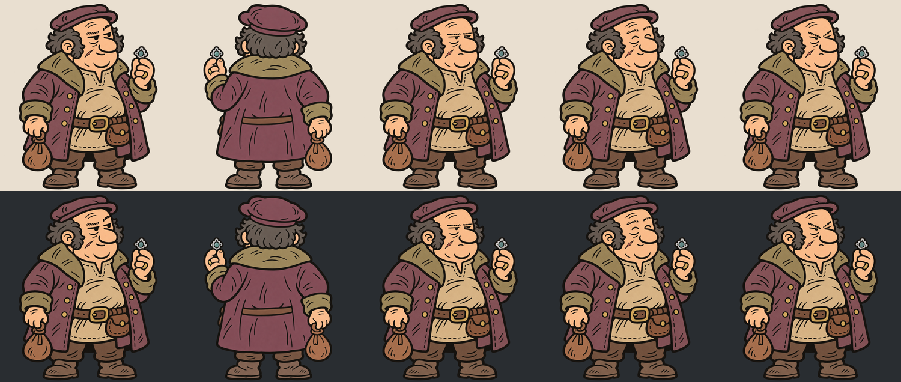

# Скупщик краденого

Матёрый торгаш: приземистый, плотный, с тяжёлым прищуром, седыми бакенбардами и старым шрамом. Добротный поношенный кафтан, кошель и серебряная брошь подчёркивают его занятие.

- [Мастер-атлас PNG](atlas.png): 3672 × 2592, RGBA, сетка 3 × 2, ячейки 1224 × 1296.
- Порядок: обычный спереди, сзади, недовольный; счастливый, злой, пустая прозрачная ячейка.
- [Манифест](manifest.json), [проверка ячеек](verification.json), [проверка масок эмоций](expression-work/verification.json).
- Полные редактируемые исходники находятся в `masters/`; исходная генерация — в `generated/`.
- [Промпты базового образа и первой версии](prompts.json), [промпты спины и эмоций уточнённого образа](expression-work/prompts.json). Использован встроенный image_gen.

Эмоции получены из фрагмента канонического лица. Новые штрихи перенесены через локальные маски. Вне масок изменено ноль пикселей; весь исходный альфа-канал сохранён. Нос, шрам, бакенбарды, силуэт головы, костюм и предметы одинаковы во всех передних видах.

Мастер-атлас собран точным копированием RGBA. При подготовке общего холста спина смещена на 8 px вправо и 3 px вниз исключительно прозрачным дополнением холста: без изменения масштаба и обрезки рисунка. Координаты записаны в `canvas.json`.

## Unity

Версия для проекта: `hukaton/Assets/Content/NPCs/StolenGoodsFence/StolenGoodsFenceAtlas.png` относительно корня репозитория. Она подготовлена штатным `output/sprite-density/tool/resample.py`: 200 texel/m при номинальном масштабе клиента 1/7, PPU 28.57143. Это отдельная производная версия; полноразмерные мастера сохранены.

Производный атлас 1024 × 1024, пять равных прямоугольников 272 × 361, общий pivot на линии стоп. Прямоугольники идут сверху слева по сетке 3 × 2; остаток степенного холста прозрачен. Режим Sprite / Multiple, нулевые отступы между ячейками, NPOT None, без mipmaps и сжатия. Уменьшение выполнено до импорта, поэтому дополнительный ресайз импортёром не требуется.

Точный статус проверки Editor записывается отдельно в `unity-verification.json`. Этот художественный набор сам по себе не включает добавление персонажа в список игровых посетителей или проверку торгового поведения.

Статус художественного варианта: подготовлен для просмотра пользователем; окончательное принятие ещё не зафиксировано.
