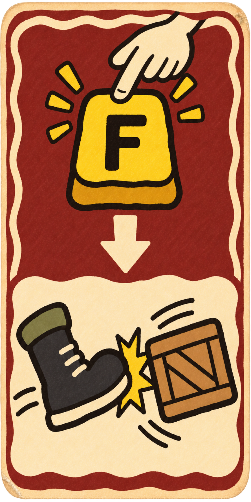

# Учебная карта «Пинок» — 17 ноября 2026

Перерисована карта F → удар ботинком по ящику: толстый неровный контур, простые формы, кирпичный фон, жёлтая клавиша. После замечания пользователя отдельно переделана рука: компактная ладонь, большой палец, три согнутых пальца и нажимающий указательный.

## Файлы

- `masters/instruction-kick.png` — итог 1024 × 2048 RGBA, установлен в `hukaton/Assets/Tutorial/Art/instruction-kick.png`.
- `revisions/` — исходные генерации; первая отклонена из-за руки.
- `previous/` — резервная копия карты, метаданных и определения до замены.
- `prompt.json`, `hand-fix-prompt.json` — запросы генерации.
- `manifest.json`, `before.json`, `png-checks.json` — происхождение и проверки.
- `preview-0.png`, `preview-1.png` — уменьшенные превью на светлом и тёмном фоне.

## Проверка

Сохранены исходные размеры, GUID, метаданные импорта и определение карты. Файл в Assets побайтно совпадает с итоговым мастером. Проверены RGBA, прозрачные углы и читаемость изображения на двух фонах. Unity подтвердила обновление AssetDatabase и загрузку Texture2D. Проверка учебной сцены в Play mode не выполнялась. Финальный вариант ещё не отмечен как одобренный пользователем.
